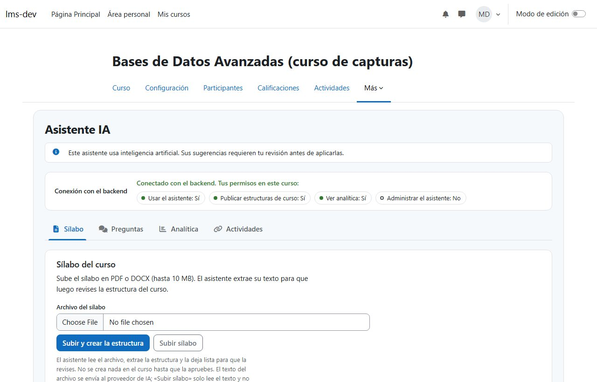
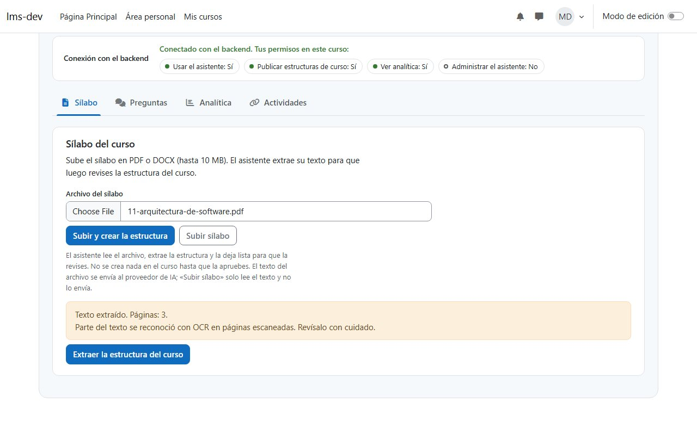
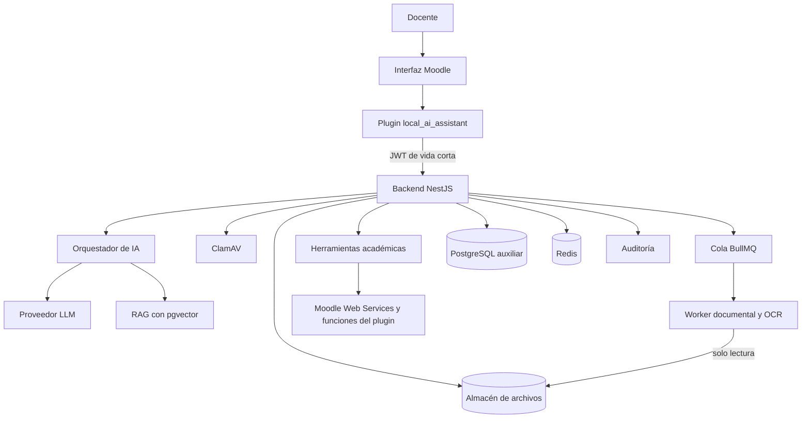

# 🎓 LMS Inteligente con Asistente de IA

[](https://moodle.org/)
[](https://nestjs.com/)
[](https://www.typescriptlang.org/)
[](https://www.postgresql.org/)
[](https://www.prisma.io/)
[](https://nodejs.org/)
[](https://pnpm.io/)
[](https://github.com/kiramman-mp3/sistema-gestion-aprendizaje-IA/actions/workflows/ci.yml)

**LMS Inteligente con Asistente de IA** es una plataforma de gestión del aprendizaje basada en Moodle,
ampliada con una capa propia de inteligencia artificial que ayuda al docente a planificar cursos a
partir de su sílabo, consultar en lenguaje natural la información real del curso y recibir
recomendaciones pedagógicas basadas en evidencias.

Es un proyecto de desarrollo de software y titulación para una institución de educación superior de
Ecuador. Terminó el **Sprint 4** del [roadmap](docs/ROADMAP.md): sobre la versión `v0.1.0` (hito H1,
plugin, backend y Moodle autenticados), el docente ya sube su sílabo y el sistema extrae su texto con
páginas, encabezados y tablas, con OCR para documentos escaneados. Todo se prueba con datos
sintéticos. La extracción estructurada con IA llega en el Sprint 5.

> [!TIP]
> Para levantar el entorno completo, sigue la [guía del entorno local](docs/desarrollo/entorno-local.md).
> Para revisar solo el código:
>
> ```bash
> git clone https://github.com/kiramman-mp3/sistema-gestion-aprendizaje-IA.git
> cd sistema-gestion-aprendizaje-IA
> pnpm install
> pnpm lint && pnpm typecheck && pnpm test
> ```

---

## 📖 Descripción

### ¿Qué problema resuelve?

Planificar un curso en Moodle a partir de un sílabo y dar seguimiento al rendimiento de los
estudiantes exige mucho trabajo manual: crear secciones y actividades una por una, revisar entregas y
calificaciones en distintas pantallas y detectar a tiempo a quién conviene apoyar.

### ¿Qué hace?

1. El docente carga su sílabo en PDF o DOCX.
2. El sistema extrae unidades, resultados de aprendizaje, actividades, evaluaciones y fechas, y marca lo que no encuentra.
3. El docente revisa y corrige la extracción.
4. El sistema propone la estructura del curso y, tras la aprobación del docente, la publica en Moodle.
5. El docente pregunta en lenguaje natural, por ejemplo "¿quién no entregó la tarea 3?", y recibe datos reales de Moodle con su fuente.
6. El sistema calcula indicadores del curso y señales transparentes de posible dificultad.
7. Para un estudiante, el sistema resume evidencias y sugiere estrategias pedagógicas que el docente decide si aplica.

### ¿Para quién está pensado?

Para docentes universitarios que usan Moodle, y para los administradores institucionales que
gestionan la plataforma.

---

## 🖼️ Capturas

| Página del asistente                                                                                                   | Carga del sílabo                                                                                                           |
| ---------------------------------------------------------------------------------------------------------------------- | -------------------------------------------------------------------------------------------------------------------------- |
|  |  |
| <sub>El docente del curso ve la conexión con el backend y sus permisos (Moodle local, datos sintéticos).</sub>         | <sub>Un sílabo escaneado sintético se procesó con OCR y quedó marcado para revisión.</sub>                                 |

---

## ✨ Características

Implementado hasta el Sprint 4:

- **Entorno reproducible:** Moodle 5.1.8 con `moodle-docker`, base auxiliar PostgreSQL 17 con `pgvector`, Redis y datos sintéticos deterministas, levantados con dos scripts.
- **Integración con mínimo privilegio:** usuario técnico de Moodle con un rol que solo permite usar REST, autorizado en un único servicio restringido definido por el plugin.
- **Backend con salud verificable:** `GET /api/v1/health` informa el estado de la base de datos, Redis y Moodle.
- **Logs sin secretos:** los tokens, cabeceras de autorización y cuerpos de petición se ocultan en los logs.
- **Autenticación entre el plugin y el backend:** el plugin firma un JWT HS256 de 5 minutos y un solo uso; el backend lo verifica y rechaza reutilizaciones.
- **Permisos de Moodle en cada petición:** el backend pregunta a Moodle qué puede hacer el docente en el curso y bloquea cursos ajenos y estudiantes.
- **Auditoría:** los rechazos de autenticación y de acceso quedan registrados sin tokens ni datos personales.
- **Página del asistente en Moodle:** enlazada desde el curso, comprueba la conexión con el backend y muestra los permisos del docente.
- **Contrato del sílabo:** esquema Zod v1 con reglas de consistencia y exportación a JSON Schema.
- **Carga segura de sílabos:** PDF y DOCX de hasta 10 MB, validados por su contenido real, sin macros, con límite de descompresión y analizados con ClamAV antes de guardarse; un archivo malicioso se rechaza y se audita.
- **Extracción de texto en segundo plano:** un worker aislado, sin acceso a la base de datos, extrae el texto con su página, encabezados y tablas; el backend valida el resultado antes de guardarlo.
- **OCR para sílabos escaneados:** las páginas sin texto pasan por Tesseract en español y el documento se marca con confianza baja.
- **Progreso visible en Moodle:** la página del asistente sube el sílabo, muestra el avance y explica el resultado o el error.
- **Retención de archivos:** el original se borra al vencer su plazo (30 días por defecto) y las cargas que no se pudieron encolar se reintentan solas.

Planificadas para el MVP según el [documento de requisitos](docs/requisitos/implementacion_lms_inteligente_ia.md):

- **Planificación asistida:** convierte el texto del sílabo en una propuesta de secciones y actividades que el docente edita y aprueba antes de publicar.
- **Asistente conversacional:** responde preguntas sobre entregas, pendientes de calificar y notas consultando Moodle mediante herramientas explícitas, nunca con SQL libre.
- **Analítica del rendimiento:** indicadores documentados y cálculos deterministas, sin que el modelo de IA calcule notas.
- **Asistente pedagógico:** recomendaciones basadas en evidencias observables, sin diagnósticos ni decisiones académicas automáticas.

---

## 🛠️ Tecnologías Utilizadas

- **Frontend:** plugin local de Moodle 5.1 (`local_ai_assistant`, PHP 8.3).
- **Backend:** NestJS 11 con TypeScript 6, configuración validada con Zod, logs con `pino`, cliente REST propio para Moodle y cliente propio de clamd.
- **Worker documental:** Node con TypeScript, pdf.js 6 para PDF, fflate y fast-xml-parser para DOCX, Poppler y Tesseract para OCR.
- **Cola de trabajos:** BullMQ 6 sobre Redis, con flujos padre/hijo y planificadores.
- **Base de datos:** PostgreSQL 17 con `pgvector` 0.8.6 mediante Prisma 7 y el adaptador `pg`; Redis 8.8 con `ioredis`.
- **IA:** proveedor LLM por definir (D-07) detrás de la interfaz `LlmProvider`.
- **Contratos:** Zod 4 en `packages/contracts`, con exportación a JSON Schema.
- **Pruebas:** Vitest en `packages/*`, en el worker y en el JavaScript del plugin (con jsdom); Jest y Supertest en el backend; PHPUnit en el plugin.
- **Calidad:** ESLint, Prettier, Redocly CLI (contrato OpenAPI), `phpcs` con `moodle-cs` y GitHub Actions.
- **Infraestructura:** Docker Compose (con ClamAV 1.5 y el worker aislado) y `moodle-docker`.

El estado de cada decisión está en el [registro de ADR](docs/architecture/adr/README.md).

---

## 🏛️ Arquitectura



Moodle es la fuente de verdad de los datos académicos. El backend valida permisos y consulta Moodle;
la IA interpreta, consulta herramientas y propone, y el docente conserva la decisión final. Hoy están
construidos el plugin, el backend con autenticación y permisos, la carga con antivirus, la cola y el
worker documental; la IA, la publicación y el RAG llegan en los sprints 5 a 9.

---

## 📁 Estructura del Proyecto

```bash
.
├── .github/                        # CI (workflows/ci.yml) y plantillas de issues y pull requests
├── apps/
│   ├── document-worker/            # Worker documental: PDF, DOCX y OCR (sin acceso a la base)
│   │   ├── src/extract/            # Extractores de PDF, DOCX y OCR
│   │   ├── src/processor.ts        # Procesa un trabajo de la cola document-text
│   │   └── Dockerfile              # Imagen con Poppler y Tesseract en español
│   └── api/                        # Backend NestJS
│       ├── prisma/                 # Esquema y migraciones de la base auxiliar
│       ├── prisma.config.ts        # Configuración de Prisma (lee el .env de la raíz)
│       ├── src/
│       │   ├── config/             # Variables de entorno validadas y logger
│       │   ├── common/filters/     # Formato de error del contrato
│       │   ├── auth/               # JWT del plugin, guards de curso y capacidades, GET /session
│       │   ├── audit/              # Registro de auditoría
│       │   ├── health/             # GET /api/v1/health e indicadores
│       │   ├── database/           # PrismaService
│       │   ├── redis/              # Conexión a Redis
│       │   ├── antivirus/          # Cliente de clamd y servicio de análisis
│       │   ├── storage/            # Almacén de archivos subidos
│       │   ├── syllabi/            # POST y GET /syllabi, encolado y resultados del worker
│       │   ├── queue/              # Nombres de colas y conexión de BullMQ
│       │   ├── maintenance/        # Retención de archivos y reintento de cargas
│       │   └── integrations/       # Cliente REST de Moodle y cuenta de integración
│       ├── test/                   # Pruebas e2e
│       └── Dockerfile              # Imagen del backend
├── packages/
│   └── contracts/                  # Esquema del sílabo v1, contratos de la cola de texto y JSON Schema
├── moodle/local/ai_assistant/      # Plugin de Moodle
│   ├── classes/external/           # get_backend_token (AJAX) y check_access (integración)
│   ├── classes/local/              # Emisor de tokens para el backend
│   ├── amd/src/ y amd/build/       # Módulos de la página (conexión, carga del sílabo y editor de la extracción) y su build
│   ├── templates/                  # Plantilla Mustache de la página
│   ├── db/                         # Capacidades y servicios web
│   └── index.php, lib.php          # Página del asistente y enlace en el curso
├── infra/
│   ├── docker/                     # Init de PostgreSQL e imagen de phpcs
│   ├── moodle/                     # local.yml de moodle-docker, Apache y scripts CLI (integración, seed)
│   ├── amd/                        # Rollup de los módulos AMD y pruebas de su JavaScript (Vitest + jsdom)
│   └── scripts/                    # moodle.sh y phpcs.sh
├── docs/
│   ├── ROADMAP.md                  # Plan por fases y sprints
│   ├── equipo/                     # Reparto del trabajo entre el equipo
│   ├── desarrollo/                 # Guía del entorno local
│   ├── resultados/                 # Resultados por fase
│   ├── capturas/                   # Capturas de pantalla
│   ├── requisitos/                 # Documento original y especificación numerada (RF/RNF/CU)
│   ├── architecture/               # ADR, decisiones, modelo de datos y comparativa
│   ├── api/openapi.yaml            # Contrato OpenAPI v0 del backend
│   ├── security/                   # Análisis de privacidad (LOPDP)
│   ├── testing/                    # Plan de pruebas
│   ├── levantamiento/              # Guía de entrevista, catálogo de sílabos, consentimiento
│   └── prototipos/                 # Prototipos de baja fidelidad
├── CONTRIBUTING.md                 # Cómo contribuir: ramas, commits, pruebas y PR
├── CLAUDE.md                       # Reglas de Git y documentación del proyecto
├── docker-compose.yml              # Base auxiliar y Redis; perfiles antivirus, worker y api
├── .env.example                    # Variables de entorno de referencia
├── package.json                    # Scripts del workspace
└── pnpm-workspace.yaml             # Paquetes y política de scripts de instalación
```

---

## 💻 Requisitos del Sistema

- Node.js 24 o superior (el repositorio usa la versión de `.nvmrc`).
- pnpm 12.
- Git; en Windows, Git Bash para los scripts de `infra/scripts/`.
- Docker Desktop o Docker Engine con Compose v2, unos 3 GB libres para Moodle y las imágenes, y 1,5 GB de memoria para ClamAV.

En producción se necesitarán además una instancia de Moodle 5.1 accesible por HTTPS, un gestor de
secretos y un proveedor de IA; se definen en el Sprint 13.

---

## ⚙️ Instalación y Configuración

La [guía del entorno local](docs/desarrollo/entorno-local.md) explica cada paso y los problemas
conocidos. En resumen:

1. Clonar el repositorio, instalar dependencias y crear el `.env`.

   ```bash
   git clone https://github.com/kiramman-mp3/sistema-gestion-aprendizaje-IA.git
   cd sistema-gestion-aprendizaje-IA
   pnpm install
   cp .env.example .env
   ```

2. Levantar la base auxiliar, Redis y ClamAV, y aplicar las migraciones.

   ```bash
   docker compose --profile antivirus up -d
   pnpm --filter @smart-lms/api prisma:deploy
   ```

3. Levantar e instalar Moodle con datos sintéticos. `install` imprime el token del usuario de integración: cópialo en `MOODLE_TOKEN`.

   ```bash
   bash infra/scripts/moodle.sh setup
   bash infra/scripts/moodle.sh up
   bash infra/scripts/moodle.sh install
   bash infra/scripts/moodle.sh seed
   ```

4. Arrancar el backend y el worker documental.

   ```bash
   pnpm --filter @smart-lms/api dev
   WORKER_STORAGE_SOURCE=./apps/api/var/storage docker compose --profile worker up -d --build document-worker
   ```

| Variable                  | Uso                                                                 |
| ------------------------- | ------------------------------------------------------------------- |
| `PORT`                    | Puerto del backend en el host                                       |
| `APP_DB_PORT`             | Puerto de la base auxiliar en el host (por defecto 5433)            |
| `APP_DB_PASSWORD`         | Contraseña de la base auxiliar                                      |
| `DATABASE_URL`            | Conexión a PostgreSQL                                               |
| `REDIS_PORT`              | Puerto de Redis en el host                                          |
| `REDIS_URL`               | Conexión a Redis                                                    |
| `MOODLE_BASE_URL`         | URL de Moodle                                                       |
| `MOODLE_TOKEN`            | Token del usuario de integración de Moodle                          |
| `MOODLE_ADMIN_PASSWORD`   | Contraseña del administrador de la instancia local                  |
| `PLUGIN_JWT_SECRET`       | Secreto compartido para firmar JWT plugin–backend (≥ 32 caracteres) |
| `CORS_ORIGINS`            | Orígenes del navegador permitidos (el `wwwroot` de Moodle)          |
| `STORAGE_DIR`             | Carpeta de los archivos subidos (relativa a `apps/api`)             |
| `SYLLABUS_RETENTION_DAYS` | Días que se conserva el archivo original (por defecto 30)           |
| `CLAMAV_PORT`             | Puerto de ClamAV en el host (por defecto 3310)                      |
| `CLAMAV_URL`              | clamd por TCP; obligatoria en producción                            |
| `WORKER_STORAGE_SOURCE`   | Carpeta del host que el worker monta en solo lectura                |
| `AI_PROVIDER`             | Proveedor de IA (pendiente, decisión D-07)                          |
| `AI_API_KEY`              | Clave del proveedor de IA                                           |

> [!WARNING]
> Los secretos nunca se guardan en el repositorio. `.env` está en `.gitignore`.

---

## ▶️ Uso y Ejecución

### Desarrollo

| Comando                                          | Qué hace                                                                 |
| ------------------------------------------------ | ------------------------------------------------------------------------ |
| `pnpm lint`                                      | ESLint en todo el repositorio                                            |
| `pnpm lint:api`                                  | Valida `docs/api/openapi.yaml` con Redocly                               |
| `pnpm format` / `pnpm format:check`              | Formatea o verifica el formato con Prettier                              |
| `pnpm typecheck`                                 | Revisa tipos en todos los paquetes                                       |
| `pnpm test`                                      | Pruebas de todos los paquetes                                            |
| `pnpm build`                                     | Compila todos los paquetes                                               |
| `pnpm --filter @smart-lms/api dev`               | Backend en modo desarrollo con recarga                                   |
| `pnpm --filter @smart-lms/api prisma:migrate`    | Crea y aplica una migración en desarrollo                                |
| `pnpm --filter @smart-lms/api prisma:deploy`     | Aplica las migraciones pendientes                                        |
| `pnpm --filter @smart-lms/contracts schema:json` | Regenera el JSON Schema del sílabo                                       |
| `pnpm --filter @smart-lms/document-worker test`  | Pruebas del worker documental                                            |
| `pnpm --filter @smart-lms/plugin-js test`        | Pruebas del JavaScript del plugin (modelo y editor de la extracción)     |
| `docker compose --profile antivirus up -d`       | Levanta ClamAV                                                           |
| `docker compose --profile worker up -d --build`  | Levanta el worker documental aislado                                     |
| `pnpm build:amd`                                 | Compila los módulos AMD del plugin                                       |
| `pnpm check:amd`                                 | Falla si `amd/build` no corresponde a `amd/src`                          |
| `bash infra/scripts/moodle.sh <comando>`         | `setup`, `sync`, `up`, `install`, `configure`, `seed`, `down`, `compose` |
| `bash infra/scripts/phpcs.sh [--fix]`            | Revisa (o corrige) el PHP con el estándar de Moodle                      |

### Producción local

`docker compose --profile api up -d --build` ejecuta el backend, el worker y ClamAV en contenedores, con un volumen compartido para los archivos. Con el Moodle local,
`/health` informa `moodle: down` porque Moodle redirige a `http://localhost:8000`; para desarrollar
contra Moodle, ejecuta el backend en el host.

---

## 🚀 Despliegue

Pendiente. El entorno de producción se define en el Sprint 13 (ver [roadmap](docs/ROADMAP.md)).

---

## 🔌 API

Prefijo `/api/v1`. Todas las rutas salvo `/health` exigen el JWT del plugin. Contrato completo en
[`docs/api/openapi.yaml`](docs/api/openapi.yaml).

| Método | Ruta           | Qué hace                                                    |
| ------ | -------------- | ----------------------------------------------------------- |
| GET    | `/health`      | Estado de la base, Redis, Moodle y el antivirus             |
| GET    | `/session`     | Identidad, roles y capacidades del docente en el curso      |
| POST   | `/syllabi`     | Carga un sílabo (multipart) y encola la extracción de texto |
| GET    | `/syllabi/:id` | Estado, progreso, páginas y confianza de la extracción      |

El flujo de carga y extracción está en [`docs/architecture/procesamiento-silabos.md`](docs/architecture/procesamiento-silabos.md).

### Migraciones

| Migración                                       | Cambio                                                           |
| ----------------------------------------------- | ---------------------------------------------------------------- |
| `20261109163904_init`                           | Esquema inicial de 15 tablas y extensiones `vector` y `pgcrypto` |
| `20261109200000_integration_account_unique_url` | Una cuenta de integración por sitio Moodle                       |
| `20261110090000_document_text`                  | Estado `TEXT_READY` y texto extraído del sílabo                  |

---

## 🧩 Decisiones y pendientes

### Decisiones cerradas

| Decisión           | Resultado                                         |
| ------------------ | ------------------------------------------------- |
| Versión de Moodle  | 5.1.8, instancia nueva local con datos sintéticos |
| Régimen académico  | Universitario (LOES)                              |
| Gestor de paquetes | pnpm workspaces                                   |
| ORM                | Prisma 7 con adaptador `pg`                       |

### Por confirmar

- Proveedor de IA y presupuesto (D-07).
- Formatos de sílabo, tipos de actividad y reglamento de ponderaciones (D-03, D-04, D-05).
- Política institucional de datos personales y piloto con docentes (D-08, D-09).

El detalle está en [decisiones del Sprint 0](docs/architecture/decisiones-sprint-0.md).

---

## 🗺️ Roadmap de Funcionalidades

- [x] Repositorio, flujo de ramas y CI base
- [x] Decisiones de arquitectura iniciales
- [x] Especificación de requisitos, modelo de datos, contrato API y prototipos (Sprint 1)
- [x] Esquema v1 del sílabo con reglas de consistencia (Sprint 1)
- [ ] Entrevistas, catálogo de sílabos y validación de prototipos con docentes (Sprint 1)
- [x] Entorno Moodle, plugin base, backend, base auxiliar y cliente de Moodle (Sprint 2)
- [x] Autenticación plugin–backend, autorización, auditoría y página del asistente (Sprint 3)
- [x] Carga segura de sílabos, cola, extracción de texto y OCR (Sprint 4)
- [ ] Extracción estructurada con IA y revisión del docente (Sprint 5; el editor del plugin ya está, falta la extracción con IA)
- [ ] Generación y publicación de cursos (Sprints 6–7)
- [ ] Asistente conversacional (Sprints 8–9)
- [ ] Analítica y asistente pedagógico (Sprints 10–11)
- [ ] Evaluación con docentes (Sprint 12)
- [ ] Despliegue y documentación final (Sprint 13)

---

## 🤝 Cómo contribuir

El trabajo se organiza por sprints en el [roadmap](docs/ROADMAP.md) y el
[reparto del trabajo](docs/equipo/reparto-trabajo.md) dice qué tiene cada persona. Antes de abrir un
pull request lee [`CONTRIBUTING.md`](CONTRIBUTING.md): ramas desde `develop`, Conventional
Commits, verificaciones locales y documentación al cerrar cada sprint. Las reglas de Git completas
están en [`CLAUDE.md`](CLAUDE.md).

| Persona | Línea de trabajo                                                    |
| ------- | ------------------------------------------------------------------- |
| Pashma  | IA, datos y analítica: LLM, extracción, chat, RAG y recomendaciones |
| José    | Moodle, publicación e interfaz: plugin, propuestas, despliegue      |

---

## 👥 Contribuidores

| Nombre       | Commits |
| ------------ | ------- |
| kiramman-mp3 | 193     |

---

## 📚 Fuentes

<details>
<summary>Referencias técnicas</summary>

- [Moodle Developer Documentation](https://moodledev.io/)
- [Moodle Web Services](https://moodledev.io/docs/5.1/apis/subsystems/external)
- [Moodle AI subsystem](https://moodledev.io/docs/5.1/apis/subsystems/ai)
- [moodle-docker](https://github.com/moodlehq/moodle-docker)
- [NestJS Documentation](https://docs.nestjs.com/)
- [Prisma Documentation](https://www.prisma.io/docs)
- [pgvector](https://github.com/pgvector/pgvector)
- [OWASP Top 10](https://owasp.org/www-project-top-ten/)
- [Autoridad de Protección de Datos Personales de Ecuador](https://www.spdp.gob.ec/)

</details>

---

## ✍️ Autor

kiramman-mp3
