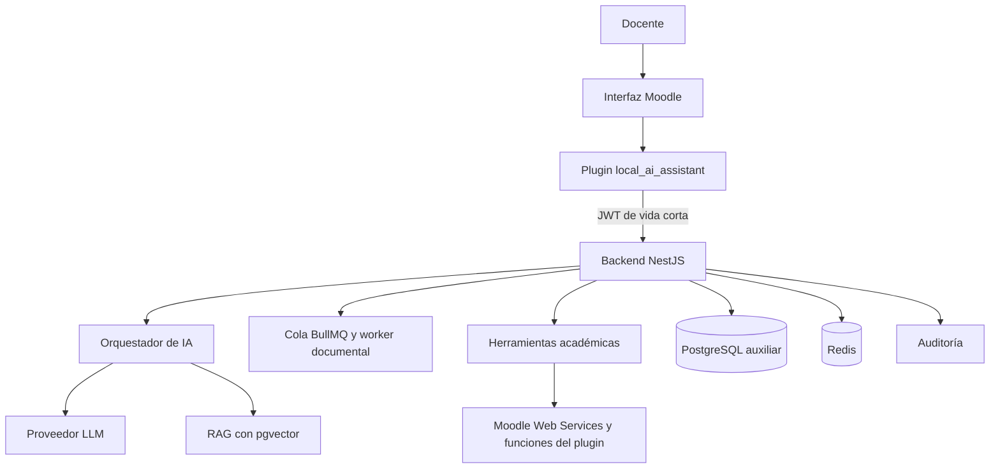

# 🎓 LMS Inteligente con Asistente de IA

[](https://moodle.org/)
[](https://nestjs.com/)
[](https://www.typescriptlang.org/)
[](https://www.postgresql.org/)
[](https://www.prisma.io/)
[](https://nodejs.org/)
[](https://pnpm.io/)

**LMS Inteligente con Asistente de IA** es una plataforma de gestión del aprendizaje basada en Moodle,
ampliada con una capa propia de inteligencia artificial que ayuda al docente a planificar cursos a
partir de su sílabo, consultar en lenguaje natural la información real del curso y recibir
recomendaciones pedagógicas basadas en evidencias.

Es un proyecto de desarrollo de software y titulación para una institución de educación superior de
Ecuador. Terminó el **Sprint 2** del [roadmap](docs/ROADMAP.md): Moodle 5.1 con el plugin del proyecto,
el backend NestJS, la base auxiliar y Redis funcionan juntos en local con datos sintéticos. Las
funciones de IA empiezan en los sprints siguientes.

> [!TIP]
> Para levantar el entorno completo, sigue la [guía del entorno local](docs/desarrollo/entorno-local.md).
> Para revisar solo el código:
>
> ```bash
> pnpm install
> pnpm lint && pnpm typecheck && pnpm test
> ```

---

## 📖 Descripción

### ¿Qué problema resuelve?

Planificar un curso en Moodle a partir de un sílabo y dar seguimiento al rendimiento de los
estudiantes exige mucho trabajo manual: crear secciones y actividades una por una, revisar entregas y
calificaciones en distintas pantallas y detectar a tiempo a quién conviene apoyar.

### ¿Qué hace?

1. El docente carga su sílabo en PDF o DOCX.
2. El sistema extrae unidades, resultados de aprendizaje, actividades, evaluaciones y fechas, y marca lo que no encuentra.
3. El docente revisa y corrige la extracción.
4. El sistema propone la estructura del curso y, tras la aprobación del docente, la publica en Moodle.
5. El docente pregunta en lenguaje natural, por ejemplo "¿quién no entregó la tarea 3?", y recibe datos reales de Moodle con su fuente.
6. El sistema calcula indicadores del curso y señales transparentes de posible dificultad.
7. Para un estudiante, el sistema resume evidencias y sugiere estrategias pedagógicas que el docente decide si aplica.

### ¿Para quién está pensado?

Para docentes universitarios que usan Moodle, y para los administradores institucionales que
gestionan la plataforma.

---

## 🖼️ Capturas

Todavía no hay pantallas propias: el plugin solo tiene su página de ajustes. Las capturas se agregarán
en `docs/capturas/` cuando exista la interfaz del asistente (Sprint 3 en adelante).

---

## ✨ Características

Implementado hasta el Sprint 2:

- **Entorno reproducible:** Moodle 5.1.8 con `moodle-docker`, base auxiliar PostgreSQL 17 con `pgvector`, Redis y datos sintéticos deterministas, levantados con dos scripts.
- **Integración con mínimo privilegio:** usuario técnico de Moodle con un rol que solo permite usar REST, autorizado en un único servicio restringido definido por el plugin.
- **Backend con salud verificable:** `GET /api/v1/health` informa el estado de la base de datos, Redis y Moodle.
- **Logs sin secretos:** los tokens, cabeceras de autorización y cuerpos de petición se ocultan en los logs.
- **Contrato del sílabo:** esquema Zod v1 con reglas de consistencia y exportación a JSON Schema.

Planificadas para el MVP según el [documento de requisitos](docs/requisitos/implementacion_lms_inteligente_ia.md):

- **Planificación asistida:** convierte un sílabo en una propuesta de secciones y actividades que el docente edita y aprueba antes de publicar.
- **Asistente conversacional:** responde preguntas sobre entregas, pendientes de calificar y notas consultando Moodle mediante herramientas explícitas, nunca con SQL libre.
- **Analítica del rendimiento:** indicadores documentados y cálculos deterministas, sin que el modelo de IA calcule notas.
- **Asistente pedagógico:** recomendaciones basadas en evidencias observables, sin diagnósticos ni decisiones académicas automáticas.

---

## 🛠️ Tecnologías Utilizadas

- **Frontend:** plugin local de Moodle 5.1 (`local_ai_assistant`, PHP 8.3).
- **Backend:** NestJS 11 con TypeScript 6, configuración validada con Zod, logs con `pino` y cliente REST propio para Moodle.
- **Base de datos:** PostgreSQL 17 con `pgvector` 0.8.6 mediante Prisma 7 y el adaptador `pg`; Redis 8.8 con `ioredis`.
- **IA:** proveedor LLM por definir (D-07) detrás de la interfaz `LlmProvider`.
- **Contratos:** Zod 4 en `packages/contracts`, con exportación a JSON Schema.
- **Pruebas:** Vitest en `packages/*`; Jest y Supertest en el backend; PHPUnit en el plugin.
- **Calidad:** ESLint, Prettier, Redocly CLI (contrato OpenAPI), `phpcs` con `moodle-cs` y GitHub Actions.
- **Infraestructura:** Docker Compose y `moodle-docker`.

El estado de cada decisión está en el [registro de ADR](docs/architecture/adr/README.md).

---

## 🏛️ Arquitectura



Moodle es la fuente de verdad de los datos académicos. El backend valida permisos y consulta Moodle;
la IA interpreta, consulta herramientas y propone, y el docente conserva la decisión final. Hoy están
construidos el plugin base, el backend con su base auxiliar, Redis y el cliente de Moodle; el JWT, la
IA, la cola y el RAG llegan en los sprints 3 a 9.

---

## 📁 Estructura del Proyecto

```bash
.
├── .github/workflows/ci.yml        # CI: lint, formato, contrato API, tipos, pruebas, build y phpcs
├── apps/
│   └── api/                        # Backend NestJS
│       ├── prisma/                 # Esquema y migraciones de la base auxiliar
│       ├── prisma.config.ts        # Configuración de Prisma (lee el .env de la raíz)
│       ├── src/
│       │   ├── config/             # Variables de entorno validadas y logger
│       │   ├── common/filters/     # Formato de error del contrato
│       │   ├── health/             # GET /api/v1/health e indicadores
│       │   ├── database/           # PrismaService
│       │   ├── redis/              # Conexión a Redis
│       │   └── integrations/moodle # Cliente REST de Moodle
│       ├── test/                   # Pruebas e2e
│       └── Dockerfile              # Imagen del backend
├── packages/
│   └── contracts/                  # Esquema del sílabo v1, reglas y JSON Schema
├── moodle/local/ai_assistant/      # Plugin de Moodle: capacidades, servicio, ajustes, privacidad
├── infra/
│   ├── docker/                     # Init de PostgreSQL e imagen de phpcs
│   ├── moodle/                     # local.yml de moodle-docker, Apache y scripts CLI (integración, seed)
│   └── scripts/                    # moodle.sh y phpcs.sh
├── docs/
│   ├── ROADMAP.md                  # Plan por fases y sprints
│   ├── desarrollo/                 # Guía del entorno local
│   ├── requisitos/                 # Documento original y especificación numerada (RF/RNF/CU)
│   ├── architecture/               # ADR, decisiones, modelo de datos y comparativa
│   ├── api/openapi.yaml            # Contrato OpenAPI v0 del backend
│   ├── security/                   # Análisis de privacidad (LOPDP)
│   ├── testing/                    # Plan de pruebas
│   ├── levantamiento/              # Guía de entrevista, catálogo de sílabos, consentimiento
│   └── prototipos/                 # Prototipos de baja fidelidad
├── docker-compose.yml              # Base auxiliar, Redis y backend (perfil api)
├── .env.example                    # Variables de entorno de referencia
├── package.json                    # Scripts del workspace
└── pnpm-workspace.yaml             # Paquetes y política de scripts de instalación
```

---

## 💻 Requisitos del Sistema

- Node.js 24 o superior (el repositorio usa la versión de `.nvmrc`).
- pnpm 12.
- Git; en Windows, Git Bash para los scripts de `infra/scripts/`.
- Docker Desktop o Docker Engine con Compose v2, y unos 2 GB libres para Moodle y las imágenes.

En producción se necesitarán además una instancia de Moodle 5.1 accesible por HTTPS, un gestor de
secretos y un proveedor de IA; se definen en el Sprint 13.

---

## ⚙️ Instalación y Configuración

La [guía del entorno local](docs/desarrollo/entorno-local.md) explica cada paso y los problemas
conocidos. En resumen:

1. Instalar dependencias y crear el `.env`.

   ```bash
   pnpm install
   cp .env.example .env
   ```

2. Levantar la base auxiliar y Redis, y aplicar las migraciones.

   ```bash
   docker compose up -d
   pnpm --filter @smart-lms/api prisma:deploy
   ```

3. Levantar e instalar Moodle con datos sintéticos. `install` imprime el token del usuario de integración: cópialo en `MOODLE_TOKEN`.

   ```bash
   bash infra/scripts/moodle.sh setup
   bash infra/scripts/moodle.sh up
   bash infra/scripts/moodle.sh install
   bash infra/scripts/moodle.sh seed
   ```

4. Arrancar el backend.

   ```bash
   pnpm --filter @smart-lms/api dev
   ```

| Variable                | Uso                                                                 |
| ----------------------- | ------------------------------------------------------------------- |
| `PORT`                  | Puerto del backend en el host                                       |
| `APP_DB_PORT`           | Puerto de la base auxiliar en el host (por defecto 5433)            |
| `APP_DB_PASSWORD`       | Contraseña de la base auxiliar                                      |
| `DATABASE_URL`          | Conexión a PostgreSQL                                               |
| `REDIS_PORT`            | Puerto de Redis en el host                                          |
| `REDIS_URL`             | Conexión a Redis                                                    |
| `MOODLE_BASE_URL`       | URL de Moodle                                                       |
| `MOODLE_TOKEN`          | Token del usuario de integración de Moodle                          |
| `MOODLE_ADMIN_PASSWORD` | Contraseña del administrador de la instancia local                  |
| `PLUGIN_JWT_SECRET`     | Secreto compartido para firmar JWT plugin–backend (≥ 32 caracteres) |
| `AI_PROVIDER`           | Proveedor de IA (pendiente, decisión D-07)                          |
| `AI_API_KEY`            | Clave del proveedor de IA                                           |

> [!WARNING]
> Los secretos nunca se guardan en el repositorio. `.env` está en `.gitignore`.

---

## ▶️ Uso y Ejecución

### Desarrollo

| Comando                                          | Qué hace                                                    |
| ------------------------------------------------ | ----------------------------------------------------------- |
| `pnpm lint`                                      | ESLint en todo el repositorio                               |
| `pnpm lint:api`                                  | Valida `docs/api/openapi.yaml` con Redocly                  |
| `pnpm format` / `pnpm format:check`              | Formatea o verifica el formato con Prettier                 |
| `pnpm typecheck`                                 | Revisa tipos en todos los paquetes                          |
| `pnpm test`                                      | Pruebas de todos los paquetes                               |
| `pnpm build`                                     | Compila todos los paquetes                                  |
| `pnpm --filter @smart-lms/api dev`               | Backend en modo desarrollo con recarga                      |
| `pnpm --filter @smart-lms/api prisma:migrate`    | Crea y aplica una migración en desarrollo                   |
| `pnpm --filter @smart-lms/api prisma:deploy`     | Aplica las migraciones pendientes                           |
| `pnpm --filter @smart-lms/contracts schema:json` | Regenera el JSON Schema del sílabo                          |
| `bash infra/scripts/moodle.sh <comando>`         | `setup`, `sync`, `up`, `install`, `seed`, `down`, `compose` |
| `bash infra/scripts/phpcs.sh [--fix]`            | Revisa (o corrige) el PHP con el estándar de Moodle         |

### Producción local

`docker compose --profile api up -d --build` ejecuta el backend en un contenedor. Con el Moodle local,
`/health` informa `moodle: down` porque Moodle redirige a `http://localhost:8000`; para desarrollar
contra Moodle, ejecuta el backend en el host.

---

## 🚀 Despliegue

Pendiente. El entorno de producción se define en el Sprint 13 (ver [roadmap](docs/ROADMAP.md)).

---

## 🧩 Decisiones y pendientes

### Decisiones cerradas

| Decisión           | Resultado                                         |
| ------------------ | ------------------------------------------------- |
| Versión de Moodle  | 5.1.8, instancia nueva local con datos sintéticos |
| Régimen académico  | Universitario (LOES)                              |
| Gestor de paquetes | pnpm workspaces                                   |
| ORM                | Prisma 7 con adaptador `pg`                       |

### Por confirmar

- Proveedor de IA y presupuesto (D-07).
- Formatos de sílabo, tipos de actividad y reglamento de ponderaciones (D-03, D-04, D-05).
- Política institucional de datos personales y piloto con docentes (D-08, D-09).

El detalle está en [decisiones del Sprint 0](docs/architecture/decisiones-sprint-0.md).

---

## 🗺️ Roadmap de Funcionalidades

- [x] Repositorio, flujo de ramas y CI base
- [x] Decisiones de arquitectura iniciales
- [x] Especificación de requisitos, modelo de datos, contrato API y prototipos (Sprint 1)
- [x] Esquema v1 del sílabo con reglas de consistencia (Sprint 1)
- [ ] Entrevistas, catálogo de sílabos y validación de prototipos con docentes (Sprint 1)
- [x] Entorno Moodle, plugin base, backend, base auxiliar y cliente de Moodle (Sprint 2)
- [ ] Autenticación plugin–backend, autorización y auditoría (Sprint 3)
- [ ] Procesamiento de sílabos (Sprints 4–5)
- [ ] Generación y publicación de cursos (Sprints 6–7)
- [ ] Asistente conversacional (Sprints 8–9)
- [ ] Analítica y asistente pedagógico (Sprints 10–11)
- [ ] Evaluación con docentes (Sprint 12)
- [ ] Despliegue y documentación final (Sprint 13)

---

## 👥 Contribuidores

| Nombre       | Commits |
| ------------ | ------- |
| kiramman-mp3 | 91      |

---

## 📚 Fuentes

<details>
<summary>Referencias técnicas</summary>

- [Moodle Developer Documentation](https://moodledev.io/)
- [Moodle Web Services](https://moodledev.io/docs/5.1/apis/subsystems/external)
- [Moodle AI subsystem](https://moodledev.io/docs/5.1/apis/subsystems/ai)
- [moodle-docker](https://github.com/moodlehq/moodle-docker)
- [NestJS Documentation](https://docs.nestjs.com/)
- [Prisma Documentation](https://www.prisma.io/docs)
- [pgvector](https://github.com/pgvector/pgvector)
- [OWASP Top 10](https://owasp.org/www-project-top-ten/)
- [Autoridad de Protección de Datos Personales de Ecuador](https://www.spdp.gob.ec/)

</details>

---

## ✍️ Autor

kiramman-mp3
