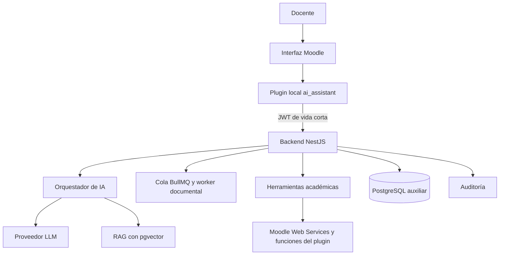

# 🎓 LMS Inteligente con Asistente de IA

[](https://moodle.org/)
[](https://www.typescriptlang.org/)
[](https://www.postgresql.org/)
[](https://nodejs.org/)
[](https://pnpm.io/)

**LMS Inteligente con Asistente de IA** es una plataforma de gestión del aprendizaje basada en Moodle,
ampliada con una capa propia de inteligencia artificial que ayuda al docente a planificar cursos a
partir de su sílabo, consultar en lenguaje natural la información real del curso y recibir
recomendaciones pedagógicas basadas en evidencias.

Es un proyecto de desarrollo de software y titulación para una institución de educación superior de
Ecuador. Está en el **Sprint 0** del [roadmap](docs/ROADMAP.md): todavía no hay aplicaciones
implementadas, solo la base del repositorio, la integración continua y las decisiones de arquitectura.

> [!TIP]
> Para revisar el proyecto en su estado actual:
>
> ```bash
> pnpm install
> pnpm lint && pnpm format:check
> ```
>
> Después, lee el [roadmap](docs/ROADMAP.md) y las [decisiones de arquitectura](docs/architecture/adr/README.md).

---

## 📖 Descripción

### ¿Qué problema resuelve?

Planificar un curso en Moodle a partir de un sílabo y dar seguimiento al rendimiento de los
estudiantes exige mucho trabajo manual: crear secciones y actividades una por una, revisar entregas y
calificaciones en distintas pantallas y detectar a tiempo a quién conviene apoyar.

### ¿Qué hace?

1. El docente carga su sílabo en PDF o DOCX.
2. El sistema extrae unidades, resultados de aprendizaje, actividades, evaluaciones y fechas, y marca lo que no encuentra.
3. El docente revisa y corrige la extracción.
4. El sistema propone la estructura del curso y, tras la aprobación del docente, la publica en Moodle.
5. El docente pregunta en lenguaje natural, por ejemplo "¿quién no entregó la tarea 3?", y recibe datos reales de Moodle con su fuente.
6. El sistema calcula indicadores del curso y señales transparentes de posible dificultad.
7. Para un estudiante, el sistema resume evidencias y sugiere estrategias pedagógicas que el docente decide si aplica.

### ¿Para quién está pensado?

Para docentes universitarios que usan Moodle, y para los administradores institucionales que
gestionan la plataforma.

---

## 🖼️ Capturas

Todavía no hay interfaz. Las capturas se agregarán en `docs/capturas/` cuando exista el plugin de
Moodle (Sprint 3 en adelante).

---

## ✨ Características

Planificadas para el MVP según el [documento de requisitos](docs/requisitos/implementacion_lms_inteligente_ia.md):

- **Planificación asistida:** convierte un sílabo en una propuesta de secciones y actividades que el docente edita y aprueba antes de publicar.
- **Asistente conversacional:** responde preguntas sobre entregas, pendientes de calificar y notas consultando Moodle mediante herramientas explícitas, nunca con SQL libre.
- **Analítica del rendimiento:** indicadores documentados y cálculos deterministas, sin que el modelo de IA calcule notas.
- **Asistente pedagógico:** recomendaciones basadas en evidencias observables, sin diagnósticos ni decisiones académicas automáticas.
- **Seguridad y privacidad:** permisos de Moodle validados en el servidor, auditoría, seudonimización antes de llamar al proveedor de IA y cumplimiento de la LOPDP.

---

## 🛠️ Tecnologías Utilizadas

- **Frontend:** plugin local de Moodle 5.1 (PHP, AMD y plantillas Mustache).
- **Backend:** NestJS con TypeScript, Prisma, BullMQ y Redis.
- **Base de datos:** base de Moodle y base auxiliar PostgreSQL con `pgvector`.
- **IA:** proveedor LLM por definir detrás de la interfaz `LlmProvider`.
- **Pruebas:** Jest y Supertest en el backend; PHPUnit en el plugin.
- **Calidad:** ESLint, Prettier y GitHub Actions.
- **Despliegue:** Docker y Docker Compose (entorno de producción por definir en el Sprint 13).

El estado de cada decisión está en el [registro de ADR](docs/architecture/adr/README.md).

---

## 🏛️ Arquitectura



Moodle es la fuente de verdad de los datos académicos. El backend valida permisos y consulta Moodle;
la IA interpreta, consulta herramientas y propone, y el docente conserva la decisión final.

---

## 📁 Estructura del Proyecto

```bash
.
├── .github/workflows/ci.yml   # Pipeline: lint, formato, tipos, pruebas y build
├── apps/                      # Aplicaciones Node (api, document-worker) — desde el Sprint 2
├── packages/                  # Código compartido (contracts, shared) — desde el Sprint 1
├── moodle/local/              # Plugin local_ai_assistant — desde el Sprint 2
├── infra/                     # Docker, scripts y monitoreo
├── tests/                     # Pruebas de integración, e2e y fixtures
├── docs/
│   ├── ROADMAP.md             # Plan por fases y sprints
│   ├── requisitos/            # Documento de requisitos técnicos y funcionales
│   └── architecture/          # Decisiones del Sprint 0 y registro de ADR
├── .env.example               # Variables de entorno de referencia
├── eslint.config.mjs          # Configuración de ESLint
├── package.json               # Scripts del workspace
└── pnpm-workspace.yaml        # Paquetes del workspace
```

---

## 💻 Requisitos del Sistema

- Node.js 24 o superior (el repositorio usa la versión de `.nvmrc`).
- pnpm 12.
- Git.
- Docker y Docker Compose (necesarios desde el Sprint 2 para Moodle, PostgreSQL y Redis).

---

## ⚙️ Instalación y Configuración

1. Clonar el repositorio y entrar en la carpeta.

   ```bash
   git clone <url-del-repositorio>
   cd sistema-gestion-aprendizaje-IA
   ```

2. Instalar dependencias.

   ```bash
   pnpm install
   ```

3. Crear el archivo de entorno a partir del ejemplo y completar los valores.

   ```bash
   cp .env.example .env
   ```

| Variable            | Uso                                               |
| ------------------- | ------------------------------------------------- |
| `APP_DB_PASSWORD`   | Contraseña de la base auxiliar                    |
| `DATABASE_URL`      | Conexión a PostgreSQL                             |
| `REDIS_URL`         | Conexión a Redis para la cola de trabajos         |
| `MOODLE_BASE_URL`   | URL de Moodle                                     |
| `MOODLE_TOKEN`      | Token del usuario de integración de Moodle        |
| `PLUGIN_JWT_SECRET` | Secreto compartido para firmar JWT plugin–backend |
| `AI_PROVIDER`       | Proveedor de IA (pendiente, decisión D-07)        |
| `AI_API_KEY`        | Clave del proveedor de IA                         |

> [!WARNING]
> Los secretos nunca se guardan en el repositorio. `.env` está en `.gitignore`.

---

## ▶️ Uso y Ejecución

### Desarrollo

Todavía no hay aplicaciones que ejecutar. Los scripts del workspace ya funcionan y se aplicarán a cada
paquete a medida que se agreguen.

| Comando             | Qué hace                                           |
| ------------------- | -------------------------------------------------- |
| `pnpm lint`         | Ejecuta ESLint en todo el repositorio              |
| `pnpm format`       | Formatea el código con Prettier                    |
| `pnpm format:check` | Verifica el formato sin modificar archivos         |
| `pnpm typecheck`    | Ejecuta `typecheck` en los paquetes que lo definan |
| `pnpm test`         | Ejecuta `test` en los paquetes que lo definan      |
| `pnpm build`        | Ejecuta `build` en los paquetes que lo definan     |

---

## 🚀 Despliegue

Pendiente. El entorno de producción se define en el Sprint 13 (ver [roadmap](docs/ROADMAP.md)).

---

## 🧩 Decisiones y pendientes

### Decisiones cerradas

| Decisión           | Resultado                                       |
| ------------------ | ----------------------------------------------- |
| Versión de Moodle  | 5.1, instancia nueva local con datos sintéticos |
| Régimen académico  | Universitario (LOES)                            |
| Gestor de paquetes | pnpm workspaces                                 |

### Por confirmar

- Proveedor de IA y presupuesto (D-07).
- Formatos de sílabo, tipos de actividad y reglamento de ponderaciones (D-03, D-04, D-05).
- Política institucional de datos personales y piloto con docentes (D-08, D-09).

El detalle está en [decisiones del Sprint 0](docs/architecture/decisiones-sprint-0.md).

---

## 🗺️ Roadmap de Funcionalidades

- [x] Repositorio, flujo de ramas y CI base
- [x] Decisiones de arquitectura iniciales
- [ ] Especificación de requisitos y prototipos (Sprint 1)
- [ ] Entorno Moodle, plugin y backend conectados (Sprints 2–3)
- [ ] Procesamiento de sílabos (Sprints 4–5)
- [ ] Generación y publicación de cursos (Sprints 6–7)
- [ ] Asistente conversacional (Sprints 8–9)
- [ ] Analítica y asistente pedagógico (Sprints 10–11)
- [ ] Evaluación con docentes (Sprint 12)
- [ ] Despliegue y documentación final (Sprint 13)

---

## 👥 Contribuidores

| Nombre       | Commits |
| ------------ | ------- |
| kiramman-mp3 | 21      |

---

## 📚 Fuentes

<details>
<summary>Referencias técnicas</summary>

- [Moodle Developer Documentation](https://moodledev.io/)
- [Moodle Web Services](https://moodledev.io/docs/5.1/apis/subsystems/external)
- [Moodle AI subsystem](https://moodledev.io/docs/5.1/apis/subsystems/ai)
- [NestJS Documentation](https://docs.nestjs.com/)
- [Prisma Documentation](https://www.prisma.io/docs)
- [OWASP Top 10](https://owasp.org/www-project-top-ten/)
- [Autoridad de Protección de Datos Personales de Ecuador](https://www.spdp.gob.ec/)

</details>

---

## ✍️ Autor

kiramman-mp3
