# 🎓 LMS Inteligente con Asistente de IA

[](https://moodle.org/)
[](https://nestjs.com/)
[](https://www.typescriptlang.org/)
[](https://www.postgresql.org/)
[](https://www.prisma.io/)
[](https://nodejs.org/)
[](https://pnpm.io/)
[](https://github.com/kiramman-mp3/sistema-gestion-aprendizaje-IA/actions/workflows/ci.yml)
[](LICENSE)

**LMS Inteligente con Asistente de IA** es una plataforma de gestión del aprendizaje basada en Moodle,
ampliada con una capa propia de inteligencia artificial que ayuda al docente a planificar cursos a
partir de su sílabo, consultar en lenguaje natural la información real del curso y recibir
recomendaciones pedagógicas basadas en evidencias.

Es un proyecto de desarrollo de software y titulación para una institución de educación superior de
Ecuador, y se presenta como una **demostración funcional del agente**. La versión `v0.3.0` recorre de
punta a punta lo planeado en el [roadmap](docs/ROADMAP.md): el docente sube su sílabo, el sistema
extrae su estructura con IA, propone el curso y, tras su aprobación, lo publica en Moodle; después
puede preguntarle al asistente por los datos reales del curso, ver la analítica y recibir
recomendaciones pedagógicas. Todo se prueba con datos sintéticos: no se reúnen sílabos reales ni se
hace el piloto con docentes (véase la sección «Decisiones y pendientes»).

> [!TIP]
> Para levantar el entorno completo, sigue la [guía del entorno local](docs/desarrollo/entorno-local.md).
> Para revisar solo el código:
>
> ```bash
> git clone https://github.com/kiramman-mp3/sistema-gestion-aprendizaje-IA.git
> cd sistema-gestion-aprendizaje-IA
> pnpm install
> pnpm lint && pnpm typecheck && pnpm test
> ```

---

## 📖 Descripción

### ¿Qué problema resuelve?

Planificar un curso en Moodle a partir de un sílabo y dar seguimiento al rendimiento de los
estudiantes exige mucho trabajo manual: crear secciones y actividades una por una, revisar entregas y
calificaciones en distintas pantallas y detectar a tiempo a quién conviene apoyar.

### ¿Qué hace?

1. El docente carga su sílabo en PDF o DOCX.
2. El sistema extrae unidades, resultados de aprendizaje, actividades, evaluaciones y fechas, y marca lo que no encuentra.
3. El docente revisa y corrige la extracción.
4. El sistema propone la estructura del curso y, tras la aprobación del docente, la publica en Moodle. Con «Subir y crear la estructura» la extracción arranca sola al subir el archivo, y «Aprobar y publicar» aprueba y publica con una sola confirmación ([ADR-024](docs/architecture/adr/0024-estructura-del-curso-en-pocos-pasos.md)); la revisión del docente se mantiene en dos puntos.
5. El docente pregunta en lenguaje natural, por ejemplo "¿quién no entregó la tarea 3?", y recibe datos reales de Moodle con su fuente.
6. El sistema calcula indicadores del curso y señales transparentes de posible dificultad.
7. Para un estudiante, el sistema resume evidencias y sugiere estrategias pedagógicas que el docente decide si aplica.

### ¿Para quién está pensado?

Para docentes universitarios que usan Moodle, y para los administradores institucionales que
gestionan la plataforma.

---

## 🖼️ Capturas

| Página del asistente                                                                                                                       | Carga del sílabo                                                                                                           |
| ------------------------------------------------------------------------------------------------------------------------------------------ | -------------------------------------------------------------------------------------------------------------------------- |
|                      |  |
| <sub>El docente del curso ve la conexión con el backend, sus permisos y las pestañas del asistente (Moodle local, datos sintéticos).</sub> | <sub>Un sílabo escaneado sintético se procesó con OCR y quedó marcado para revisión.</sub>                                 |

Capturas tomadas en un navegador real (Chromium) con Moodle 5.1 local, el modelo de IA real y datos sintéticos:

| Pantalla                                                                                                                                            | Pantalla                                                                                                                           |
| --------------------------------------------------------------------------------------------------------------------------------------------------- | ---------------------------------------------------------------------------------------------------------------------------------- |
| 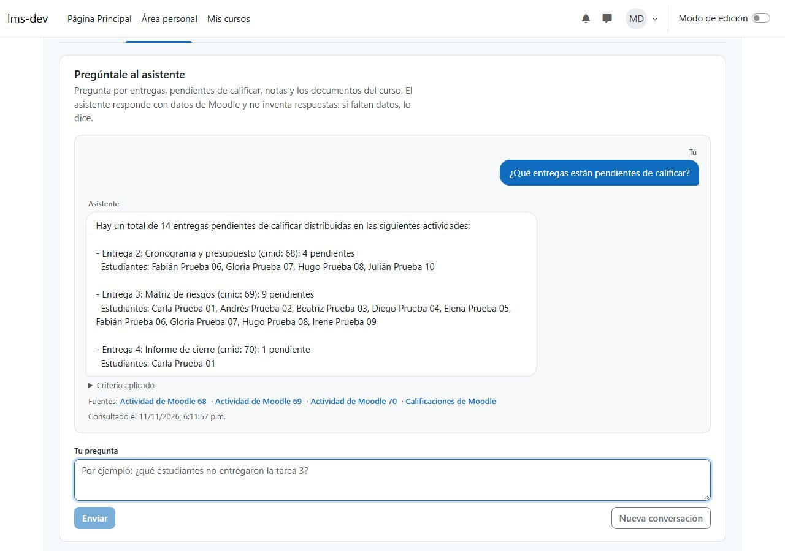                                        | 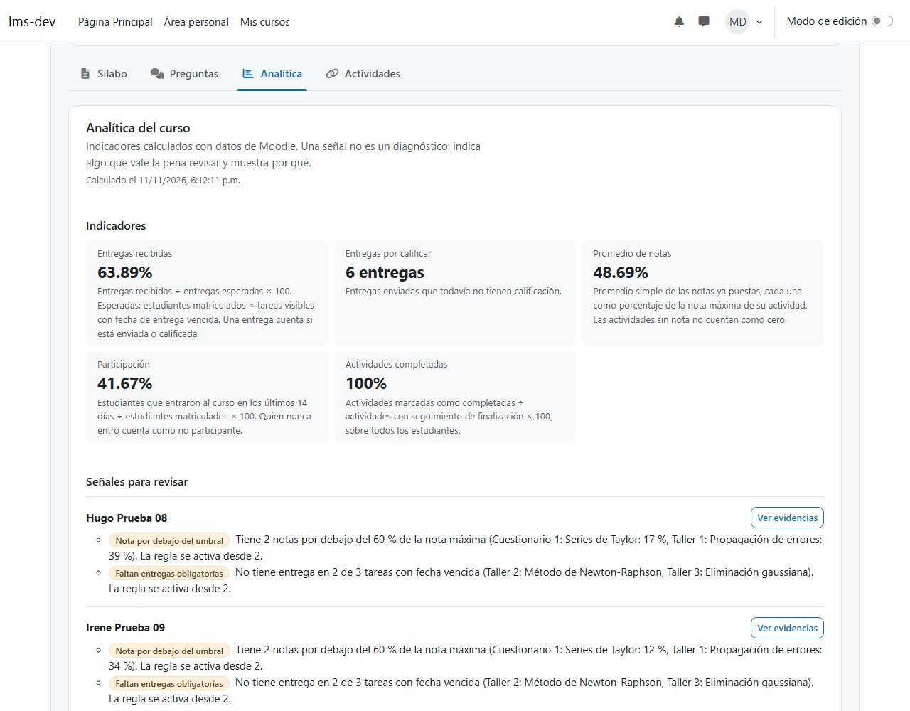                      |
| <sub>Respuesta del asistente (Gemini, datos sintéticos): cuenta las entregas por calificar, nombra las actividades y cita fuentes y criterio.</sub> | <sub>Indicadores con su definición y señales para revisar; una señal no es un diagnóstico y muestra por qué aparece.</sub>         |
| 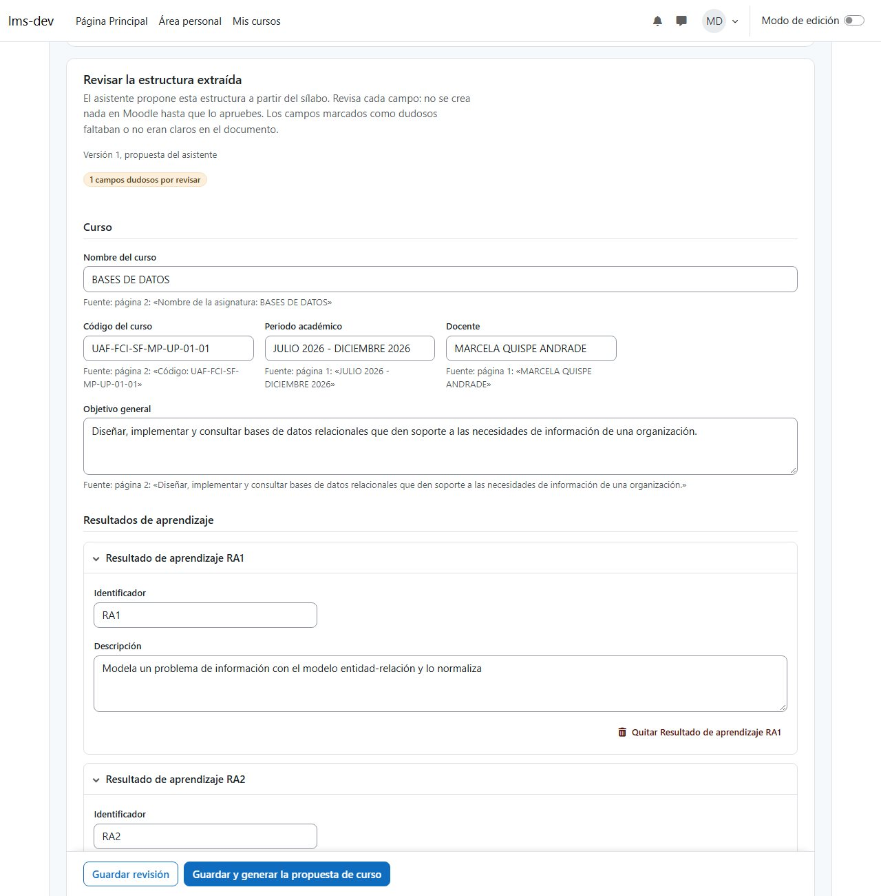                                       | 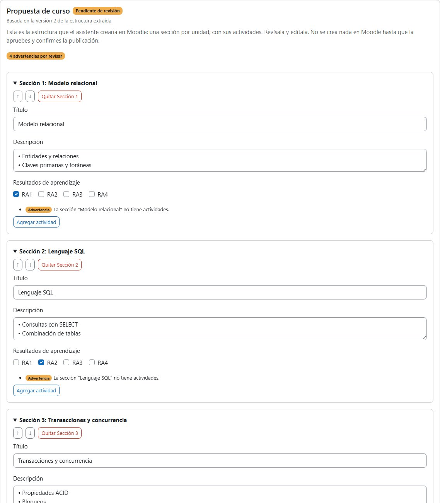                      |
| <sub>Estructura extraída de un sílabo ficticio, con la fuente de cada campo y los campos dudosos marcados.</sub>                                    | <sub>Propuesta de curso: nada se crea en Moodle hasta que el docente la aprueba y confirma la publicación.</sub>                   |
| 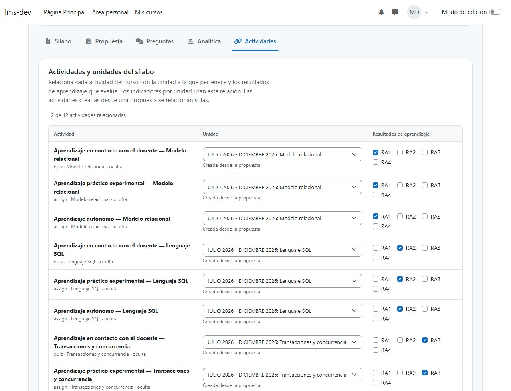                             | 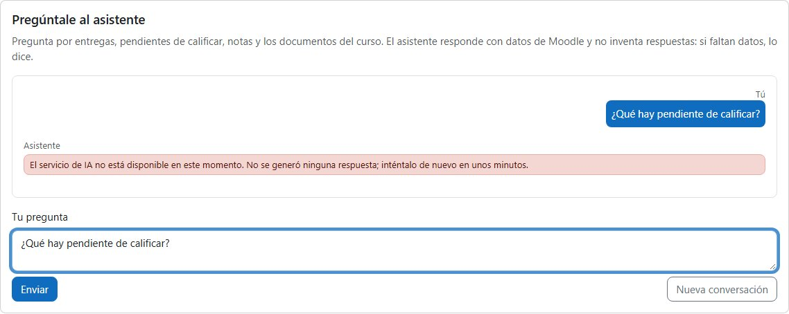 |
| <sub>Relación de cada actividad del curso con su unidad y sus resultados de aprendizaje.</sub>                                                      | <sub>Si el proveedor de IA falla (503), el aviso lo dice y la pregunta vuelve al cuadro para reenviarla.</sub>                     |
| 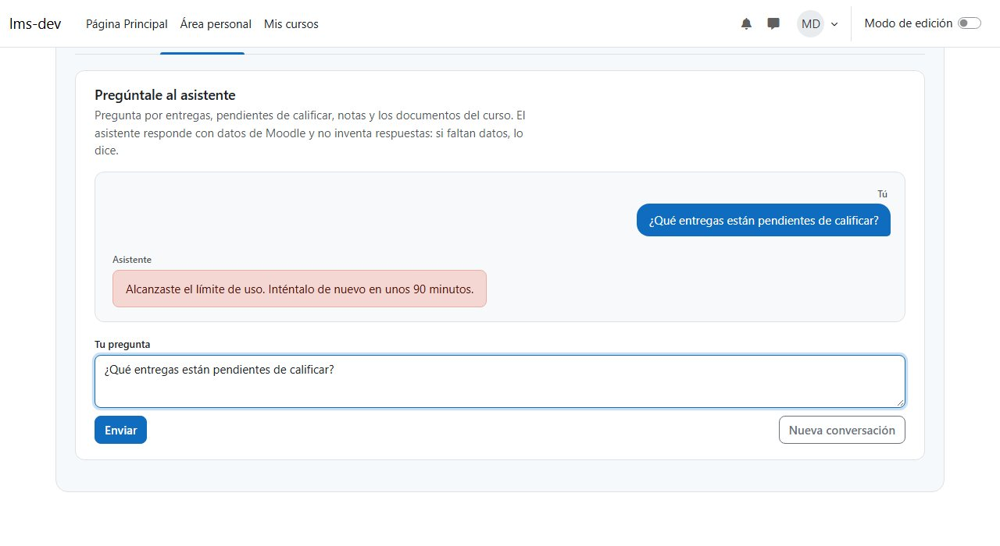                                            | 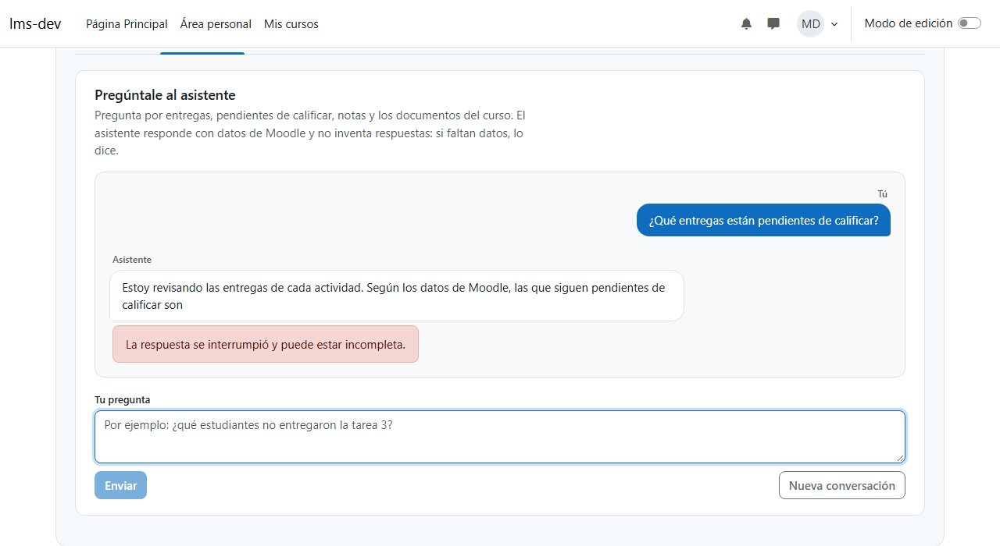                       |
| <sub>Al alcanzar el límite de uso (429) se indica cuánto esperar, en horas o minutos.</sub>                                                         | <sub>Si el docente detiene la respuesta, se muestra como interrumpida y puede estar incompleta.</sub>                              |
| 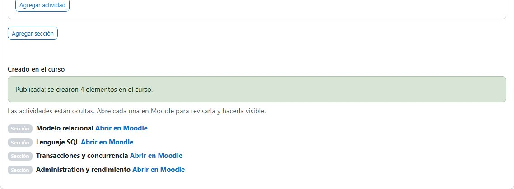                                   | 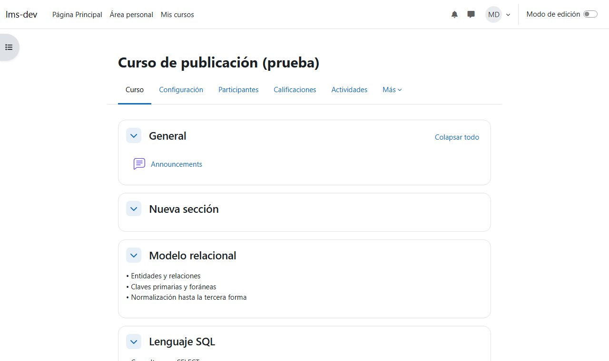                |
| <sub>Tras confirmar, la publicación crea las secciones en el curso y enlaza a cada una; las actividades se crean ocultas.</sub>                     | <sub>El curso de Moodle con las cuatro secciones creadas desde la propuesta aprobada.</sub>                                        |
| 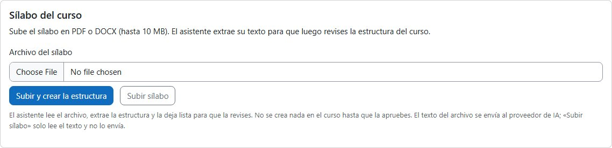               |                                                                                                                                    |
| <sub>«Subir y crear la estructura» sube el archivo y extrae la estructura sin más clics; «Subir sílabo» solo lee el texto.</sub>                    |                                                                                                                                    |
| 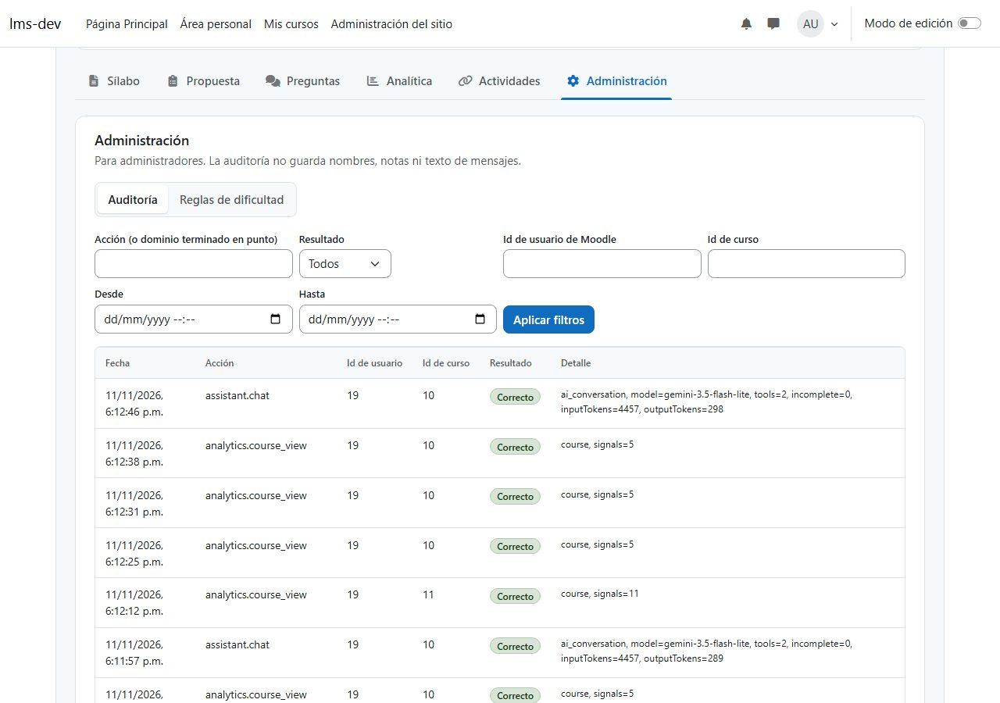                                      | 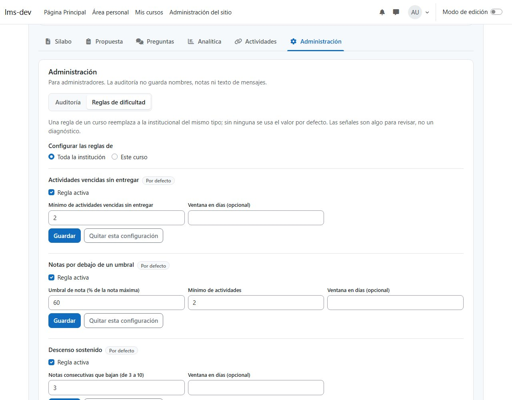             |
| <sub>Auditoría para administradores: acciones, usuarios y resultados, sin nombres, notas ni texto de mensajes.</sub>                                | <sub>Reglas de dificultad por institución o por curso, con su valor por defecto.</sub>                                             |

---

## ✨ Características

Base:

- **Entorno reproducible:** Moodle 5.1.8 con `moodle-docker`, base auxiliar PostgreSQL 17 con `pgvector`, Redis y datos sintéticos deterministas, levantados con dos scripts.
- **Integración con mínimo privilegio:** usuario técnico de Moodle con un rol que solo permite usar REST, autorizado en un único servicio restringido definido por el plugin.
- **Backend con salud verificable:** `GET /api/v1/health` informa el estado de la base de datos, Redis y Moodle.
- **Logs sin secretos:** los tokens, cabeceras de autorización y cuerpos de petición se ocultan en los logs.
- **Autenticación entre el plugin y el backend:** el plugin firma un JWT HS256 de 5 minutos y un solo uso; el backend lo verifica y rechaza reutilizaciones.
- **Permisos de Moodle en cada petición:** el backend pregunta a Moodle qué puede hacer el docente en el curso y bloquea cursos ajenos y estudiantes.
- **Auditoría:** los rechazos de autenticación y de acceso quedan registrados sin tokens ni datos personales.
- **Página del asistente en Moodle:** enlazada desde el curso, comprueba la conexión con el backend, muestra los permisos del docente y se organiza en pestañas por tarea (sílabo, propuesta, preguntas, analítica, actividades y administración); una pestaña solo aparece si hay algo que mostrar y se puede recorrer con el teclado.
- **Contrato del sílabo:** esquema Zod v1 con reglas de consistencia y exportación a JSON Schema.
- **Carga segura de sílabos:** PDF y DOCX de hasta 10 MB, validados por su contenido real, sin macros, con límite de descompresión y analizados con ClamAV antes de guardarse; un archivo malicioso se rechaza y se audita.
- **Extracción de texto en segundo plano:** un worker aislado, sin acceso a la base de datos, extrae el texto con su página, encabezados y tablas; el backend valida el resultado antes de guardarlo.
- **OCR para sílabos escaneados:** las páginas sin texto pasan por Tesseract en español y el documento se marca con confianza baja.
- **Progreso visible en Moodle:** la página del asistente sube el sílabo, muestra el avance y explica el resultado o el error.
- **Retención de archivos:** el original se borra al vencer su plazo (30 días por defecto) y las cargas que no se pudieron encolar se reintentan solas.

Asistente y analítica (hechos):

- **Planificación asistida:** convierte el texto del sílabo en una propuesta de secciones y actividades que el docente edita, aprueba y publica en Moodle sin duplicados.
- **Asistente conversacional:** responde sobre entregas, pendientes de calificar, notas, rendimiento por unidad, evidencias de un estudiante y lo que dicen los documentos del curso (con página), consultando Moodle con herramientas explícitas, nunca con SQL libre. Cada respuesta indica el criterio aplicado y, si la pregunta es ambigua, pide una sola aclaración.
- **Privacidad por diseño:** el modelo solo ve seudónimos; los nombres los pone la sesión de Moodle del docente. Las lecturas de Moodle devuelven solo ids.
- **Analítica del rendimiento:** indicadores documentados y cálculos deterministas, señales de dificultad con su explicación y evolución de los indicadores en el tiempo (un snapshot por día y docente).
- **Asistente pedagógico:** recomendaciones basadas en evidencias observables y en el sílabo del curso, con un validador que impide diagnósticos y etiquetas.
- **Administración:** consulta de la auditoría (sin nombres ni notas) y configuración de las reglas de dificultad por institución o curso, para quien tenga la capacidad `local/ai_assistant:administer`.
- **Operación:** producción con TLS y red interna, copias cifradas con prueba de restauración, monitoreo de salud y alertas de errores y consumo de IA.

---

## 🛠️ Tecnologías Utilizadas

- **Frontend:** plugin local de Moodle 5.1 (`local_ai_assistant`, PHP 8.3).
- **Backend:** NestJS 11 con TypeScript 6, configuración validada con Zod, logs con `pino`, cliente REST propio para Moodle y cliente propio de clamd.
- **Worker documental:** Node con TypeScript, pdf.js 6 para PDF, fflate y fast-xml-parser para DOCX, Poppler y Tesseract para OCR.
- **Cola de trabajos:** BullMQ 6 sobre Redis, con flujos padre/hijo y planificadores.
- **Base de datos:** PostgreSQL 17 con `pgvector` 0.8.6 mediante Prisma 7 y el adaptador `pg`; Redis 8.8 con `ioredis`.
- **IA:** proveedor LLM y de embeddings sin decisión institucional (D-07; la demostración usa Gemini) detrás de las interfaces `LlmProvider` y `EmbeddingProvider`; con `AI_PROVIDER=mock` hay un proveedor de demostración y con `AI_PROVIDER=gemini` uno real para pruebas con datos sintéticos ([ADR-023](docs/architecture/adr/0023-proveedor-gemini-y-modelos.md)). Búsqueda en documentos (RAG) con `pgvector` (vectores de 1024 dimensiones, índice HNSW por coseno).
- **Contratos:** Zod 4 en `packages/contracts`, con exportación a JSON Schema.
- **Pruebas:** Vitest en `packages/*`, en el worker y en el JavaScript del plugin (con jsdom); Jest y Supertest en el backend; PHPUnit en el plugin.
- **Calidad:** ESLint, Prettier, Redocly CLI (contrato OpenAPI), `phpcs` con `moodle-cs` y GitHub Actions.
- **Infraestructura:** Docker Compose (con ClamAV 1.5 y el worker aislado) y `moodle-docker`.

El estado de cada decisión está en el [registro de ADR](docs/architecture/adr/README.md).

---

## 🏛️ Arquitectura

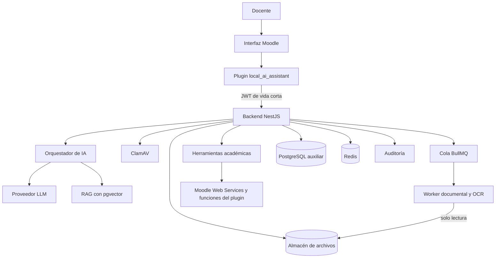

Moodle es la fuente de verdad de los datos académicos. El backend valida permisos y consulta Moodle;
la IA interpreta, consulta herramientas y propone, y el docente conserva la decisión final. Todos los
módulos del diagrama están construidos y verificados de punta a punta con datos sintéticos: el plugin,
el backend con autenticación y permisos, la carga con antivirus, la cola, el worker documental, la
extracción y las propuestas con IA, la publicación en Moodle, el chat con RAG, la analítica y las
recomendaciones.

---

## 📁 Estructura del Proyecto

```bash
.
├── .github/                        # CI (workflows/ci.yml) y plantillas de issues y pull requests
├── apps/
│   ├── document-worker/            # Worker documental: PDF, DOCX y OCR (sin acceso a la base)
│   │   ├── src/extract/            # Extractores de PDF, DOCX y OCR
│   │   ├── src/processor.ts        # Procesa un trabajo de la cola document-text
│   │   └── Dockerfile              # Imagen con Poppler y Tesseract en español
│   └── api/                        # Backend NestJS
│       ├── prisma/                 # Esquema y migraciones de la base auxiliar
│       ├── prisma.config.ts        # Configuración de Prisma (lee el .env de la raíz)
│       ├── src/
│       │   ├── config/             # Variables de entorno validadas y logger
│       │   ├── common/filters/     # Formato de error del contrato
│       │   ├── auth/               # JWT del plugin, guards de curso y capacidades, GET /session
│       │   ├── audit/              # Registro de auditoría
│       │   ├── health/             # GET /api/v1/health e indicadores
│       │   ├── database/           # PrismaService
│       │   ├── redis/              # Conexión a Redis
│       │   ├── antivirus/          # Cliente de clamd y servicio de análisis
│       │   ├── storage/            # Almacén de archivos subidos
│       │   ├── syllabi/            # POST y GET /syllabi, encolado y resultados del worker
│       │   │   └── extraction/     # Extracción con IA: prompt, verificación contra el texto, versiones y rutas
│       │   ├── proposals/          # Propuestas de curso: generador, validación, estados y API
│       │   ├── assistant/          # Chat: POST /assistant/chat (SSE), orquestador, herramientas y límites de uso
│       │   ├── analytics/          # Indicadores, señales de dificultad, evidencias del estudiante y GET /analytics
│       │   ├── llm/                # Interfaces del proveedor de IA y de embeddings, límites, consumo y proveedores de demostración
│       │   ├── rag/                # Fragmentos de los documentos, indexación con pgvector y búsqueda por curso
│       │   ├── admin/              # GET /audit y administración de las reglas de dificultad (capacidad `admin`)
│       │   ├── privacy/            # Seudonimización de estudiantes y datos personales
│       │   ├── recommendations/    # Recomendaciones pedagógicas, seguimiento docente y validador de lenguaje
│       │   ├── queue/              # Nombres de colas y conexión de BullMQ
│       │   ├── maintenance/        # Retención de archivos y conversaciones, y reintento de cargas
│       │   └── integrations/       # Cliente REST de Moodle, lecturas académicas y cuenta de integración
│       ├── test/                   # Pruebas e2e
│       └── Dockerfile              # Imagen del backend
├── packages/
│   └── contracts/                  # Esquema del sílabo v1, métricas de extracción, lecturas de Moodle, contratos de la cola y JSON Schema
├── moodle/local/ai_assistant/      # Plugin de Moodle
│   ├── classes/external/           # get_backend_token (AJAX), check_access, publish_section, publish_module y read (siete lecturas de integración)
│   ├── classes/local/              # Emisor de tokens, publicador de secciones y actividades, lectura de datos académicos (reader.php) y observador
│   ├── amd/src/ y amd/build/       # Módulos de la página (navegación por pestañas, carga, editor de la extracción, propuesta, publicación, chat, analítica, relación de actividades) y su build
│   ├── templates/                  # Plantilla Mustache de la página
│   ├── styles.css                  # Estilos de la página (`.local_ai_assistant`), sobre las variables de Bootstrap del tema; tras cambiarlo hay que purgar cachés de Moodle
│   ├── db/                         # Capacidades, servicios web, tabla de mapeo (install.xml, upgrade.php) y eventos
│   └── index.php, lib.php          # Página del asistente y enlace en el curso
├── infra/
│   ├── docker/                     # Init de PostgreSQL e imagen de phpcs
│   ├── moodle/                     # local.yml de moodle-docker, Apache y scripts CLI (integración, seed, cursos de prueba y sus imágenes de portada)
│   ├── amd/                        # Rollup de los módulos AMD y pruebas de su JavaScript (Vitest + jsdom)
│   ├── mocks/                      # API de IA simulada para desarrollar la interfaz (`pnpm mock:ai`)
│   ├── loadtest/                   # Prueba de carga básica (`pnpm loadtest`)
│   ├── synthetic-syllabi/          # Generador de los sílabos sintéticos de prueba (`pnpm synthetic:syllabi`)
│   ├── monitoring/                 # check-health.sh (salud, contenedores, copias, disco) y check-ai-usage.sh (errores y consumo de IA)
│   └── scripts/                    # moodle.sh, phpcs.sh, copias, restauración, verificaciones de punta a punta (`smoke:*`) y mediciones (F1, texto extraído)
├── docs/
│   ├── ROADMAP.md                  # Plan por fases y sprints
│   ├── equipo/                     # Reparto del trabajo entre el equipo
│   ├── desarrollo/                 # Guía del entorno local
│   ├── resultados/                 # Resultados por fase
│   ├── capturas/                   # Capturas de pantalla
│   ├── requisitos/                 # Documento original y especificación numerada (RF/RNF/CU)
│   ├── architecture/               # ADR, decisiones, modelo de datos y comparativa
│   ├── api/openapi.yaml            # Contrato OpenAPI v0 del backend
│   ├── security/                   # Análisis de privacidad (LOPDP), revisión OWASP y seguridad de la IA
│   ├── testing/                    # Plan de pruebas
│   ├── user-manual/                # Manual del docente, del administrador y guion de capacitación
│   ├── operacion/                  # Instalación, operación diaria e incidentes
│   ├── thesis/                     # Capítulos técnicos de la tesis
│   ├── levantamiento/              # Guía de entrevista, catálogo de sílabos, consentimiento
│   └── prototipos/                 # Prototipos de baja fidelidad
├── CONTRIBUTING.md                 # Cómo contribuir: ramas, commits, pruebas y PR
├── LICENSE                         # Licencia propietaria (todos los derechos reservados)
├── .mailmap                        # Une las identidades de Git de cada persona
├── CLAUDE.md                       # Reglas de Git y documentación del proyecto
├── docker-compose.yml              # Base auxiliar y Redis; perfiles antivirus, worker y api (desarrollo)
├── docker-compose.prod.yml         # Producción: proxy con TLS, red interna, secretos fuera del repositorio
├── .env.example                    # Variables de entorno de referencia
├── package.json                    # Scripts del workspace
└── pnpm-workspace.yaml             # Paquetes y política de scripts de instalación
```

---

## 💻 Requisitos del Sistema

- Node.js 24 o superior (el repositorio usa la versión de `.nvmrc`).
- pnpm 12.
- Git; en Windows, Git Bash para los scripts de `infra/scripts/`.
- Docker Desktop o Docker Engine con Compose v2, unos 3 GB libres para Moodle y las imágenes, y 1,5 GB de memoria para ClamAV.

En producción se necesitan además una instancia de Moodle 5.1 accesible por HTTPS, un gestor de
secretos y un proveedor de IA; los pasos están en el [manual de instalación y operación](docs/operacion/instalacion-y-operacion.md).

---

## ⚙️ Instalación y Configuración

La [guía del entorno local](docs/desarrollo/entorno-local.md) explica cada paso y los problemas
conocidos. En resumen:

1. Clonar el repositorio, instalar dependencias y crear el `.env`.

   ```bash
   git clone https://github.com/kiramman-mp3/sistema-gestion-aprendizaje-IA.git
   cd sistema-gestion-aprendizaje-IA
   pnpm install
   cp .env.example .env
   ```

2. Levantar la base auxiliar, Redis y ClamAV, y aplicar las migraciones.

   ```bash
   docker compose --profile antivirus up -d
   pnpm --filter @smart-lms/api prisma:deploy
   ```

3. Levantar e instalar Moodle con datos sintéticos. `install` imprime el token del usuario de integración: cópialo en `MOODLE_TOKEN`.

   ```bash
   bash infra/scripts/moodle.sh setup
   bash infra/scripts/moodle.sh up
   bash infra/scripts/moodle.sh install
   bash infra/scripts/moodle.sh seed
   ```

4. Arrancar el backend y el worker documental.

   ```bash
   pnpm --filter @smart-lms/api dev
   WORKER_STORAGE_SOURCE=./apps/api/var/storage docker compose --profile worker up -d --build document-worker
   ```

| Variable                               | Uso                                                                                                                            |
| -------------------------------------- | ------------------------------------------------------------------------------------------------------------------------------ |
| `PORT`                                 | Puerto del backend en el host                                                                                                  |
| `APP_DB_PORT`                          | Puerto de la base auxiliar en el host (por defecto 5433)                                                                       |
| `APP_DB_PASSWORD`                      | Contraseña de la base auxiliar                                                                                                 |
| `DATABASE_URL`                         | Conexión a PostgreSQL                                                                                                          |
| `REDIS_PORT`                           | Puerto de Redis en el host                                                                                                     |
| `REDIS_URL`                            | Conexión a Redis                                                                                                               |
| `MOODLE_BASE_URL`                      | URL de Moodle                                                                                                                  |
| `MOODLE_TOKEN`                         | Token del usuario de integración de Moodle                                                                                     |
| `MOODLE_ADMIN_PASSWORD`                | Contraseña del administrador de la instancia local                                                                             |
| `PLUGIN_JWT_SECRET`                    | Secreto compartido para firmar JWT plugin–backend (≥ 32 caracteres)                                                            |
| `CORS_ORIGINS`                         | Orígenes del navegador permitidos (el `wwwroot` de Moodle)                                                                     |
| `STORAGE_DIR`                          | Carpeta de los archivos subidos (relativa a `apps/api`)                                                                        |
| `SYLLABUS_RETENTION_DAYS`              | Días que se conserva el archivo original (por defecto 30)                                                                      |
| `RATE_LIMIT_PER_MINUTE`                | Peticiones por usuario y minuto antes de responder 429 (120; 0 lo desactiva)                                                   |
| `CLAMAV_PORT`                          | Puerto de ClamAV en el host (por defecto 3310)                                                                                 |
| `CLAMAV_URL`                           | clamd por TCP; obligatoria en producción                                                                                       |
| `WORKER_STORAGE_SOURCE`                | Carpeta del host que el worker monta en solo lectura                                                                           |
| `AI_PROVIDER`                          | Proveedor de IA (pendiente, decisión D-07); `mock` es el de demostración (no vale en producción) y `gemini` el real de pruebas |
| `AI_MODEL`                             | Modelo de chat y extracción con `gemini` (`gemini-3.5-flash`)                                                                  |
| `AI_EMBEDDING_MODEL`                   | Modelo de embeddings con `gemini` (`gemini-embedding-001`, 1024 dimensiones)                                                   |
| `AI_EMBEDDING_MIN_SCORE`               | Similitud mínima para citar un pasaje de los documentos del curso (0.62, calibrada con datos sintéticos)                       |
| `AI_API_KEY`                           | Clave del proveedor de IA                                                                                                      |
| `AI_TIMEOUT_MS`                        | Tiempo máximo de una llamada al proveedor (60000)                                                                              |
| `AI_MAX_INPUT_TOKENS`                  | Tokens estimados de entrada a partir de los cuales no se llama (32000)                                                         |
| `AI_MAX_OUTPUT_TOKENS`                 | Tope de tokens de salida (8192)                                                                                                |
| `PSEUDONYM_SECRET`                     | Clave de los seudónimos de estudiantes (≥ 32 caracteres); obligatoria en producción con IA                                     |
| `AI_CONVERSATION_RETENTION_DAYS`       | Días que se conserva una conversación con el asistente (90, provisional)                                                       |
| `ANALYTICS_SNAPSHOT_RETENTION_DAYS`    | Días que se conservan los snapshots de indicadores del panel (365, provisional)                                                |
| `AI_DAILY_MESSAGES_PER_TEACHER`        | Mensajes por docente en 24 horas antes de responder 429 (200)                                                                  |
| `AI_DAILY_TOKENS_PER_TEACHER`          | Tokens por docente en 24 horas antes de responder 429 (500000)                                                                 |
| `AI_DAILY_RECOMMENDATIONS_PER_TEACHER` | Recomendaciones pedagógicas por docente en 24 horas antes de responder 429 (50)                                                |

> [!WARNING]
> Los secretos nunca se guardan en el repositorio. `.env` está en `.gitignore`.

---

## ▶️ Uso y Ejecución

### Desarrollo

| Comando                                             | Qué hace                                                                                                                      |
| --------------------------------------------------- | ----------------------------------------------------------------------------------------------------------------------------- |
| `pnpm lint`                                         | ESLint en todo el repositorio                                                                                                 |
| `pnpm lint:api`                                     | Valida `docs/api/openapi.yaml` con Redocly                                                                                    |
| `pnpm format` / `pnpm format:check`                 | Formatea o verifica el formato con Prettier                                                                                   |
| `pnpm typecheck`                                    | Revisa tipos en todos los paquetes                                                                                            |
| `pnpm test`                                         | Pruebas de todos los paquetes                                                                                                 |
| `pnpm build`                                        | Compila todos los paquetes                                                                                                    |
| `pnpm --filter @smart-lms/api dev`                  | Backend en modo desarrollo con recarga                                                                                        |
| `pnpm --filter @smart-lms/api prisma:migrate`       | Crea y aplica una migración en desarrollo                                                                                     |
| `pnpm --filter @smart-lms/api prisma:deploy`        | Aplica las migraciones pendientes                                                                                             |
| `pnpm --filter @smart-lms/contracts schema:json`    | Regenera el JSON Schema del sílabo                                                                                            |
| `pnpm --filter @smart-lms/document-worker test`     | Pruebas del worker documental                                                                                                 |
| `pnpm --filter @smart-lms/plugin-js test`           | Pruebas del JavaScript del plugin: pantallas, modelos y navegación por pestañas                                               |
| `docker compose --profile antivirus up -d`          | Levanta ClamAV                                                                                                                |
| `docker compose --profile worker up -d --build`     | Levanta el worker documental aislado                                                                                          |
| `pnpm build:amd`                                    | Compila los módulos AMD del plugin                                                                                            |
| `pnpm check:amd`                                    | Falla si `amd/build` no corresponde a `amd/src`                                                                               |
| `pnpm mock:ai`                                      | API de IA simulada (puerto 3100) para probar la interfaz sin el LLM                                                           |
| `pnpm loadtest -- --scenario session`               | Prueba de carga básica del backend (también `--scenario chat`)                                                                |
| `pnpm smoke:publicacion`                            | Verificación de punta a punta de CU-02 y CU-03 con Moodle real                                                                |
| `pnpm smoke:asistente`                              | Verificación del chat, la analítica, la administración y los snapshots con la API real y el curso de prueba                   |
| `pnpm smoke:ia`                                     | Chat, búsqueda en documentos, ataques, recomendación y latencia con el proveedor de IA real (consume cuota; datos sintéticos) |
| `pnpm extract:synthetic`                            | Pasa los 12 sílabos sintéticos por la extracción real y guarda lo obtenido en `var/` para medir el F1                         |
| `pnpm smoke:silabos`                                | Carga, antivirus, worker, OCR, extracción y búsqueda en documentos con los sílabos sintéticos                                 |
| `pnpm synthetic:syllabi`                            | Regenera los 12 sílabos sintéticos (los escaneados usan Docker)                                                               |
| `pnpm eval:text` / `pnpm eval:text:docker`          | Qué parte del contenido de un sílabo llega al texto que extrae el worker (con OCR en Docker)                                  |
| `bash infra/monitoring/check-ai-usage.sh`           | Alertas de errores y consumo de IA (para cron)                                                                                |
| `bash infra/scripts/backup-moodle.sh`               | Copia cifrada de la base de Moodle y de `moodledata` (`MAINTENANCE=1` pone el sitio en mantenimiento durante la copia)        |
| `bash infra/scripts/restore-moodle-test.sh`         | Restaura la última copia de Moodle en una base temporal y la compara con la real                                              |
| `pnpm eval:extraction [dir] [--check]`              | Precisión, exhaustividad y F1 de la extracción sobre un conjunto de referencia                                                |
| `bash infra/scripts/moodle.sh <comando>`            | `setup`, `sync`, `up`, `install`, `configure`, `seed`, `down`, `compose`                                                      |
| `bash infra/scripts/phpcs.sh [--fix]`               | Revisa (o corrige) el PHP con el estándar de Moodle                                                                           |
| `php /opt/smart-lms/cli/seed_cursos_prueba.php`     | Dentro del contenedor de Moodle: crea cuatro cursos de prueba más (`--recrear` los borra y los vuelve a crear)                |
| `php /opt/smart-lms/cli/cargar_imagenes_cursos.php` | Dentro del contenedor de Moodle: deja la imagen de portada de cada curso de prueba                                            |

### Producción local

`docker compose --profile api up -d --build` ejecuta el backend, el worker y ClamAV en contenedores, con un volumen compartido para los archivos. Con el Moodle local,
`/health` informa `moodle: down` porque Moodle redirige a `http://localhost:8000`; para desarrollar
contra Moodle, ejecuta el backend en el host.

---

## 🚀 Despliegue

El backend se despliega con `docker-compose.prod.yml`: un proxy Caddy con TLS automático (la única entrada), el
backend, el worker documental, PostgreSQL con pgvector, Redis y ClamAV, con red interna, límites de recursos,
contenedores sin privilegios y secretos en archivos fuera del repositorio. Moodle es el de la institución.

```bash
cp .env.production.example .env.production        # y completar; los secretos van en ${SECRETS_DIR}
COMPOSE="docker compose --env-file .env.production -f docker-compose.prod.yml"
$COMPOSE up -d --build app-db redis clamav && $COMPOSE run --rm migrate && $COMPOSE up -d --build
```

| Variable (`.env.production`) | Qué es                                                                |
| ---------------------------- | --------------------------------------------------------------------- |
| `SECRETS_DIR`                | Carpeta con `api.env`, `worker.env`, `db_password` y `redis_password` |
| `API_DOMAIN`, `ACME_EMAIL`   | Dominio público del backend y correo de Let's Encrypt                 |
| `MOODLE_BASE_URL`            | `wwwroot` de Moodle; también es el único origen CORS permitido        |

Las copias de seguridad cifradas (`infra/scripts/backup.sh` y, si el Moodle corre con Docker Compose,
`backup-moodle.sh`), sus pruebas de restauración (`restore-test.sh` y `restore-moodle-test.sh`) y el monitoreo (`infra/monitoring/check-health.sh`) se programan con cron. Pasos completos, actualización y restauración en el
[manual de instalación y operación](docs/operacion/instalacion-y-operacion.md); qué hacer ante un fallo, en el
[procedimiento de incidentes](docs/operacion/procedimiento-incidentes.md); y para quien enseña, el
[manual del docente](docs/user-manual/manual-docente.md).

---

## 🔌 API

Prefijo `/api/v1`. Todas las rutas salvo `/health` exigen el JWT del plugin. Contrato completo en
[`docs/api/openapi.yaml`](docs/api/openapi.yaml).

| Método | Ruta                                                               | Qué hace                                                                                                              |
| ------ | ------------------------------------------------------------------ | --------------------------------------------------------------------------------------------------------------------- |
| GET    | `/health`                                                          | Estado de la base, Redis, Moodle y el antivirus                                                                       |
| GET    | `/session`                                                         | Identidad, roles y capacidades del docente en el curso                                                                |
| POST   | `/syllabi`                                                         | Carga un sílabo (multipart) y encola la extracción de texto                                                           |
| GET    | `/syllabi/:id`                                                     | Estado, progreso, páginas y confianza de la extracción                                                                |
| POST   | `/syllabi/:id/extract`                                             | Inicia o reintenta la extracción con IA (202); el sílabo pasa a `EXTRACTED` o `FAILED`                                |
| GET    | `/syllabi/:id/extraction`                                          | Última versión de la extracción, o la de `?version=`                                                                  |
| PUT    | `/syllabi/:id/extraction`                                          | Guarda la revisión del docente como versión nueva y deja el sílabo en `REVIEWED`                                      |
| POST   | `/proposals`                                                       | Genera la propuesta de curso desde una extracción revisada (`publish`)                                                |
| GET    | `/proposals/:id`                                                   | Propuesta con sus elementos y la revisión (`issues`)                                                                  |
| PATCH  | `/proposals/:id`                                                   | Reemplaza los elementos; una propuesta aprobada vuelve a revisión (`publish`)                                         |
| POST   | `/proposals/:id/approve`                                           | Aprueba una propuesta en revisión y sin errores (`publish`)                                                           |
| POST   | `/proposals/:id/publish`                                           | Publica en Moodle una propuesta aprobada o reanuda una fallida; exige `Idempotency-Key` y `confirm: true` (`publish`) |
| GET    | `/proposals/:id/publish-operations/:operationId`                   | Progreso y resultado de una publicación                                                                               |
| GET    | `/courses/:courseId/activity-mappings`                             | Unidades y resultados del sílabo revisado, y las actividades ya relacionadas                                          |
| PUT    | `/courses/:courseId/activity-mappings/:cmId`                       | Relaciona una actividad con una unidad y sus resultados (`publish`)                                                   |
| DELETE | `/courses/:courseId/activity-mappings/:cmId`                       | Quita la relación de una actividad (`publish`)                                                                        |
| POST   | `/assistant/chat`                                                  | Mensaje al asistente; con `Accept: text/event-stream` responde por SSE (`tool`, `token`, `final`, `error`)            |
| GET    | `/assistant/conversations/:id`                                     | Historial de una conversación propia; una ajena responde 404                                                          |
| GET    | `/analytics/courses/:courseId`                                     | Indicadores del curso y señales de dificultad con su explicación (`viewanalytics`)                                    |
| GET    | `/analytics/courses/:courseId/students/:studentId`                 | Evidencias del estudiante: observado, calculado y desconocido (`viewanalytics`)                                       |
| POST   | `/analytics/courses/:courseId/students/:studentId/recommendations` | Genera una recomendación pedagógica; `422` si faltan datos (`viewanalytics`)                                          |
| GET    | `/analytics/courses/:courseId/history`                             | Evolución de los indicadores: los snapshots del propio docente (`viewanalytics`)                                      |
| POST   | `/recommendations/:id/followups`                                   | Registra el seguimiento docente de una recomendación (`viewanalytics`)                                                |
| GET    | `/audit`                                                           | Auditoría filtrable y paginada, sin nombres ni notas (`admin`)                                                        |
| GET    | `/admin/difficulty-rules`                                          | Reglas de las señales de dificultad de la institución o de un curso (`admin`)                                         |
| PUT    | `/admin/difficulty-rules/:rule`                                    | Guarda una regla de la institución o de un curso (`admin`)                                                            |
| DELETE | `/admin/difficulty-rules/:rule`                                    | Quita la configuración propia de una regla (`admin`)                                                                  |

Las herramientas del chat, la analítica y las recomendaciones leen de Moodle con las siete funciones de lectura del plugin ([lecturas de Moodle](docs/architecture/lecturas-moodle.md)). Con `AI_PROVIDER=mock` la extracción, el chat y las recomendaciones responden con datos de demostración y lo avisan.

El flujo de carga y extracción de texto está en [`docs/architecture/procesamiento-silabos.md`](docs/architecture/procesamiento-silabos.md); el de la extracción con IA, en [`docs/architecture/extraccion-ia.md`](docs/architecture/extraccion-ia.md); el del chat, en [`docs/architecture/asistente-chat.md`](docs/architecture/asistente-chat.md); el de la analítica y las recomendaciones, en [`docs/architecture/analitica.md`](docs/architecture/analitica.md); el de propuestas, en [`docs/architecture/propuestas.md`](docs/architecture/propuestas.md); el de publicación, en [`docs/architecture/publicacion.md`](docs/architecture/publicacion.md); las pantallas del chat, la analítica y la relación de actividades, en [`docs/architecture/interfaces-plugin.md`](docs/architecture/interfaces-plugin.md); y lo que espera la interfaz de la línea de IA, en [`docs/equipo/integracion-con-ia.md`](docs/equipo/integracion-con-ia.md).

### Migraciones

| Migración                                       | Cambio                                                           |
| ----------------------------------------------- | ---------------------------------------------------------------- |
| `20261109163904_init`                           | Esquema inicial de 15 tablas y extensiones `vector` y `pgcrypto` |
| `20261109200000_integration_account_unique_url` | Una cuenta de integración por sitio Moodle                       |
| `20261110090000_document_text`                  | Estado `TEXT_READY` y texto extraído del sílabo                  |
| `20261110130000_analytics_snapshot_day`         | Snapshots de indicadores: uno por día, curso y docente           |
| `20261110140000_document_chunks_vector`         | `vector(1024)`, índice HNSW y fragmento único por documento      |
| `20261110141000_document_chunks_drop_old_index` | Quita el índice simple que reemplaza el único                    |

El plugin de Moodle tiene su propia tabla, `local_ai_assistant_items` (relaciona cada elemento publicado con su sección o actividad), creada por `db/install.xml` y `db/upgrade.php`; tras actualizar el plugin se aplica con `admin/cli/upgrade.php`.

---

## 🧩 Decisiones y pendientes

### Decisiones cerradas

| Decisión           | Resultado                                         |
| ------------------ | ------------------------------------------------- |
| Versión de Moodle  | 5.1.8, instancia nueva local con datos sintéticos |
| Régimen académico  | Universitario (LOES)                              |
| Gestor de paquetes | pnpm workspaces                                   |
| ORM                | Prisma 7 con adaptador `pg`                       |

### Por confirmar

- Proveedor de IA y presupuesto (D-07).
- Formatos de sílabo, tipos de actividad y reglamento de ponderaciones (D-03, D-04, D-05).
- Política institucional de datos personales y piloto con docentes (D-08, D-09).

El detalle está en [decisiones del Sprint 0](docs/architecture/decisiones-sprint-0.md).

> [!NOTE]
> Este repositorio es una demostración del agente. Lo que depende de datos reales (los sílabos reales para
> medir el F1) y lo que de ello se deriva (entrevistas, aval ético, piloto con docentes y su encuesta,
> capacitación impartida y despliegue en producción) no se hará y queda fuera de alcance. Todo lo demás
> está construido y probado con datos sintéticos.

---

## 🗺️ Roadmap de Funcionalidades

Los puntos sin marcar dependen de datos o personas reales y quedan fuera del alcance de la demostración.

- [x] Repositorio, flujo de ramas y CI base
- [x] Decisiones de arquitectura iniciales
- [x] Especificación de requisitos, modelo de datos, contrato API y prototipos (Sprint 1)
- [x] Esquema v1 del sílabo con reglas de consistencia (Sprint 1)
- [ ] Entrevistas, catálogo de sílabos y validación de prototipos con docentes (Sprint 1)
- [x] Entorno Moodle, plugin base, backend, base auxiliar y cliente de Moodle (Sprint 2)
- [x] Autenticación plugin–backend, autorización, auditoría y página del asistente (Sprint 3)
- [x] Carga segura de sílabos, cola, extracción de texto y OCR (Sprint 4)
- [ ] Extracción estructurada con IA y revisión del docente (Sprint 5; hechos el editor y la API, falta medir el F1 con sílabos reales)
- [x] Propuesta de curso: generador, validación, estados, API y vista previa (Sprint 6)
- [x] Publicación idempotente en Moodle, con confirmación, resumen y reanudación (Sprint 7)
- [x] Asistente conversacional (Sprints 8–9): chat, orquestador, seudonimización, límites de uso, lecturas de Moodle, búsqueda en documentos (RAG), criterio aplicado y aclaración única, probados también con Gemini y datos sintéticos, incluidas las pruebas de ataque
- [x] Analítica y asistente pedagógico (Sprints 10–11): panel, indicadores, señales, evidencias (también como herramienta del chat), snapshots, reglas por API, recomendaciones y seguimiento; la pertinencia de las recomendaciones con docentes queda fuera de alcance
- [ ] Evaluación con docentes (Sprint 12): hechas la suite de seguridad SEC-01 a SEC-10, la revisión OWASP, la prueba de carga sin IA y las verificaciones de punta a punta con el proveedor de demostración y con Gemini; faltan la medición de RNF-01 a RNF-03 con licencia de pago, la calidad de la IA con sílabos reales y el piloto con la encuesta SUS
- [ ] Despliegue y documentación final (Sprint 13): hechos el entorno de producción, las copias (también de Moodle) con prueba de restauración, el monitoreo y las alertas, los manuales, los capítulos técnicos de la tesis y la versión `v0.3.0`; faltan el RPO y el RTO, el despliegue real, la capacitación y la versión 1.0

---

## 🤝 Cómo contribuir

El trabajo se organiza por sprints en el [roadmap](docs/ROADMAP.md) y el
[reparto del trabajo](docs/equipo/reparto-trabajo.md) dice qué tiene cada persona. Antes de abrir un
pull request lee [`CONTRIBUTING.md`](CONTRIBUTING.md): ramas desde `develop`, Conventional
Commits, verificaciones locales y documentación al cerrar cada sprint. Las reglas de Git completas
están en [`CLAUDE.md`](CLAUDE.md).

| Persona | Línea de trabajo                                                    |
| ------- | ------------------------------------------------------------------- |
| Pashma  | IA, datos y analítica: LLM, extracción, chat, RAG y recomendaciones |
| José    | Moodle, publicación e interfaz: plugin, propuestas, despliegue      |

---

## 👥 Contribuidores

Conteo de `git shortlog -sn` en `main` con la versión `v0.3.0` (el archivo `.mailmap` une las identidades de cada persona).

| Nombre            | Commits |
| ----------------- | ------- |
| JoseM151          | 277     |
| Johan Rodríguez   | 217     |
| JuanCarlos Pashma | 79      |

---

## 📚 Fuentes

<details>
<summary>Referencias técnicas</summary>

- [Moodle Developer Documentation](https://moodledev.io/)
- [Moodle Web Services](https://moodledev.io/docs/5.1/apis/subsystems/external)
- [Moodle AI subsystem](https://moodledev.io/docs/5.1/apis/subsystems/ai)
- [moodle-docker](https://github.com/moodlehq/moodle-docker)
- [NestJS Documentation](https://docs.nestjs.com/)
- [Prisma Documentation](https://www.prisma.io/docs)
- [pgvector](https://github.com/pgvector/pgvector)
- [OWASP Top 10](https://owasp.org/www-project-top-ten/)
- [Autoridad de Protección de Datos Personales de Ecuador](https://www.spdp.gob.ec/)

</details>

---

## ⚖️ Licencia

El código es propietario y todos los derechos están reservados: ver [`LICENSE`](LICENSE).

---

## ✍️ Autor

Johan Rodríguez
