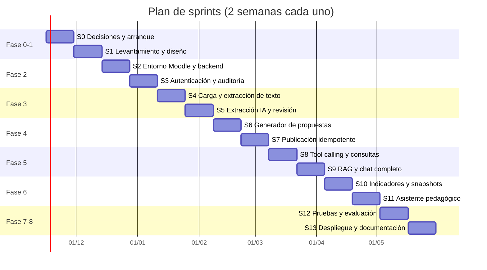

| S13 | En curso | undefined | | Producción, copias (también de Moodle) con prueba de restauración, monitoreo y alertas, manuales, guion de capacitación, tesis (borradores) y README final hechos; faltan RPO y RTO, despliegue real y capacitación impartida (fuera de alcance) || S12 | En curso | undefined | | Suite SEC-01 a SEC-10, revisión OWASP, prueba de carga sin IA y verificaciones de punta a punta (también con Gemini) hechas; faltan RNF-01 a RNF-03 con licencia de pago, la evaluación con docentes, el piloto y SUS (fuera de alcance) || S11 | Terminado | undefined | 2026-11-13 | Evidencias (ruta y herramienta del chat), recomendaciones con pasajes del sílabo, seguimiento y validador hechos y probados con Gemini y datos sintéticos; la pertinencia con docentes queda en S12 (fuera de alcance) || S8 | Terminado | undefined | 2026-11-13 | Chat, orquestador, seudonimización, lecturas de Moodle, criterio aplicado, aclaración única y evidencias hechos; `get_assignment_submissions` probada con Gemini; `get_teacher_courses` descartada |# 🗺️ Roadmap de implementación — LMS inteligente con asistente de IA

Plan de implementación por fases y sprints del sistema descrito en
[`docs/requisitos/implementacion_lms_inteligente_ia.md`](requisitos/implementacion_lms_inteligente_ia.md)
(en adelante, **documento de requisitos**). Incorpora además las brechas detectadas en el análisis
de ese documento: autenticación plugin–backend, creación de actividades mediante función externa
propia, almacenamiento vectorial, procesamiento asíncrono, historial para analítica y seudonimización
antes de llamar al proveedor LLM.

| Dato                 | Valor                                                                             |
| -------------------- | --------------------------------------------------------------------------------- |
| Versión del plan     | 1.0                                                                               |
| Reparto del trabajo  | [`docs/equipo/reparto-trabajo.md`](equipo/reparto-trabajo.md) (desde el Sprint 5) |
| Fecha                | 2026-11-09                                                                        |
| Cadencia             | Sprints de 2 semanas                                                              |
| Duración estimada    | 14 sprints (~28 semanas)                                                          |
| Equipo de referencia | 1–2 desarrolladores + docente tutor + 2–5 docentes piloto                         |
| Estado               | Planificación                                                                     |

> [!IMPORTANT]
> Las fechas y la duración son orientativas. El Sprint 0 cierra las decisiones de la sección 19 del
> documento de requisitos; si alguna cambia (por ejemplo, integrar una instancia Moodle existente en
> lugar de una nueva), se replanifica a partir del Sprint 2.

---

## 📌 Principios que guían el plan

- **Moodle es la fuente de verdad.** La base auxiliar guarda solo datos de la capa inteligente y referencias a IDs de Moodle.
- **La IA propone, el docente decide.** Toda escritura en Moodle pasa por aprobación y confirmación explícitas.
- **Cálculos en código, no en el modelo.** Promedios, porcentajes, estados y umbrales se calculan con funciones deterministas y probadas.
- **Autorización en el servidor, en cada petición.** Ocultar botones no cuenta como control.
- **Valor demostrable temprano.** Cada fase termina con algo que un docente puede usar y evaluar.
- **Flujo Git del proyecto.** Una rama `feature/*`, `fix/*`, `refactor/*`, `chore/*` o `docs/*` por historia, commits pequeños con Conventional Commits y merge `--no-ff` a `develop` (ver `CLAUDE.md`).

---

## 🧭 Vista general

| Fase | Nombre                        | Sprints | Semanas | Hito al cerrar                                                    |
| ---- | ----------------------------- | ------- | ------- | ----------------------------------------------------------------- |
| 0    | Decisiones y arranque         | S0      | 1–2     | Decisiones cerradas, repo y CI base                               |
| 1    | Levantamiento y diseño        | S1      | 3–4     | Requisitos numerados, prototipos, ADRs                            |
| 2    | Infraestructura e integración | S2–S3   | 5–8     | **H1:** plugin ↔ backend ↔ Moodle autenticado (alcanzado)         |
| 3    | Procesamiento de sílabos      | S4–S5   | 9–12    | **H2:** sílabo convertido en extracción editable                  |
| 4    | Generación y publicación      | S6–S7   | 13–16   | **H3:** estructura publicada en Moodle sin duplicados (alcanzado) |
| 5    | Asistente conversacional      | S8–S9   | 17–20   | **H4:** chat que consulta datos reales del curso                  |
| 6    | Analítica y recomendaciones   | S10–S11 | 21–24   | **H5:** panel analítico y asistente pedagógico                    |
| 7    | Pruebas y evaluación          | S12     | 25–26   | **H6:** informe de evaluación con docentes                        |
| 8    | Despliegue y documentación    | S13     | 27–28   | **H7:** versión 1.0 en `main`, manuales y tesis                   |

> El calendario no incluye vacaciones ni periodos de exámenes. Conviene alinear S12 (evaluación con
> docentes) con un periodo lectivo activo.

---

## 🏗️ Stack y decisiones de arquitectura propuestas

Cada decisión se registra como ADR en `docs/architecture/adr/` durante el Sprint 0 o el Sprint 1.

| ADR     | Decisión propuesta                                                                                           | Alternativa                  | Motivo                                                                                      |
| ------- | ------------------------------------------------------------------------------------------------------------ | ---------------------------- | ------------------------------------------------------------------------------------------- |
| ADR-001 | Monorepo con `pnpm` workspaces (`apps/`, `packages/`, `moodle/`)                                             | Repos separados              | Contratos compartidos (`packages/contracts`) entre backend y worker                         |
| ADR-002 | Backend NestJS + TypeScript + Prisma + PostgreSQL                                                            | —                            | Definido en el documento de requisitos                                                      |
| ADR-003 | Worker documental en TypeScript (`pdf-parse`/`pdfjs`, `mammoth`) con OCR opcional                            | Worker en Python             | Reduce el proyecto a dos lenguajes (PHP + TS); Python solo si el OCR o las tablas lo exigen |
| ADR-004 | Cola de trabajos con BullMQ + Redis                                                                          | Tabla de jobs en PostgreSQL  | Extracción y publicación son largas y necesitan reintentos                                  |
| ADR-005 | Vectores en PostgreSQL con `pgvector`                                                                        | Vector store externo         | Una sola base auxiliar, filtros por curso en SQL                                            |
| ADR-006 | Autenticación plugin → backend con JWT de vida corta firmado por el plugin (`sub`, `courseid`, `exp`, `jti`) | Token por usuario de Moodle  | El token de integración único no aplica los permisos del docente                            |
| ADR-007 | Validación de capacidades mediante función externa propia del plugin (`local_ai_assistant_check_access`)     | Replicar roles en el backend | Moodle sigue decidiendo los permisos                                                        |
| ADR-008 | Creación de actividades mediante funciones externas del plugin que usan `create_module()`                    | Servicios web core           | No hay servicios web core para crear módulos                                                |
| ADR-009 | Capa de abstracción de proveedor LLM (interfaz `LlmProvider`) con salida estructurada validada con Zod       | SDK de un proveedor acoplado | Riesgo de dependencia de proveedor (sección 15)                                             |
| ADR-010 | Seudonimización: el LLM recibe `Estudiante#<id>` y el backend restaura los nombres                           | Enviar nombres reales        | Minimización de datos (LOPDP)                                                               |
| ADR-011 | Entorno Moodle de desarrollo con `moodlehq/moodle-docker` y versión fijada                                   | `bitnami/moodle:latest`      | Imagen oficial de desarrollo; Bitnami retiró su catálogo gratuito                           |
| ADR-012 | Usar o no el subsistema de IA nativo de Moodle (4.5+)                                                        | Backend propio               | Se documenta la comparación; el plan asume backend propio                                   |

> [!WARNING]
> Moodle 5.1 reorganizó el código bajo el directorio `public/`. Verificar en el Sprint 2 la ruta
> correcta del plugin (`public/local/ai_assistant` o `local/ai_assistant`) según la versión instalada.

---

## 📋 Requisitos trazables

El documento de requisitos no numera los requisitos. Esta tabla los numera para enlazarlos con
sprints, casos de uso y pruebas. Se refina en el Sprint 1.

### Requisitos funcionales

| ID    | Requisito                                                                                              | CU    | Sprint |
| ----- | ------------------------------------------------------------------------------------------------------ | ----- | ------ |
| RF-01 | El plugin se comunica con el backend mediante JWT firmado de vida corta                                | —     | S3     |
| RF-02 | El backend valida identidad, curso, rol, capacidad y alcance en cada petición                          | Todos | S3     |
| RF-03 | Carga de sílabos PDF/DOCX con validación de extensión, MIME real, tamaño y antivirus                   | CU-01 | S4     |
| RF-04 | Extracción de texto, tablas y encabezados; OCR para documentos escaneados                              | CU-01 | S4     |
| RF-05 | Extracción estructurada con IA validada contra esquema versionado; campos dudosos marcados             | CU-01 | S5     |
| RF-06 | El docente revisa y corrige la extracción; se guardan versiones                                        | CU-01 | S5     |
| RF-07 | Generación de propuesta de secciones y actividades vinculadas a unidad y resultado de aprendizaje      | CU-02 | S6     |
| RF-08 | Edición y aprobación de la propuesta con máquina de estados                                            | CU-02 | S6     |
| RF-09 | Publicación idempotente en Moodle con registro de IDs y manejo de fallos parciales                     | CU-03 | S7     |
| RF-10 | Chat en lenguaje natural con tool calling sobre herramientas explícitas                                | CU-04 | S8     |
| RF-11 | Consulta de estados reales de entrega por actividad                                                    | CU-04 | S8     |
| RF-12 | Consulta de actividades pendientes de calificar                                                        | CU-04 | S8     |
| RF-13 | Resumen de calificaciones según reglas del curso                                                       | CU-04 | S8     |
| RF-14 | Búsqueda RAG en sílabos y documentos del curso con referencias                                         | CU-04 | S9     |
| RF-15 | Indicadores de curso: entregas, pendientes, promedio, evolución, rendimiento por unidad, participación | —     | S10    |
| RF-16 | Señales de posible dificultad con umbrales y ventanas configurables                                    | CU-05 | S10    |
| RF-17 | Evidencias por estudiante en un curso autorizado                                                       | CU-05 | S11    |
| RF-18 | Recomendaciones pedagógicas con evidencias, limitaciones e indicadores de seguimiento                  | CU-05 | S11    |
| RF-19 | Registro de auditoría de consultas y operaciones sensibles                                             | Todos | S3     |
| RF-20 | Registro del seguimiento docente de las recomendaciones                                                | CU-05 | S11    |

### Requisitos no funcionales (propuestos; validar en S0–S1)

| ID     | Requisito                                            | Meta propuesta                                             |
| ------ | ---------------------------------------------------- | ---------------------------------------------------------- |
| RNF-01 | Tiempo hasta el primer token del chat (streaming)    | p95 < 3 s                                                  |
| RNF-02 | Respuesta completa del chat con una herramienta      | p95 < 10 s                                                 |
| RNF-03 | Extracción de un sílabo de 20 páginas                | < 2 min                                                    |
| RNF-04 | Tamaño máximo de archivo                             | 10 MB                                                      |
| RNF-05 | Cobertura de pruebas del backend                     | ≥ 70 % en módulos de dominio                               |
| RNF-06 | Consultas a otro curso sin permiso bloqueadas        | 100 %                                                      |
| RNF-07 | Costo de IA por docente al mes                       | Límite configurable; meta a fijar con el presupuesto       |
| RNF-08 | Retención de documentos, embeddings y conversaciones | Configurable; valor por defecto a fijar con la institución |
| RNF-09 | Idiomas de la interfaz                               | Español e inglés (`lang/es`, `lang/en`)                    |
| RNF-10 | Accesibilidad de la interfaz del plugin              | WCAG 2.1 AA en componentes propios                         |

### Metas de calidad de IA (propuestas; medir en S12)

| Métrica                                                   | Meta                      |
| --------------------------------------------------------- | ------------------------- |
| F1 de extracción de unidades                              | ≥ 0.85                    |
| F1 de extracción de resultados de aprendizaje             | ≥ 0.80                    |
| Exactitud de consultas de entregas                        | ≥ 95 %                    |
| Exactitud de cálculos académicos                          | 100 % (son deterministas) |
| Respuestas con fuente verificable                         | ≥ 95 %                    |
| Abstención correcta cuando faltan datos                   | ≥ 90 %                    |
| Recomendaciones calificadas como pertinentes por docentes | ≥ 70 %                    |
| SUS                                                       | ≥ 68                      |

---

## ✅ Definición de terminado (DoD)

Una historia se considera terminada cuando:

- [ ] El código está en una rama de trabajo y se integró a `develop` con `git merge --no-ff`.
- [ ] Los commits son pequeños, siguen Conventional Commits y no tienen atribución de IA.
- [ ] Linter, pruebas y build pasan en local y en CI.
- [ ] Hay pruebas unitarias del dominio y, si toca Moodle o la API, pruebas de integración.
- [ ] Los endpoints nuevos tienen DTO, validación y pruebas de autorización negativas.
- [ ] No hay secretos en el código, en los logs ni en el frontend.
- [ ] La documentación afectada (README, API, ADR, este roadmap) está actualizada en el mismo cambio.

---

## 🚀 Fase 0 — Decisiones y arranque

### Sprint 0 · Semanas 1–2

**Objetivo:** cerrar las decisiones bloqueantes y dejar el repositorio listo para desarrollar.

**Decisiones a cerrar (sección 19 del documento de requisitos):**

Registro detallado en [`docs/architecture/decisiones-sprint-0.md`](architecture/decisiones-sprint-0.md).

- [x] D-01 Versión de Moodle de la institución. → Moodle 5.1.
- [x] D-02 Moodle nuevo o integración con una instancia existente. → Instancia nueva local con datos sintéticos.
- [ ] D-03 Tipos y formatos de sílabo; reunir de 10 a 20 sílabos reales anonimizados.
- [ ] D-04 Estructura de parciales y ponderaciones (régimen LOES o LOEI). → Parcial: régimen LOES; falta el reglamento con parciales y pesos.
- [ ] D-05 Tipos de actividad que se crearán automáticamente (propuesta: `assign`, `forum`, `quiz` vacío, `label`/`page`).
- [x] D-06 Disponibilidad de servicios web y permisos administrativos. → Disponibles en la instancia local.
- [ ] D-07 Proveedor de IA, modelo y presupuesto mensual. → Sin definir; se trabaja con `LlmProvider` (ADR-009). Para las pruebas hay un proveedor Gemini con datos sintéticos y plan gratuito ([ADR-023](architecture/adr/0023-proveedor-gemini-y-modelos.md), [resultados](resultados/ia-real-sintetica.md)); no vale para el piloto.
- [ ] D-08 Política institucional sobre datos personales y proveedores externos.
- [ ] D-09 Docentes, cursos y estudiantes para el piloto.
- [ ] D-10 Calendario disponible para desarrollar y validar.

**Tareas técnicas:**

- [x] Inicializar Git con `main`, `develop` y el flujo de ramas de `CLAUDE.md`.
- [x] `chore/monorepo-setup`: `pnpm` workspaces, `.editorconfig`, `.gitattributes` (EOL LF), `.gitignore`, `.env.example`.
- [x] `chore/lint-format`: ESLint + Prettier para TS. (`phpcs` se movió al Sprint 2: aún no hay código PHP.)
- [x] `ci/base-pipeline`: CI con lint, pruebas y build en cada push a `develop` y ramas de trabajo. (Pendiente de verificar en GitHub: el repositorio aún no tiene remoto.)
- [x] `docs/adr-template`: plantilla de ADR y registro de ADR-001 a ADR-012.
- [x] `docs/readme`: README inicial según la estructura de `CLAUDE.md`.

**Desvíos:**

- TypeScript fijado en `~6.0`: `typescript-eslint` 8 aún no admite TypeScript 7.
- `phpcs` con el estándar `moodle` pasa al Sprint 2, junto con el esqueleto del plugin.

**Entregables:** decisiones D-01 a D-10 documentadas, repositorio con CI en verde y ADRs iniciales.

**Riesgo principal:** no obtener sílabos reales o permisos de Moodle. Mitigación: sílabos sintéticos
validados por el tutor y Moodle local de desarrollo.

---

## 📐 Fase 1 — Levantamiento y diseño

### Sprint 1 · Semanas 3–4

**Objetivo:** convertir el documento de requisitos en especificación verificable y diseño.

- [ ] Entrevistar a 2–5 docentes y medir el tiempo actual de planificación de un curso (línea base para el indicador de ahorro de tiempo). Instrumento listo: [`docs/levantamiento/guia-entrevista.md`](levantamiento/guia-entrevista.md).
- [ ] Documentar el proceso actual de planificación y seguimiento (`docs/architecture/proceso-actual.md`). Depende de las entrevistas.
- [ ] Catalogar los formatos de sílabo recibidos y sus secciones. Plantilla lista: [`docs/levantamiento/catalogo-silabos.md`](levantamiento/catalogo-silabos.md); faltan los sílabos (D-03).
- [x] Refinar RF y RNF con criterios de aceptación medibles → [`docs/requisitos/especificacion-requisitos.md`](requisitos/especificacion-requisitos.md).
- [x] Diseñar el modelo de datos completo: añadir `IntegrationAccount`, `DocumentChunk`, `PedagogicalRecommendation`, `AnalyticsSnapshot`, `PublishOperation` y unificar estados de documento y propuesta → [`docs/architecture/modelo-datos.md`](architecture/modelo-datos.md).
- [x] Diseñar el contrato de la API → [`docs/api/openapi.yaml`](api/openapi.yaml), validado con `pnpm lint:api`.
- [x] Diseñar el JSON Schema v1 del sílabo en `packages/contracts` → esquema Zod, reglas de consistencia, 17 pruebas y `json-schema/syllabus-extraction-1.0.json`.
- [x] Prototipos de baja fidelidad: panel docente, generación de curso, chat y análisis individual → [`docs/prototipos/prototipos-baja-fidelidad.md`](prototipos/prototipos-baja-fidelidad.md). Falta validarlos con docentes.
- [x] Análisis de privacidad: finalidad, base de legitimación, categorías de datos, necesidad de evaluación de impacto (LOPDP) → [`docs/security/analisis-privacidad.md`](security/analisis-privacidad.md). Falta revisión jurídica.
- [ ] Plan de pruebas y conjunto de referencia: sílabos etiquetados y preguntas con respuesta verificada por docentes. Plan listo: [`docs/testing/plan-pruebas.md`](testing/plan-pruebas.md); el conjunto de referencia depende de D-03.
- [ ] Solicitar consentimiento informado y aval ético para el piloto. Borrador listo: [`docs/levantamiento/consentimiento-informado-borrador.md`](levantamiento/consentimiento-informado-borrador.md).
- [x] Comparar el subsistema de IA de Moodle con el backend propio (ADR-012) → [`docs/architecture/comparativa-subsistema-ia-moodle.md`](architecture/comparativa-subsistema-ia-moodle.md).

**Desvíos:**

- Se añadieron CU-06 (configurar la integración) y CU-07 (consultar auditoría), que el documento de requisitos no tenía.
- Los estados del documento y de la propuesta se separaron: `EXTRACTED` ya no es un estado de propuesta.
- `packages/contracts` usa Vitest; el backend seguirá con Jest (ADR-002).
- Se añadió `@redocly/cli` 2.71.1 y el paso "Contrato OpenAPI" en CI.

**Entregables:** especificación de requisitos, diagramas, prototipos, OpenAPI v0, esquema del sílabo v1, plan de pruebas.

**Criterio de aceptación:** el tutor y al menos un docente piloto validan requisitos y prototipos.

---

## 🔌 Fase 2 — Infraestructura e integración

### Sprint 2 · Semanas 5–6 — Entorno y esqueletos

**Objetivo:** levantar Moodle, el backend y la base auxiliar en Docker.

- [x] `chore/docker-dev-env`: Docker Compose con PostgreSQL 17 + `pgvector` 0.8.6, Redis 8.8 y el backend (perfil `api`), con healthchecks. Moodle 5.1.8 con `moodle-docker` (commit fijado) mediante `infra/scripts/moodle.sh`. Guía: [`docs/desarrollo/entorno-local.md`](desarrollo/entorno-local.md).
- [x] `chore/moodle-seed`: `infra/moodle/cli/seed.php` crea 2 cursos, 3 docentes, 12 estudiantes y 5 tareas con todos los estados de entrega; verificado contra la base de Moodle.
- [x] `feature/moodle-local-plugin-skeleton`: plugin `local_ai_assistant` con capacidades `use`, `publish` y `viewanalytics`, servicio web restringido, ajustes (URL del backend y secreto JWT), `lang/es`, `lang/en` y proveedor de privacidad. Instalado en Moodle; PHPUnit 2/2.
- [x] `chore/phpcs`: `phpcs` con `moodle-cs` 3.7.0 en Docker (`infra/scripts/phpcs.sh`) y en CI.
- [x] `feature/api-skeleton`: NestJS 11 con configuración validada con Zod, logs `pino` con redacción de secretos, filtro de errores con el formato del contrato y `GET /api/v1/health`.
- [x] `feature/prisma-base-schema`: Prisma 7 con adaptador `pg`, 15 tablas del modelo de datos y migración inicial con `vector` y `pgcrypto`.
- [x] `feature/moodle-client`: cliente REST con timeouts, reintentos solo en lecturas, mapeo de errores y validación de respuestas.
- [x] Crear usuario de integración con permisos mínimos y token dedicado: `infra/moodle/cli/setup_integration.php`. El token solo puede llamar a las funciones del servicio del plugin (verificado: otras funciones devuelven `accessexception`).
- [x] Indicador de salud de Redis (añadido para cumplir el criterio de aceptación).

**Criterio de aceptación:** `docker compose up` deja todo funcionando; `GET /api/v1/health` informa el estado de Moodle, la base de datos y Redis.
**Resultado:** cumplido con el backend en el host: `{"status":"ok","dependencies":{"database":"ok","redis":"ok","moodle":"ok"}}`. Con el backend en contenedor (perfil `api`), Moodle aparece `down` por la redirección a su `wwwroot`; documentado como limitación del entorno local.

**Desvíos:**

- Moodle no está en el `docker-compose.yml` del proyecto: se levanta con `moodle-docker` (ADR-011) y un script propio. Moodle 5.1 sirve el sitio desde `public/`, así que `infra/moodle/local.yml` cambia el `DocumentRoot` y monta el plugin en `public/local/ai_assistant`.
- En Windows, montar el código de Moodle desde el host hacía la instalación inviable (horas). El código se clona dentro de un volumen de Docker; la instalación quedó en unos 3 minutos.
- `document-worker` se movió al Sprint 4: la aplicación todavía no existe.
- `@nestjs/config` quedó en 4.0.4: la versión 12 es solo ESM y no funciona con Nest 11 en CommonJS ni con Jest.
- Puerto de la base auxiliar en el host: 5433 por defecto, para no chocar con otras bases locales.
- pnpm 12 exige decidir los scripts de instalación en CI y Docker: se declararon en `allowBuilds` (todos denegados; no son necesarios).
- El cliente de Moodle trataba `accessexception` como error de autenticación; se corrigió a error de permisos tras verlo contra Moodle real.

### Sprint 3 · Semanas 7–8 — Autenticación, autorización y auditoría

**Objetivo:** comunicación segura de extremo a extremo con los permisos reales de Moodle.

- [x] `feature/plugin-jwt-signing`: `token_issuer` firma JWT HS256 de 300 s con `sub`, `courseid`, `iss`, `aud`, `iat`, `exp` y `jti`; `get_backend_token` lo entrega por AJAX con la sesión del usuario. El secreto queda en los ajustes del plugin.
- [x] `feature/api-jwt-guard`: verificación con `node:crypto` (solo HS256), guard global con `@Public()` y `jti` de un solo uso en Redis.
- [x] `feature/moodle-access-check`: `local_ai_assistant_check_access` con la capacidad de sistema `checkaccess`, solo para el usuario de integración; caché de 120 s en Redis.
- [x] `feature/course-scope-guard`: `CourseAccessGuard` global: exige `use`, que `:courseId` coincida con el token y las capacidades de `@RequireCapability`.
- [x] `feature/audit-log`: `AuditService` registra `auth.denied` y `access.denied` sin tokens ni datos personales.
- [x] `feature/plugin-assistant-shell`: página del asistente (Mustache + AMD compilado con Rollup) enlazada desde el curso; verificada en Chrome.
- [x] Pruebas negativas: token inválido, expirado y reutilizado, curso ajeno y estudiante, en pruebas unitarias, e2e y contra Moodle real.

**Entregables (H1):** Moodle funcional, plugin inicial y backend conectado y autenticado.

**Criterio de aceptación:** las pruebas negativas de autorización de la sección 13.2 relacionadas pasan al 100 %.
**Resultado:** cumplido (SEC-01, SEC-02, SEC-03 y SEC-09). Hito H1 alcanzado; resultados de la fase en [`docs/resultados/fase-2.md`](resultados/fase-2.md) y flujo en [`docs/architecture/autenticacion-autorizacion.md`](architecture/autenticacion-autorizacion.md).

**Desvíos:**

- Se añadió `feature/api-cors`: el navegador llama al backend desde Moodle, así que el backend acepta solo los orígenes de `CORS_ORIGINS`.
- La verificación del JWT no usa `jose`: su versión vigente es solo ESM y falla con Jest en CommonJS. Se implementó con `node:crypto`.
- Los módulos AMD se compilan con Rollup (`pnpm build:amd`) en lugar del grunt de Moodle; CI verifica que `amd/build` esté al día.
- `moodle.sh install` ahora configura el secreto JWT y la URL del backend del plugin a partir del `.env` (`moodle.sh configure`).
- La URL del backend por defecto del plugin pasó a `http://localhost:3000/api/v1`: la usa el navegador, no el servidor de Moodle.

---

## 📄 Fase 3 — Procesamiento de sílabos

### Sprint 4 · Semanas 9–10 — Carga segura y extracción de texto

**Objetivo:** recibir un sílabo de forma segura y obtener su texto estructurado.

- [x] `feature/syllabus-upload`: `POST /syllabi` con validación de extensión, MIME real (magic bytes), tamaño, checksum y antivirus (ClamAV).
- [x] `feature/job-queue`: BullMQ + Redis; estados de trabajo y reintentos.
- [x] `feature/document-worker`: extracción de texto PDF/DOCX conservando página, encabezados y tablas. Incluye su servicio en `docker-compose.yml` (movido desde S2).
- [x] `feature/ocr-fallback`: OCR para PDF escaneados, con marca de baja confianza.
- [x] `feature/syllabus-status`: `GET /syllabi/:id` con estado y progreso.
- [x] `feature/plugin-syllabus-upload-ui`: pantalla de carga con progreso.
- [x] Política de retención de archivos temporales.

**Criterio de aceptación:** los sílabos del conjunto de referencia se procesan; un archivo con extensión falsa se rechaza.
**Resultado:** cumplido en parte. Un archivo con extensión falsa se rechaza (FUN-02) y un archivo con malware se rechaza y se audita (SEC-05), probados contra ClamAV real. Se procesaron PDF digitales, DOCX y un PDF escaneado sintéticos; el conjunto de referencia de sílabos reales sigue pendiente de D-03. Detalle en [`docs/architecture/procesamiento-silabos.md`](architecture/procesamiento-silabos.md).

**Desvíos:**

- El worker documental no tiene acceso a la base de datos: devuelve el texto por un flujo padre/hijo de BullMQ y el backend lo valida y lo guarda ([ADR-013](architecture/adr/0013-worker-sin-base-de-datos.md)).
- Se añadió el estado `TEXT_READY` y las columnas `extracted_text`, `page_count` y `text_extracted_at` (migración `20261110090000_document_text`), y un índice único por URL de Moodle en `integration_accounts` (`20261109200000_integration_account_unique_url`).
- pdf.js no reconstruye tablas de un PDF: su contenido llega como párrafos. En DOCX las tablas sí se conservan y las páginas son estimadas.
- El OCR usa Poppler y Tesseract instalados en la imagen del worker, no una biblioteca de Node: en el host de Windows no hay OCR.
- ADR-003 (worker en TypeScript) queda aceptada de forma provisional: falta confirmarla con los sílabos reales de D-03.
- Se corrigieron dos fallas del Sprint 3: el `typecheck` del backend fallaba en la prueba de CORS y los módulos AMD compilados no estaban versionados, así que `check:amd` no comprobaba nada.

### Sprint 5 · Semanas 11–12 — Extracción estructurada con IA y revisión

**Objetivo:** convertir el texto en un JSON validado que el docente pueda corregir.

- [x] `feature/llm-provider-abstraction`: interfaz `LlmProvider` con salida estructurada, límites de tokens, timeouts y registro de consumo; proveedor simulado para pruebas ([ADR-009](architecture/adr/0009-abstraccion-proveedor-llm.md)).
- [x] `feature/syllabus-structured-extraction`: extracción al esquema v1 validado con Zod; `uncertainFields` y `sourceReferences` con página.
- [x] Reglas: no inventar fechas, ponderaciones ni actividades; los campos ausentes quedan `null` y pendientes. Cada fecha y ponderación que devuelve el modelo se busca en el texto del documento; si no está escrita, se anula y se marca en `uncertainFields`.
- [x] Defensa contra prompt injection: el texto del documento va delimitado como datos.
- [x] `feature/extraction-versioning`: `POST /syllabi/:id/extract`, `GET` y `PUT /syllabi/:id/extraction` y versiones en `syllabus_extractions`.
- [x] `feature/plugin-extraction-editor`: editor de unidades, temas, resultados, fechas y ponderaciones con indicador de confianza. Contrato esperado del backend y pruebas en [`docs/architecture/editor-extraccion.md`](architecture/editor-extraccion.md).
- [ ] Primera medición de precisión, exhaustividad y F1 sobre el conjunto de referencia. **Parcial:** hecho el medidor (`pnpm eval:extraction`); falta el conjunto de referencia con sílabos reales (D-03).

**Entregables (H2):** sílabo convertido en extracción editable y versionada.

**Avance:** el editor del plugin está terminado y probado en un DOM simulado con la extracción de ejemplo de `packages/contracts`. La API de la línea de IA está hecha y probada con el proveedor simulado: `POST /syllabi/:id/extract` (202), `GET` y `PUT /syllabi/:id/extraction`. Falta integrarla con el editor en un Moodle real y medir el F1 con sílabos reales.

**Desvíos:**

- La extracción corre dentro del proceso de la API, sin cola de BullMQ. Una extracción en `PROCESSING` de más de 10 minutos se considera perdida y se puede reintentar. Ver [extracción con IA](architecture/extraccion-ia.md).
- `PUT /syllabi/:id/extraction` también acepta sílabos en `TEXT_READY` o `FAILED`, para que el docente complete la extracción a mano mientras no haya proveedor de IA (D-07).
- Las tres rutas exigen la capacidad `use`, igual que la carga del sílabo; el OpenAPI no pide `publish`.
- Desde `REVIEWED` no se puede volver a extraer (`409 INVALID_TRANSITION`): se protege la revisión del docente.

**Criterio de aceptación:** un sílabo sin fechas no recibe fechas inventadas; F1 de unidades medido y registrado.

---

## 🧱 Fase 4 — Generación y publicación

### Sprint 6 · Semanas 13–14 — Generador de propuestas

**Objetivo:** proponer la estructura del curso a partir de la extracción aprobada.

- [x] `feature/proposal-generator`: unidades → secciones; actividades → tipos de Moodle según D-05 (tabla provisional en `activity-type-map.ts`).
- [x] Cada actividad queda vinculada a una unidad y a un resultado de aprendizaje (hereda los de su unidad; si no hay ninguno, la revisión lo marca).
- [x] Validación de ponderaciones contra la configuración institucional (D-04), con una política provisional (`proposal-policy.ts`).
- [x] `feature/proposal-state-machine`: `DRAFT → NEEDS_REVIEW → APPROVED → PUBLISHING → PUBLISHED`, con `REJECTED` y `FAILED`; las 49 combinaciones probadas.
- [x] `feature/proposal-api`: `POST /proposals`, `GET /proposals/:id`, `PATCH /proposals/:id`, `POST /proposals/:id/approve` ([ADR-014](architecture/adr/0014-edicion-propuestas-reemplazo-concurrencia.md)).
- [x] Detección de reprocesamiento del mismo sílabo (checksum) para evitar propuestas duplicadas (`409 PROPOSAL_EXISTS` y `confirmDuplicate`).
- [x] `feature/plugin-proposal-preview`: vista previa editable de secciones y actividades.

**Criterio de aceptación:** el docente edita y aprueba una propuesta; las transiciones inválidas se rechazan.
**Resultado:** cumplido (FUN-05). Probado con 38 pruebas e2e, 60 de la máquina de estados, 3 contra PostgreSQL real (incluidas tres aprobaciones simultáneas: solo una se aplica) y 28 de la vista previa en un DOM simulado. Diseño en [`docs/architecture/propuestas.md`](architecture/propuestas.md).

**Desvíos:**

- El generador necesita `unitRef` para ubicar el periodo de cada actividad; se expone en el contrato como campo de `ProposalItem`.
- La respuesta de la propuesta incluye `issues` (errores que impiden aprobar y advertencias), calculadas al leer y no guardadas.
- `POST /proposals` exige que el sílabo esté `REVIEWED`: la propuesta parte de lo que el docente revisó.
- D-04 y D-05 siguen abiertas: la política (total 100 por periodo, todos los tipos permitidos) y la tabla de tipos de Moodle son provisionales y se cambian en un solo lugar.
- El contrato no tiene ruta para rechazar (`NEEDS_REVIEW → REJECTED`); la transición existe en la máquina de estados.
- Falta comprobar la vista previa en Moodle con la API real (depende de la extracción con IA del Sprint 5).

### Sprint 7 · Semanas 15–16 — Publicación idempotente

**Objetivo:** crear en Moodle solo los elementos aprobados, sin duplicados.

- [x] `feature/moodle-create-section`: función externa del plugin para crear secciones (`local_ai_assistant_publish_section`); una sección ya creada para el mismo elemento se devuelve, no se actualiza.
- [x] `feature/moodle-create-module`: función externa con `create_module()` para `assign`, `forum`, `quiz`, `label` y `page` (D-05 provisional), con validación de parámetros y de los permisos del docente.
- [x] `feature/publish-job`: `POST /proposals/:id/publish` con clave de idempotencia; ejecución en cola, ítem por ítem, registrando `moodleItemId`.
- [x] Manejo de fallos parciales: reanudar desde el último ítem publicado; informe de creados y fallidos.
- [x] Confirmación explícita del docente antes de publicar (`confirm: true` en la API y casilla en el plugin).
- [x] `feature/plugin-publish-summary`: resumen de elementos creados y errores con enlaces a Moodle.
- [x] Pruebas: publicación repetida, caída de Moodle a mitad de publicación, permisos insuficientes.

**Entregables (H3):** creación controlada de estructura y actividades en Moodle.

**Criterio de aceptación:** repetir la publicación no crea duplicados; se crean únicamente los elementos aprobados.
**Resultado:** cumplido (FUN-06, SEC-04). Hito H3 alcanzado; resultados de la fase en [`docs/resultados/fase-4.md`](resultados/fase-4.md) y diseño en [`docs/architecture/publicacion.md`](architecture/publicacion.md).

**Desvíos:**

- El plugin guarda una tabla propia (`local_ai_assistant_items`) para reconocer lo ya creado; añade `db/install.xml`, `db/upgrade.php` y un observador de borrado de curso. Las actividades llevan además el id del elemento en su `idnumber`.
- Se publica con la identidad del docente (no la del usuario de integración): el usuario técnico solo recibe la capacidad `local/ai_assistant:createcontent` y Moodle exige los permisos del docente ([ADR-015](architecture/adr/0015-publicacion-idempotente-identidad-docente.md)).
- Las actividades se crean ocultas y el cuestionario vacío; el docente las revisa y las muestra.
- Se añadió `lastPublishOperation` a la propuesta para retomar el seguimiento al recargar la página.
- La verificación de punta a punta con Moodle real encontró un error que PHPUnit y CLI no mostraban (Moodle no carga `course/lib.php` en una petición de servicio web); corregido.
- Las pruebas PHPUnit del plugin no corren en CI (solo `phpcs`).
- **(2026-11-11)** Se redujeron los pasos del docente de 7 a 3 botones y una casilla sin quitar la revisión: «Subir y crear la estructura», «Guardar y generar la propuesta de curso» y «Aprobar y publicar» con una sola confirmación ([ADR-024](architecture/adr/0024-estructura-del-curso-en-pocos-pasos.md), [pruebas de pantalla](resultados/pruebas-de-pantalla.md)). Solo cambia el plugin; el backend y el contrato no.
- **(2026-11-11)** La estructura generada sigue la organización del sílabo: los componentes de evaluación van como instrumentos y no como periodos, los contenidos se agrupan por unidad temática y, si el sílabo no lista actividades, se proponen actividades sugeridas por componente y unidad ([ADR-025](architecture/adr/0025-estructura-segun-la-organizacion-del-silabo.md)).
- **(2026-11-11)** La página retoma al abrirse el sílabo y la propuesta más recientes del curso (`GET /syllabi/latest` y `GET /proposals/latest`); antes solo se mostraban con `syllabusid` o `proposalid` en la dirección y el docente perdía de vista su trabajo al recargar.

---

## 💬 Fase 5 — Asistente conversacional

### Sprint 8 · Semanas 17–18 — Tool calling y consultas académicas

**Objetivo:** responder preguntas sobre entregas, pendientes y notas con datos reales de Moodle.

- [x] `feature/ai-orchestrator`: bucle de tool calling con límite de iteraciones (5) y herramientas separadas de lectura y escritura: el modelo solo recibe las de lectura.
- [x] `feature/tool-teacher-courses`: `get_teacher_courses`, `get_course_activities`. Hecha `get_course_activities` contra el contrato de lectura. `get_teacher_courses` se descartó (2026-11-13): el token del plugin fija un solo curso y el asistente nunca consulta otro (SEC-01), así que listar los cursos del docente no tiene uso.
- [x] `feature/tool-submissions`: `get_assignment_submissions` respetando los estados reales de Moodle (sin entrega, borrador, enviada, tardía). Código y función `local_ai_assistant_get_submissions` hechos y verificados por REST con el curso `AN-401-PRUEBA`; probada en el chat con Gemini el 2026-11-13 (`pnpm smoke:ia`, [resultados](resultados/ia-real-sintetica.md)).
- [x] `feature/tool-pending-grading`: `get_pending_grading`. Verificada con Moodle real: devuelve los 4 pendientes del curso de prueba (`pnpm smoke:asistente`).
- [x] `feature/tool-grade-summary`: `get_course_grade_summary` con cálculos deterministas y normalización de escalas. Hecha como `get_grade_summary` (una nota ausente no cuenta como cero); verificada con Moodle real: 11, 8 y 9 notas, sin la calificación oculta.
- [x] `feature/pseudonymization`: el LLM recibe seudónimos; la respuesta lleva los seudónimos y `data.students` con su id de Moodle, y el plugin los sustituye por el nombre ([ADR-010](architecture/adr/0010-seudonimizacion.md)).
- [x] `feature/chat-api`: `POST /assistant/chat` con streaming SSE o JSON, conversación persistida e historial con límite de contexto (20 mensajes).
- [x] Respuestas con actividad, curso, fecha de consulta, criterio aplicado (`criteria`), enlace a Moodle y aviso de datos incompletos.
- [x] Aclaración única cuando la pregunta es ambigua (herramienta `ask_clarification`, una vez por pregunta).

**Criterio de aceptación:** las respuestas sobre entregas coinciden con Moodle en el conjunto de preguntas de referencia.
**Avance de la parte del plugin (Sprint 9):** la pantalla del chat con streaming SSE está hecha y probada (contrato de eventos fijado en el OpenAPI, API simulada `pnpm mock:ai`). Sustituye los seudónimos `Estudiante#NNNNNNNN` por los nombres que da Moodle (`data.students` y `get_course_students`) y maneja el 429 con `Retry-After`, el 503, el 404 `CONVERSATION_NOT_FOUND` y el 400 con `details`.

**Avance de las lecturas de Moodle (2026-11-10):** las siete funciones del plugin y la capacidad `readdata` están hechas ([lecturas de Moodle](architecture/lecturas-moodle.md)), con 18 pruebas de PHPUnit, y el curso de prueba `AN-401-PRUEBA` permite verificar el chat y la analítica con la API real y `AI_PROVIDER=mock` (`pnpm smoke:asistente`).

**Avance de la línea de IA:** la API del chat, el orquestador y la seudonimización están hechos y probados con el proveedor simulado. Las cuatro herramientas se probaron con un Moodle simulado que cumple el contrato de [`packages/contracts`](../packages/contracts/src/moodle/read.ts); no corren contra Moodle real hasta que el plugin tenga las funciones de lectura de [`docs/equipo/pendiente-de-jose.md`](equipo/pendiente-de-jose.md).

**Desvíos:**

- Los nombres nunca llegan al backend (los resuelve el plugin con `get_course_students`), así que el backend no «restaura nombres»: devuelve los seudónimos y su id en `data.students`.
- El seudónimo se deriva con HMAC (`PSEUDONYM_SECRET`), no por orden de aparición: es el mismo en todos los turnos de la conversación sin guardar una tabla de correspondencia.
- Nada se guarda si la IA falla: ni la conversación ni los mensajes.
- `get_teacher_courses` se descartó (2026-11-13): el token del plugin fija un curso y el asistente no puede consultar otro, así que la herramienta no tendría uso. `get_assignment_submissions` y las evidencias del estudiante se probaron con Gemini ese día.

### Sprint 9 · Semanas 19–20 — RAG y chat completo

**Objetivo:** consultar el contenido de sílabos y documentos del curso, y endurecer la seguridad del chat.

- [x] `feature/rag-indexing`: fragmentación con solapamiento, metadatos (curso, documento, página) y embeddings en `pgvector` (vectores de 1024 dimensiones con índice HNSW; embeddings de demostración hasta D-07, [ADR-019](architecture/adr/0019-rag-embeddings-pgvector.md)).
- [x] `feature/tool-search-documents`: `search_course_documents` con el filtro por curso dentro de la consulta, verificada con la base real y con un segundo curso.
- [x] Respuestas con referencias a documento y página.
- [x] `feature/plugin-chat-ui`: chat con streaming, fuentes y estados de error. Listo contra el contrato y la API simulada; falta la API real de la línea de IA ([interfaces del plugin](architecture/interfaces-plugin.md)).
- [x] Degradación controlada si el proveedor LLM no responde: el sistema informa el fallo sin inventar respuesta (`503 AI_PROVIDER_UNAVAILABLE`, o evento `error` si el flujo ya empezó).
- [x] Pruebas de ataque: documento con instrucciones maliciosas, petición de datos de otro curso, acceso a conversación ajena. Hechas a nivel de servicio con un modelo simulado que obedece al atacante; falta repetirlas con el proveedor real.
- [x] Límites de uso y costo por docente: tope diario de mensajes y de tokens (`429 RATE_LIMITED` con `Retry-After`). El costo en dinero queda pendiente del proveedor (D-07).

**Entregables (H4):** chat capaz de consultar información real del curso y de sus documentos.

**Criterio de aceptación:** 100 % de consultas no autorizadas bloqueadas; ningún fragmento de otro curso aparece en las respuestas.

---

## 📊 Fase 6 — Analítica y recomendaciones

### Sprint 10 · Semanas 21–22 — Indicadores y señales de dificultad

**Objetivo:** calcular indicadores transparentes y su evolución.

- [x] `feature/analytics-indicators`: porcentaje de entregas, actividades pendientes, promedio, rendimiento por unidad y participación, con definiciones documentadas ([analítica](architecture/analitica.md)).
- [x] `feature/analytics-snapshots`: **hecha bajo demanda** ([ADR-021](architecture/adr/0021-snapshots-de-indicadores-bajo-demanda.md)), no como tarea programada: se guarda un snapshot al abrir el panel, uno por día y docente. Texto original: tarea programada que guarda snapshots periódicos para calcular la evolución. **Aplazada:** una tarea programada no tiene un docente con el que leer de Moodle ([ADR-018](architecture/adr/0018-analitica-sin-snapshots-lecturas-completas.md)); la caída sostenida se calcula sin historial.
- [x] `feature/activity-unit-mapping`: mapeo manual de actividades no creadas por el sistema a unidades y resultados (o competencias de Moodle).
- [x] `feature/difficulty-signals`: reglas configurables (umbral, ventana, actividades obligatorias) con explicación de por qué se activó cada señal. Falta la API para administrarlas (`/admin/difficulty-rules`), que espera el permiso de administrador.
- [x] `feature/analytics-api`: `GET /analytics/courses/:courseId`.
- [x] `feature/plugin-teacher-dashboard`: panel con selector de curso, pendientes, indicadores y alertas explicables.
- [x] Herramienta `get_unit_performance` para el chat.

**Criterio de aceptación:** los cálculos coinciden con una hoja de verificación manual al 100 %.

### Sprint 11 · Semanas 23–24 — Asistente pedagógico individual

**Objetivo:** recomendaciones basadas en evidencias, sujetas a revisión docente.

- [x] `feature/student-evidence`: `get_student_learning_evidence` y `GET /analytics/courses/:courseId/students/:studentId`, con lo observado, lo calculado y lo desconocido por separado. La herramienta del chat (`student-tools.ts`, con el permiso `viewanalytics`) se probó con Gemini el 2026-11-13 usando el seudónimo de un turno anterior.
- [x] `feature/pedagogical-recommendations`: resumen de evidencias, fortalezas, dificultades, información faltante, estrategias, actividades de refuerzo e indicadores de seguimiento. `POST /analytics/courses/:courseId/students/:studentId/recommendations`, con `422` si faltan datos. Falta medir su pertinencia con un modelo real (Sprint 12).
- [x] Reglas de lenguaje: describir comportamientos observables; sin diagnósticos ni atribuciones personales (validador de salida + pruebas). El validador rechaza y se reintenta una vez; si el segundo intento tampoco cumple, no se guarda nada.
- [x] Integración RAG con documentos pedagógicos autorizados: las recomendaciones reciben pasajes del sílabo del curso sobre metodología y evaluación, como datos delimitados.
- [x] `feature/recommendation-follow-up`: el docente registra la intervención y su resultado (plugin y `POST /recommendations/:id/followups`).
- [x] `feature/plugin-student-analysis`: pantalla que separa datos observados, cálculos, interpretaciones de IA, información desconocida y acciones posibles.

**Entregables (H5):** panel analítico y asistente pedagógico.

**Criterio de aceptación:** ninguna recomendación del conjunto de prueba contiene diagnósticos ni etiquetas personales.

---

## 🧪 Fase 7 — Pruebas y evaluación

### Sprint 12 · Semanas 25–26

**Objetivo:** medir precisión, utilidad, usabilidad, seguridad y ahorro de tiempo.

> Las pruebas unitarias y de integración se escriben en cada sprint. Este sprint completa las pruebas
> end-to-end y ejecuta la evaluación con docentes.

- [x] Pruebas end-to-end de CU-01 a CU-07 con el proveedor de demostración (`pnpm smoke:silabos`, `smoke:publicacion`, `smoke:asistente`) y con Gemini y datos sintéticos (2026-11-13, también `smoke:ia` y `extract:synthetic`).
- [x] Suite completa de seguridad de la sección 13.2 y revisión OWASP Top 10: SEC-01 a SEC-10 automatizados (124 pruebas con código SEC, SEC-08 añadido el 2026-11-13) y 8 hallazgos OWASP cerrados ([revisión](security/revision-owasp.md)).
- [ ] Prueba de carga básica contra RNF-01 a RNF-03. **Bloqueada:** no se puede medir con el plan gratuito del proveedor de IA (cuota diaria, capacidad compartida); se hará con la licencia de pago ([detalle](resultados/ia-real-sintetica.md)).
- [ ] Evaluación de calidad de IA sobre el conjunto de referencia (sección 13.3).
- [ ] Piloto con docentes: planificación asistida frente a la línea base del Sprint 1; promedio, mediana y dispersión del ahorro de tiempo.
- [ ] Encuesta SUS y entrevistas breves.
- [ ] Evaluación de recomendaciones: pertinencia, claridad, viabilidad, relación con evidencias y alineación con resultados.
- [x] Corrección de defectos priorizados (ramas `fix/*`). No quedan defectos abiertos en GitHub; la repetición completa del 2026-11-13 no encontró fallas del código.

**Entregables (H6):** informe de resultados, correcciones y versión candidata `v1.0.0-rc`.

---

## 🚢 Fase 8 — Despliegue y documentación

### Sprint 13 · Semanas 27–28

**Objetivo:** dejar el sistema desplegado, operable y documentado.

- [x] `chore/production-compose`: imágenes con versión fijada, sin `latest`; TLS, límites de recursos y secretos fuera del repositorio ([`docker-compose.prod.yml`](../docker-compose.prod.yml)).
- [ ] Copias de seguridad cifradas de la base de Moodle, la base auxiliar y `moodledata`; prueba de restauración; RPO y RTO acordados. **Parcial:** hechas la base auxiliar y los archivos subidos, y la base y `moodledata` de Moodle (`backup-moodle.sh`, 2026-11-13), todas con prueba de restauración verificada; falta acordar el RPO y el RTO con la institución.
- [ ] Monitoreo: métricas, trazas, alertas de errores y de costo de IA. **Parcial:** hecho `check-health.sh` (backend, contenedores, antigüedad de la copia y disco) y la rotación de logs; faltan métricas, trazas y el costo de IA (dependen del proveedor).
- [x] Procedimiento de incidentes y brechas de datos ([`docs/operacion/procedimiento-incidentes.md`](operacion/procedimiento-incidentes.md)).
- [x] Manual de instalación y operación ([`docs/operacion/instalacion-y-operacion.md`](operacion/instalacion-y-operacion.md)).
- [ ] Manual del docente y capacitación. **Parcial:** hechos el [manual del docente](user-manual/manual-docente.md), el [manual del administrador](user-manual/manual-administrador.md) y el [guion de capacitación](user-manual/capacitacion.md); falta impartirla (piloto). Las capturas del producto ya están en `docs/capturas/` ([pruebas de pantalla](resultados/pruebas-de-pantalla.md)).
- [x] README final según `CLAUDE.md`.
- [x] Capítulos técnicos de la tesis (`docs/thesis/`): arquitectura, privacidad y seguridad, IA y evaluación, pruebas y resultados. Borradores que se completan con el levantamiento y el piloto.
- [ ] Merge `develop` → `main` con `--no-ff` y etiqueta `v1.0.0`.

**Entregables (H7):** sistema desplegado, manuales y versión 1.0 en `main`.

**Avance:** la infraestructura de producción, las copias con prueba de restauración, el monitoreo básico y los manuales están hechos y probados en local (imágenes construidas, `docker compose config`, copia y restauración contra la base real, el verificador de salud en sus cuatro casos). Falta el despliegue real en el servidor de la institución, la tesis y la versión `v1.0.0`.

---

## ⚠️ Riesgos por fase

| Riesgo                                            | Fase  | Señal temprana                                | Mitigación                                                    |
| ------------------------------------------------- | ----- | --------------------------------------------- | ------------------------------------------------------------- |
| Sin acceso a Moodle institucional o servicios web | 0–2   | D-02/D-06 sin respuesta al final de S0        | Moodle local con datos sintéticos; piloto en instancia propia |
| Sílabos escaneados o muy heterogéneos             | 3     | F1 bajo en S5                                 | OCR, revisión humana, plantillas por formato                  |
| Creación de módulos más costosa de lo previsto    | 4     | S7 sin `assign` funcionando a mitad de sprint | Reducir D-05 a `assign` + `label` en el MVP                   |
| Alucinaciones en el chat                          | 5     | Respuestas sin fuente en pruebas              | Herramientas obligatorias, validación de salida, abstención   |
| Costos de IA elevados                             | 5–6   | Consumo por consulta por encima de la meta    | Caché, modelo más pequeño para tareas simples, límites        |
| Analítica sin historial suficiente                | 6     | Pocos snapshots al llegar a S10               | Activar snapshots desde S8 aunque el panel llegue después     |
| Pocos docentes para el piloto                     | 7     | D-09 sin cerrar en S1                         | Reclutar en S1; evaluación con tareas controladas             |
| Retrasos acumulados                               | Todas | Velocidad de sprint < 70 % de lo planificado  | Recortar CU-05 a evidencias sin recomendaciones generativas   |

---

## ✂️ Alcance recortable

Si el calendario se aprieta, el orden de recorte es:

1. Actividades de refuerzo generadas por IA (S11): mantener solo evidencias e indicadores.
2. RAG con documentos pedagógicos externos (S11): mantener solo sílabos del curso.
3. Tipos de actividad `quiz` y `forum` (S7): mantener `assign` y `label`.
4. OCR (S4): aceptar solo PDF con texto y DOCX.

Fuera del MVP en cualquier caso (sección 3.2 del documento de requisitos): calificación autónoma,
decisiones de aprobación o sanción, diagnósticos, predicción determinista de abandono, entrenamiento
de modelos propios y publicación masiva sin revisión.

---

## 🔀 Convenciones de trabajo por sprint

- Cada historia del sprint tiene su rama (`feature/*`, `fix/*`, `refactor/*`, `chore/*`, `docs/*`) creada desde `develop`.
- Commits frecuentes y pequeños con Conventional Commits; sin trailers de coautoría de IA.
- Antes de integrar: linter, pruebas y build en verde.
- Integración a `develop` con `git merge --no-ff`; borrar la rama después.
- Al cerrar cada fase con hito estable: merge `develop` → `main` y etiqueta (`v0.1.0` en H1, `v0.2.0` en H2, … `v1.0.0` en H7).
- Este roadmap se actualiza en una rama `docs/*` al cerrar cada sprint: marcar tareas, registrar desvíos y replanificar.

---

## 📈 Seguimiento

> **Nota de alcance (2026-11-11).** El proyecto se cierra como demostración del agente. Lo que depende de datos reales (D-03,
> los sílabos reales y el F1 sobre ellos) y lo que de ello se deriva (entrevistas, aval ético, piloto con docentes y encuesta
> SUS, capacitación impartida, despliegue en producción) no se hará y queda fuera de alcance. Los sprints siguen «En curso»
> porque esas tareas siguen sin hacerse; todo lo demás está construido y verificado con datos sintéticos.

| Sprint | Estado    | Inicio     | Fin        | Notas                                                                                                                                                                                                                           |
| ------ | --------- | ---------- | ---------- | ------------------------------------------------------------------------------------------------------------------------------------------------------------------------------------------------------------------------------- |
| S0     | En curso  | 2026-11-09 | 2026-11-29 | Tareas técnicas terminadas; pendientes D-03, D-04 (pesos), D-05, D-07, D-08, D-09, D-10                                                                                                                                         |
| S1     | En curso  | 2026-11-09 |            | Diseño terminado; pendientes entrevistas, sílabos, validación de prototipos y aval ético                                                                                                                                        |
| S2     | Terminado | 2026-11-09 | 2026-11-09 | Entorno, plugin, backend, Prisma y cliente de Moodle verificados de extremo a extremo                                                                                                                                           |
| S3     | Terminado | 2026-11-09 | 2026-11-09 | JWT, permisos de Moodle, auditoría y página del asistente; H1 alcanzado                                                                                                                                                         |
| S4     | Terminado | 2026-11-09 | 2026-11-09 | Carga segura, cola, worker PDF/DOCX con OCR, estado y pantalla de carga; faltan sílabos reales (D-03)                                                                                                                           |
| S5     | En curso  | 2026-11-09 |            | Editor y API de extracción hechos; 12 sílabos sintéticos para ejercitar el flujo; falta el F1 con sílabos reales (D-03) y un proveedor de IA                                                                                    |
| S6     | Terminado | 2026-11-09 | 2026-11-09 | Generador, validación, máquina de estados, API y vista previa; D-04 y D-05 provisionales                                                                                                                                        |
| S7     | Terminado | 2026-11-09 | 2026-11-09 | Funciones del plugin, publicación idempotente en cola, panel con confirmación y resumen; H3 alcanzado                                                                                                                           |
| S8     | En curso  | 2026-11-10 |            | Chat, orquestador, seudonimización, lecturas de Moodle, criterio aplicado, aclaración única y evidencias hechos; falta probar `get_assignment_submissions` con el proveedor real                                                |
| S9     | En curso  | 2026-11-09 |            | Chat del plugin, RAG con pgvector, límites de IA y pruebas de ataque hechos; con embeddings reales de Gemini probados con datos sintéticos (umbral 0,62); falta repetirlo con documentos reales (D-03)                          |
| S10    | En curso  | 2026-11-09 |            | Panel del plugin, indicadores, señales, snapshots, reglas por API y pantalla de administración hechos                                                                                                                           |
| S11    | En curso  | 2026-11-09 |            | Evidencias, recomendaciones con pasajes del sílabo, seguimiento y validador hechos; recomendación probada con Gemini y datos sintéticos (sin etiquetas ni diagnósticos); falta medir su pertinencia con docentes                |
| S12    | En curso  | 2026-11-09 |            | Revisión OWASP, prueba de carga y verificaciones de punta a punta (CU-01 a CU-07) hechas; casos con IA real verificados con datos sintéticos; faltan RNF-01 a RNF-03 (bloqueados hasta tener licencia de pago), el piloto y SUS |
| S13    | En curso  | 2026-11-09 |            | Producción, copias, monitoreo y alertas, manuales, capacitación (guion) y tesis (borradores) hechos; faltan despliegue real, capacitación impartida y v1.0.0                                                                    |
