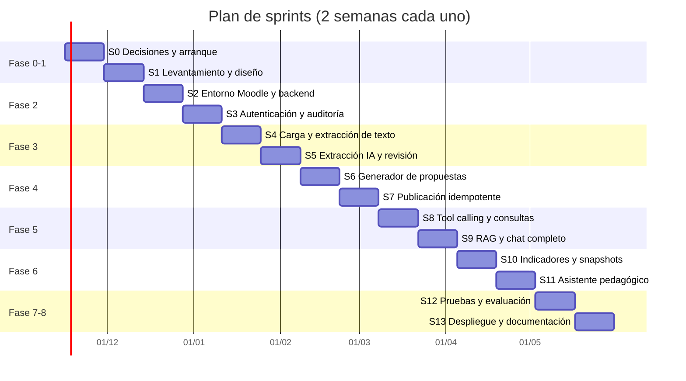

# 🗺️ Roadmap de implementación — LMS inteligente con asistente de IA

Plan de implementación por fases y sprints del sistema descrito en
[`docs/requisitos/implementacion_lms_inteligente_ia.md`](requisitos/implementacion_lms_inteligente_ia.md)
(en adelante, **documento de requisitos**). Incorpora además las brechas detectadas en el análisis
de ese documento: autenticación plugin–backend, creación de actividades mediante función externa
propia, almacenamiento vectorial, procesamiento asíncrono, historial para analítica y seudonimización
antes de llamar al proveedor LLM.

| Dato | Valor |
|---|---|
| Versión del plan | 1.0 |
| Fecha | 2026-11-09 |
| Cadencia | Sprints de 2 semanas |
| Duración estimada | 14 sprints (~28 semanas) |
| Equipo de referencia | 1–2 desarrolladores + docente tutor + 2–5 docentes piloto |
| Estado | Planificación |

> [!IMPORTANT]
> Las fechas y la duración son orientativas. El Sprint 0 cierra las decisiones de la sección 19 del
> documento de requisitos; si alguna cambia (por ejemplo, integrar una instancia Moodle existente en
> lugar de una nueva), se replanifica a partir del Sprint 2.

---

## 📌 Principios que guían el plan

- **Moodle es la fuente de verdad.** La base auxiliar guarda solo datos de la capa inteligente y referencias a IDs de Moodle.
- **La IA propone, el docente decide.** Toda escritura en Moodle pasa por aprobación y confirmación explícitas.
- **Cálculos en código, no en el modelo.** Promedios, porcentajes, estados y umbrales se calculan con funciones deterministas y probadas.
- **Autorización en el servidor, en cada petición.** Ocultar botones no cuenta como control.
- **Valor demostrable temprano.** Cada fase termina con algo que un docente puede usar y evaluar.
- **Flujo Git del proyecto.** Una rama `feature/*`, `fix/*`, `refactor/*`, `chore/*` o `docs/*` por historia, commits pequeños con Conventional Commits y merge `--no-ff` a `develop` (ver `CLAUDE.md`).

---

## 🧭 Vista general

| Fase | Nombre | Sprints | Semanas | Hito al cerrar |
|---|---|---|---|---|
| 0 | Decisiones y arranque | S0 | 1–2 | Decisiones cerradas, repo y CI base |
| 1 | Levantamiento y diseño | S1 | 3–4 | Requisitos numerados, prototipos, ADRs |
| 2 | Infraestructura e integración | S2–S3 | 5–8 | **H1:** plugin ↔ backend ↔ Moodle autenticado |
| 3 | Procesamiento de sílabos | S4–S5 | 9–12 | **H2:** sílabo convertido en extracción editable |
| 4 | Generación y publicación | S6–S7 | 13–16 | **H3:** estructura publicada en Moodle sin duplicados |
| 5 | Asistente conversacional | S8–S9 | 17–20 | **H4:** chat que consulta datos reales del curso |
| 6 | Analítica y recomendaciones | S10–S11 | 21–24 | **H5:** panel analítico y asistente pedagógico |
| 7 | Pruebas y evaluación | S12 | 25–26 | **H6:** informe de evaluación con docentes |
| 8 | Despliegue y documentación | S13 | 27–28 | **H7:** versión 1.0 en `main`, manuales y tesis |

> El calendario no incluye vacaciones ni periodos de exámenes. Conviene alinear S12 (evaluación con
> docentes) con un periodo lectivo activo.

---

## 🏗️ Stack y decisiones de arquitectura propuestas

Cada decisión se registra como ADR en `docs/architecture/adr/` durante el Sprint 0 o el Sprint 1.

| ADR | Decisión propuesta | Alternativa | Motivo |
|---|---|---|---|
| ADR-001 | Monorepo con `pnpm` workspaces (`apps/`, `packages/`, `moodle/`) | Repos separados | Contratos compartidos (`packages/contracts`) entre backend y worker |
| ADR-002 | Backend NestJS + TypeScript + Prisma + PostgreSQL | — | Definido en el documento de requisitos |
| ADR-003 | Worker documental en TypeScript (`pdf-parse`/`pdfjs`, `mammoth`) con OCR opcional | Worker en Python | Reduce el proyecto a dos lenguajes (PHP + TS); Python solo si el OCR o las tablas lo exigen |
| ADR-004 | Cola de trabajos con BullMQ + Redis | Tabla de jobs en PostgreSQL | Extracción y publicación son largas y necesitan reintentos |
| ADR-005 | Vectores en PostgreSQL con `pgvector` | Vector store externo | Una sola base auxiliar, filtros por curso en SQL |
| ADR-006 | Autenticación plugin → backend con JWT de vida corta firmado por el plugin (`sub`, `courseid`, `exp`, `jti`) | Token por usuario de Moodle | El token de integración único no aplica los permisos del docente |
| ADR-007 | Validación de capacidades mediante función externa propia del plugin (`local_ai_assistant_check_access`) | Replicar roles en el backend | Moodle sigue decidiendo los permisos |
| ADR-008 | Creación de actividades mediante funciones externas del plugin que usan `create_module()` | Servicios web core | No hay servicios web core para crear módulos |
| ADR-009 | Capa de abstracción de proveedor LLM (interfaz `LlmProvider`) con salida estructurada validada con Zod | SDK de un proveedor acoplado | Riesgo de dependencia de proveedor (sección 15) |
| ADR-010 | Seudonimización: el LLM recibe `Estudiante#<id>` y el backend restaura los nombres | Enviar nombres reales | Minimización de datos (LOPDP) |
| ADR-011 | Entorno Moodle de desarrollo con `moodlehq/moodle-docker` y versión fijada | `bitnami/moodle:latest` | Imagen oficial de desarrollo; Bitnami retiró su catálogo gratuito |
| ADR-012 | Usar o no el subsistema de IA nativo de Moodle (4.5+) | Backend propio | Se documenta la comparación; el plan asume backend propio |

> [!WARNING]
> Moodle 5.1 reorganizó el código bajo el directorio `public/`. Verificar en el Sprint 2 la ruta
> correcta del plugin (`public/local/ai_assistant` o `local/ai_assistant`) según la versión instalada.

---

## 📋 Requisitos trazables

El documento de requisitos no numera los requisitos. Esta tabla los numera para enlazarlos con
sprints, casos de uso y pruebas. Se refina en el Sprint 1.

### Requisitos funcionales

| ID | Requisito | CU | Sprint |
|---|---|---|---|
| RF-01 | El plugin se comunica con el backend mediante JWT firmado de vida corta | — | S3 |
| RF-02 | El backend valida identidad, curso, rol, capacidad y alcance en cada petición | Todos | S3 |
| RF-03 | Carga de sílabos PDF/DOCX con validación de extensión, MIME real, tamaño y antivirus | CU-01 | S4 |
| RF-04 | Extracción de texto, tablas y encabezados; OCR para documentos escaneados | CU-01 | S4 |
| RF-05 | Extracción estructurada con IA validada contra esquema versionado; campos dudosos marcados | CU-01 | S5 |
| RF-06 | El docente revisa y corrige la extracción; se guardan versiones | CU-01 | S5 |
| RF-07 | Generación de propuesta de secciones y actividades vinculadas a unidad y resultado de aprendizaje | CU-02 | S6 |
| RF-08 | Edición y aprobación de la propuesta con máquina de estados | CU-02 | S6 |
| RF-09 | Publicación idempotente en Moodle con registro de IDs y manejo de fallos parciales | CU-03 | S7 |
| RF-10 | Chat en lenguaje natural con tool calling sobre herramientas explícitas | CU-04 | S8 |
| RF-11 | Consulta de estados reales de entrega por actividad | CU-04 | S8 |
| RF-12 | Consulta de actividades pendientes de calificar | CU-04 | S8 |
| RF-13 | Resumen de calificaciones según reglas del curso | CU-04 | S8 |
| RF-14 | Búsqueda RAG en sílabos y documentos del curso con referencias | CU-04 | S9 |
| RF-15 | Indicadores de curso: entregas, pendientes, promedio, evolución, rendimiento por unidad, participación | — | S10 |
| RF-16 | Señales de posible dificultad con umbrales y ventanas configurables | CU-05 | S10 |
| RF-17 | Evidencias por estudiante en un curso autorizado | CU-05 | S11 |
| RF-18 | Recomendaciones pedagógicas con evidencias, limitaciones e indicadores de seguimiento | CU-05 | S11 |
| RF-19 | Registro de auditoría de consultas y operaciones sensibles | Todos | S3 |
| RF-20 | Registro del seguimiento docente de las recomendaciones | CU-05 | S11 |

### Requisitos no funcionales (propuestos; validar en S0–S1)

| ID | Requisito | Meta propuesta |
|---|---|---|
| RNF-01 | Tiempo hasta el primer token del chat (streaming) | p95 < 3 s |
| RNF-02 | Respuesta completa del chat con una herramienta | p95 < 10 s |
| RNF-03 | Extracción de un sílabo de 20 páginas | < 2 min |
| RNF-04 | Tamaño máximo de archivo | 10 MB |
| RNF-05 | Cobertura de pruebas del backend | ≥ 70 % en módulos de dominio |
| RNF-06 | Consultas a otro curso sin permiso bloqueadas | 100 % |
| RNF-07 | Costo de IA por docente al mes | Límite configurable; meta a fijar con el presupuesto |
| RNF-08 | Retención de documentos, embeddings y conversaciones | Configurable; valor por defecto a fijar con la institución |
| RNF-09 | Idiomas de la interfaz | Español e inglés (`lang/es`, `lang/en`) |
| RNF-10 | Accesibilidad de la interfaz del plugin | WCAG 2.1 AA en componentes propios |

### Metas de calidad de IA (propuestas; medir en S12)

| Métrica | Meta |
|---|---|
| F1 de extracción de unidades | ≥ 0.85 |
| F1 de extracción de resultados de aprendizaje | ≥ 0.80 |
| Exactitud de consultas de entregas | ≥ 95 % |
| Exactitud de cálculos académicos | 100 % (son deterministas) |
| Respuestas con fuente verificable | ≥ 95 % |
| Abstención correcta cuando faltan datos | ≥ 90 % |
| Recomendaciones calificadas como pertinentes por docentes | ≥ 70 % |
| SUS | ≥ 68 |

---

## ✅ Definición de terminado (DoD)

Una historia se considera terminada cuando:

- [ ] El código está en una rama de trabajo y se integró a `develop` con `git merge --no-ff`.
- [ ] Los commits son pequeños, siguen Conventional Commits y no tienen atribución de IA.
- [ ] Linter, pruebas y build pasan en local y en CI.
- [ ] Hay pruebas unitarias del dominio y, si toca Moodle o la API, pruebas de integración.
- [ ] Los endpoints nuevos tienen DTO, validación y pruebas de autorización negativas.
- [ ] No hay secretos en el código, en los logs ni en el frontend.
- [ ] La documentación afectada (README, API, ADR, este roadmap) está actualizada en el mismo cambio.

---

## 🚀 Fase 0 — Decisiones y arranque

### Sprint 0 · Semanas 1–2

**Objetivo:** cerrar las decisiones bloqueantes y dejar el repositorio listo para desarrollar.

**Decisiones a cerrar (sección 19 del documento de requisitos):**

- [ ] D-01 Versión de Moodle de la institución.
- [ ] D-02 Moodle nuevo o integración con una instancia existente.
- [ ] D-03 Tipos y formatos de sílabo; reunir de 10 a 20 sílabos reales anonimizados.
- [ ] D-04 Estructura de parciales y ponderaciones (régimen LOES o LOEI).
- [ ] D-05 Tipos de actividad que se crearán automáticamente (propuesta: `assign`, `forum`, `quiz` vacío, `label`/`page`).
- [ ] D-06 Disponibilidad de servicios web y permisos administrativos.
- [ ] D-07 Proveedor de IA, modelo y presupuesto mensual.
- [ ] D-08 Política institucional sobre datos personales y proveedores externos.
- [ ] D-09 Docentes, cursos y estudiantes para el piloto.
- [ ] D-10 Calendario disponible para desarrollar y validar.

**Tareas técnicas:**

- [x] Inicializar Git con `main`, `develop` y el flujo de ramas de `CLAUDE.md`.
- [ ] `chore/monorepo-setup`: `pnpm` workspaces, `.editorconfig`, `.gitattributes` (EOL LF), `.gitignore`, `.env.example`.
- [ ] `chore/lint-format`: ESLint + Prettier para TS; `phpcs` con el estándar `moodle` para el plugin.
- [ ] `ci/base-pipeline`: CI con lint, pruebas y build en cada push a `develop` y ramas de trabajo.
- [ ] `docs/adr-template`: plantilla de ADR y registro de ADR-001 a ADR-012.
- [ ] `docs/readme`: README inicial según la estructura de `CLAUDE.md`.

**Entregables:** decisiones D-01 a D-10 documentadas, repositorio con CI en verde y ADRs iniciales.

**Riesgo principal:** no obtener sílabos reales o permisos de Moodle. Mitigación: sílabos sintéticos
validados por el tutor y Moodle local de desarrollo.

---

## 📐 Fase 1 — Levantamiento y diseño

### Sprint 1 · Semanas 3–4

**Objetivo:** convertir el documento de requisitos en especificación verificable y diseño.

- [ ] Entrevistar a 2–5 docentes y medir el tiempo actual de planificación de un curso (línea base para el indicador de ahorro de tiempo).
- [ ] Documentar el proceso actual de planificación y seguimiento (`docs/architecture/proceso-actual.md`).
- [ ] Catalogar los formatos de sílabo recibidos y sus secciones.
- [ ] Refinar RF y RNF con criterios de aceptación medibles.
- [ ] Diseñar el modelo de datos completo: añadir `IntegrationAccount`, `DocumentChunk`, `PedagogicalRecommendation`, `AnalyticsSnapshot`, `PublishOperation` y unificar estados de documento y propuesta.
- [ ] Diseñar el contrato de la API (`docs/api/openapi.yaml`).
- [ ] Diseñar el JSON Schema v1 del sílabo en `packages/contracts`.
- [ ] Prototipos de baja fidelidad: panel docente, generación de curso y análisis individual.
- [ ] Análisis de privacidad: finalidad, base de legitimación, categorías de datos, necesidad de evaluación de impacto (LOPDP).
- [ ] Plan de pruebas y conjunto de referencia: sílabos etiquetados y preguntas con respuesta verificada por docentes.
- [ ] Solicitar consentimiento informado y aval ético para el piloto.

**Entregables:** especificación de requisitos, diagramas, prototipos, OpenAPI v0, esquema del sílabo v1, plan de pruebas.

**Criterio de aceptación:** el tutor y al menos un docente piloto validan requisitos y prototipos.

---

## 🔌 Fase 2 — Infraestructura e integración

### Sprint 2 · Semanas 5–6 — Entorno y esqueletos

**Objetivo:** levantar Moodle, el backend y la base auxiliar en Docker.

- [ ] `chore/docker-dev-env`: Docker Compose con Moodle (versión fijada), su base de datos, PostgreSQL 17 + `pgvector`, Redis, `api` y `document-worker`, con healthchecks y redes.
- [ ] `chore/moodle-seed`: script de datos sintéticos: cursos, docentes, estudiantes, tareas, entregas y calificaciones.
- [ ] `feature/moodle-local-plugin-skeleton`: plugin `local_ai_assistant` con `version.php`, `settings.php`, `db/access.php` (capacidades `local/ai_assistant:use`, `:publish`, `:viewanalytics`), `lang/es`, `lang/en` y proveedor de privacidad.
- [ ] `feature/api-skeleton`: NestJS con módulos `health`, `common` (guards, filters, interceptors), configuración validada y logs estructurados.
- [ ] `feature/prisma-base-schema`: esquema Prisma inicial y primera migración.
- [ ] `feature/moodle-client`: cliente de servicios web de Moodle con tipos, timeouts, reintentos y mapeo de errores.
- [ ] Crear usuario de integración con permisos mínimos y token dedicado.

**Criterio de aceptación:** `docker compose up` deja todo funcionando; `GET /api/v1/health` informa el estado de Moodle, la base de datos y Redis.

### Sprint 3 · Semanas 7–8 — Autenticación, autorización y auditoría

**Objetivo:** comunicación segura de extremo a extremo con los permisos reales de Moodle.

- [ ] `feature/plugin-jwt-signing`: el plugin firma JWT de vida corta (≤ 5 min) con `sub`, `courseid`, `exp` y `jti`; clave guardada en la configuración del plugin, nunca en el frontend.
- [ ] `feature/api-jwt-guard`: guard NestJS que valida firma, expiración y reutilización de `jti`.
- [ ] `feature/moodle-access-check`: función externa `local_ai_assistant_check_access` que devuelve rol y capacidades del usuario en el curso; caché corta en el backend.
- [ ] `feature/course-scope-guard`: guard por curso y capacidad aplicado a todos los controladores.
- [ ] `feature/audit-log`: módulo `audit` y tabla `audit_events`; logs sin datos personales innecesarios.
- [ ] `feature/plugin-assistant-shell`: página del asistente en Moodle (AMD + Mustache) que llama al backend.
- [ ] Pruebas negativas: token inválido, token expirado, curso ajeno, estudiante con herramienta de docente.

**Entregables (H1):** Moodle funcional, plugin inicial y backend conectado y autenticado.

**Criterio de aceptación:** las pruebas negativas de autorización de la sección 13.2 relacionadas pasan al 100 %.

---

## 📄 Fase 3 — Procesamiento de sílabos

### Sprint 4 · Semanas 9–10 — Carga segura y extracción de texto

**Objetivo:** recibir un sílabo de forma segura y obtener su texto estructurado.

- [ ] `feature/syllabus-upload`: `POST /syllabi` con validación de extensión, MIME real (magic bytes), tamaño, checksum y antivirus (ClamAV).
- [ ] `feature/job-queue`: BullMQ + Redis; estados de trabajo y reintentos.
- [ ] `feature/document-worker`: extracción de texto PDF/DOCX conservando página, encabezados y tablas.
- [ ] `feature/ocr-fallback`: OCR para PDF escaneados, con marca de baja confianza.
- [ ] `feature/syllabus-status`: `GET /syllabi/:id` con estado y progreso.
- [ ] `feature/plugin-syllabus-upload-ui`: pantalla de carga con progreso.
- [ ] Política de retención de archivos temporales.

**Criterio de aceptación:** los sílabos del conjunto de referencia se procesan; un archivo con extensión falsa se rechaza.

### Sprint 5 · Semanas 11–12 — Extracción estructurada con IA y revisión

**Objetivo:** convertir el texto en un JSON validado que el docente pueda corregir.

- [ ] `feature/llm-provider-abstraction`: interfaz `LlmProvider` con salida estructurada, límites de tokens, timeouts y registro de consumo.
- [ ] `feature/syllabus-structured-extraction`: extracción al esquema v1 validado con Zod; `uncertainFields` y `sourceReferences` con página.
- [ ] Reglas: no inventar fechas, ponderaciones ni actividades; los campos ausentes quedan `null` y pendientes.
- [ ] Defensa contra prompt injection: el texto del documento va delimitado como datos.
- [ ] `feature/extraction-versioning`: `POST /syllabi/:id/extract`, `GET /syllabi/:id/extraction` y versiones en `syllabus_extractions`.
- [ ] `feature/plugin-extraction-editor`: editor de unidades, temas, resultados, fechas y ponderaciones con indicador de confianza.
- [ ] Primera medición de precisión, exhaustividad y F1 sobre el conjunto de referencia.

**Entregables (H2):** sílabo convertido en extracción editable y versionada.

**Criterio de aceptación:** un sílabo sin fechas no recibe fechas inventadas; F1 de unidades medido y registrado.

---

## 🧱 Fase 4 — Generación y publicación

### Sprint 6 · Semanas 13–14 — Generador de propuestas

**Objetivo:** proponer la estructura del curso a partir de la extracción aprobada.

- [ ] `feature/proposal-generator`: unidades → secciones; actividades → tipos de Moodle según D-05.
- [ ] Cada actividad queda vinculada a una unidad y a un resultado de aprendizaje.
- [ ] Validación de ponderaciones contra la configuración institucional (D-04).
- [ ] `feature/proposal-state-machine`: `DRAFT → NEEDS_REVIEW → APPROVED → PUBLISHING → PUBLISHED`, con `REJECTED` y `FAILED`; transiciones probadas.
- [ ] `feature/proposal-api`: `POST /proposals`, `GET /proposals/:id`, `PATCH /proposals/:id`, `POST /proposals/:id/approve`.
- [ ] Detección de reprocesamiento del mismo sílabo (checksum) para evitar propuestas duplicadas.
- [ ] `feature/plugin-proposal-preview`: vista previa editable de secciones y actividades.

**Criterio de aceptación:** el docente edita y aprueba una propuesta; las transiciones inválidas se rechazan.

### Sprint 7 · Semanas 15–16 — Publicación idempotente

**Objetivo:** crear en Moodle solo los elementos aprobados, sin duplicados.

- [ ] `feature/moodle-create-section`: función externa del plugin para crear y actualizar secciones.
- [ ] `feature/moodle-create-module`: funciones externas con `create_module()` para los tipos de D-05, con validación de parámetros y capacidades.
- [ ] `feature/publish-job`: `POST /proposals/:id/publish` con clave de idempotencia; ejecución en cola, ítem por ítem, registrando `moodleItemId`.
- [ ] Manejo de fallos parciales: reanudar desde el último ítem publicado; informe de creados y fallidos.
- [ ] Confirmación explícita del docente antes de publicar.
- [ ] `feature/plugin-publish-summary`: resumen de elementos creados y errores con enlaces a Moodle.
- [ ] Pruebas: publicación repetida, caída de Moodle a mitad de publicación, permisos insuficientes.

**Entregables (H3):** creación controlada de estructura y actividades en Moodle.

**Criterio de aceptación:** repetir la publicación no crea duplicados; se crean únicamente los elementos aprobados.

---

## 💬 Fase 5 — Asistente conversacional

### Sprint 8 · Semanas 17–18 — Tool calling y consultas académicas

**Objetivo:** responder preguntas sobre entregas, pendientes y notas con datos reales de Moodle.

- [ ] `feature/ai-orchestrator`: bucle de tool calling con límite de iteraciones y herramientas separadas de lectura y escritura.
- [ ] `feature/tool-teacher-courses`: `get_teacher_courses`, `get_course_activities`.
- [ ] `feature/tool-submissions`: `get_assignment_submissions` respetando los estados reales de Moodle (sin entrega, borrador, enviada, tardía).
- [ ] `feature/tool-pending-grading`: `get_pending_grading`.
- [ ] `feature/tool-grade-summary`: `get_course_grade_summary` con cálculos deterministas y normalización de escalas.
- [ ] `feature/pseudonymization`: el LLM recibe seudónimos; el backend restaura nombres en la respuesta final.
- [ ] `feature/chat-api`: `POST /assistant/chat` con streaming, conversación persistida e historial con límite de contexto.
- [ ] Respuestas con actividad, curso, fecha de consulta, criterio aplicado, enlace a Moodle y aviso de datos incompletos.
- [ ] Aclaración única cuando la pregunta es ambigua.

**Criterio de aceptación:** las respuestas sobre entregas coinciden con Moodle en el conjunto de preguntas de referencia.

### Sprint 9 · Semanas 19–20 — RAG y chat completo

**Objetivo:** consultar el contenido de sílabos y documentos del curso, y endurecer la seguridad del chat.

- [ ] `feature/rag-indexing`: fragmentación con solapamiento, metadatos (curso, documento, versión, página) y embeddings en `pgvector`.
- [ ] `feature/tool-search-documents`: `search_course_documents` con filtro por curso antes de la búsqueda.
- [ ] Respuestas con referencias a documento y página.
- [ ] `feature/plugin-chat-ui`: chat con streaming, fuentes y estados de error.
- [ ] Degradación controlada si el proveedor LLM no responde: el sistema informa el fallo sin inventar respuesta.
- [ ] Pruebas de ataque: documento con instrucciones maliciosas, petición de datos de otro curso, acceso a conversación ajena.
- [ ] Límites de uso y costo por docente.

**Entregables (H4):** chat capaz de consultar información real del curso y de sus documentos.

**Criterio de aceptación:** 100 % de consultas no autorizadas bloqueadas; ningún fragmento de otro curso aparece en las respuestas.

---

## 📊 Fase 6 — Analítica y recomendaciones

### Sprint 10 · Semanas 21–22 — Indicadores y señales de dificultad

**Objetivo:** calcular indicadores transparentes y su evolución.

- [ ] `feature/analytics-indicators`: porcentaje de entregas, actividades pendientes, promedio, rendimiento por unidad y participación, con definiciones documentadas.
- [ ] `feature/analytics-snapshots`: tarea programada que guarda snapshots periódicos para calcular la evolución.
- [ ] `feature/activity-unit-mapping`: mapeo manual de actividades no creadas por el sistema a unidades y resultados (o competencias de Moodle).
- [ ] `feature/difficulty-signals`: reglas configurables (umbral, ventana, actividades obligatorias) con explicación de por qué se activó cada señal.
- [ ] `feature/analytics-api`: `GET /analytics/courses/:courseId`.
- [ ] `feature/plugin-teacher-dashboard`: panel con selector de curso, pendientes, indicadores y alertas explicables.
- [ ] Herramienta `get_unit_performance` para el chat.

**Criterio de aceptación:** los cálculos coinciden con una hoja de verificación manual al 100 %.

### Sprint 11 · Semanas 23–24 — Asistente pedagógico individual

**Objetivo:** recomendaciones basadas en evidencias, sujetas a revisión docente.

- [ ] `feature/student-evidence`: `get_student_learning_evidence` y `GET /analytics/courses/:courseId/students/:studentId`.
- [ ] `feature/pedagogical-recommendations`: resumen de evidencias, fortalezas, dificultades, información faltante, estrategias, actividades de refuerzo e indicadores de seguimiento.
- [ ] Reglas de lenguaje: describir comportamientos observables; sin diagnósticos ni atribuciones personales (validador de salida + pruebas).
- [ ] Integración RAG con documentos pedagógicos autorizados.
- [ ] `feature/recommendation-follow-up`: el docente registra la intervención y su resultado.
- [ ] `feature/plugin-student-analysis`: pantalla que separa datos observados, cálculos, interpretaciones de IA, información desconocida y acciones posibles.

**Entregables (H5):** panel analítico y asistente pedagógico.

**Criterio de aceptación:** ninguna recomendación del conjunto de prueba contiene diagnósticos ni etiquetas personales.

---

## 🧪 Fase 7 — Pruebas y evaluación

### Sprint 12 · Semanas 25–26

**Objetivo:** medir precisión, utilidad, usabilidad, seguridad y ahorro de tiempo.

> Las pruebas unitarias y de integración se escriben en cada sprint. Este sprint completa las pruebas
> end-to-end y ejecuta la evaluación con docentes.

- [ ] Pruebas end-to-end de CU-01 a CU-05.
- [ ] Suite completa de seguridad de la sección 13.2 y revisión OWASP Top 10.
- [ ] Prueba de carga básica contra RNF-01 a RNF-03.
- [ ] Evaluación de calidad de IA sobre el conjunto de referencia (sección 13.3).
- [ ] Piloto con docentes: planificación asistida frente a la línea base del Sprint 1; promedio, mediana y dispersión del ahorro de tiempo.
- [ ] Encuesta SUS y entrevistas breves.
- [ ] Evaluación de recomendaciones: pertinencia, claridad, viabilidad, relación con evidencias y alineación con resultados.
- [ ] Corrección de defectos priorizados (ramas `fix/*`).

**Entregables (H6):** informe de resultados, correcciones y versión candidata `v1.0.0-rc`.

---

## 🚢 Fase 8 — Despliegue y documentación

### Sprint 13 · Semanas 27–28

**Objetivo:** dejar el sistema desplegado, operable y documentado.

- [ ] `chore/production-compose`: imágenes con versión o digest fijado, sin `latest`; TLS, límites de recursos y secretos fuera del repositorio.
- [ ] Copias de seguridad cifradas de la base de Moodle, la base auxiliar y `moodledata`; prueba de restauración; RPO y RTO acordados.
- [ ] Monitoreo: métricas, trazas, alertas de errores y de costo de IA.
- [ ] Procedimiento de incidentes y brechas de datos.
- [ ] Manual de instalación y operación (`docs/user-manual/`).
- [ ] Manual del docente y capacitación.
- [ ] README final según `CLAUDE.md`.
- [ ] Capítulos técnicos de la tesis (`docs/thesis/`).
- [ ] Merge `develop` → `main` con `--no-ff` y etiqueta `v1.0.0`.

**Entregables (H7):** sistema desplegado, manuales y versión 1.0 en `main`.

---

## ⚠️ Riesgos por fase

| Riesgo | Fase | Señal temprana | Mitigación |
|---|---|---|---|
| Sin acceso a Moodle institucional o servicios web | 0–2 | D-02/D-06 sin respuesta al final de S0 | Moodle local con datos sintéticos; piloto en instancia propia |
| Sílabos escaneados o muy heterogéneos | 3 | F1 bajo en S5 | OCR, revisión humana, plantillas por formato |
| Creación de módulos más costosa de lo previsto | 4 | S7 sin `assign` funcionando a mitad de sprint | Reducir D-05 a `assign` + `label` en el MVP |
| Alucinaciones en el chat | 5 | Respuestas sin fuente en pruebas | Herramientas obligatorias, validación de salida, abstención |
| Costos de IA elevados | 5–6 | Consumo por consulta por encima de la meta | Caché, modelo más pequeño para tareas simples, límites |
| Analítica sin historial suficiente | 6 | Pocos snapshots al llegar a S10 | Activar snapshots desde S8 aunque el panel llegue después |
| Pocos docentes para el piloto | 7 | D-09 sin cerrar en S1 | Reclutar en S1; evaluación con tareas controladas |
| Retrasos acumulados | Todas | Velocidad de sprint < 70 % de lo planificado | Recortar CU-05 a evidencias sin recomendaciones generativas |

---

## ✂️ Alcance recortable

Si el calendario se aprieta, el orden de recorte es:

1. Actividades de refuerzo generadas por IA (S11): mantener solo evidencias e indicadores.
2. RAG con documentos pedagógicos externos (S11): mantener solo sílabos del curso.
3. Tipos de actividad `quiz` y `forum` (S7): mantener `assign` y `label`.
4. OCR (S4): aceptar solo PDF con texto y DOCX.

Fuera del MVP en cualquier caso (sección 3.2 del documento de requisitos): calificación autónoma,
decisiones de aprobación o sanción, diagnósticos, predicción determinista de abandono, entrenamiento
de modelos propios y publicación masiva sin revisión.

---

## 🔀 Convenciones de trabajo por sprint

- Cada historia del sprint tiene su rama (`feature/*`, `fix/*`, `refactor/*`, `chore/*`, `docs/*`) creada desde `develop`.
- Commits frecuentes y pequeños con Conventional Commits; sin trailers de coautoría de IA.
- Antes de integrar: linter, pruebas y build en verde.
- Integración a `develop` con `git merge --no-ff`; borrar la rama después.
- Al cerrar cada fase con hito estable: merge `develop` → `main` y etiqueta (`v0.1.0` en H1, `v0.2.0` en H2, … `v1.0.0` en H7).
- Este roadmap se actualiza en una rama `docs/*` al cerrar cada sprint: marcar tareas, registrar desvíos y replanificar.

---

## 📈 Seguimiento

| Sprint | Estado | Inicio | Fin | Notas |
|---|---|---|---|---|
| S0 | En curso | 2026-11-16 | 2026-11-29 | Repositorio Git inicializado |
| S1 | Pendiente | | | |
| S2 | Pendiente | | | |
| S3 | Pendiente | | | |
| S4 | Pendiente | | | |
| S5 | Pendiente | | | |
| S6 | Pendiente | | | |
| S7 | Pendiente | | | |
| S8 | Pendiente | | | |
| S9 | Pendiente | | | |
| S10 | Pendiente | | | |
| S11 | Pendiente | | | |
| S12 | Pendiente | | | |
| S13 | Pendiente | | | |
