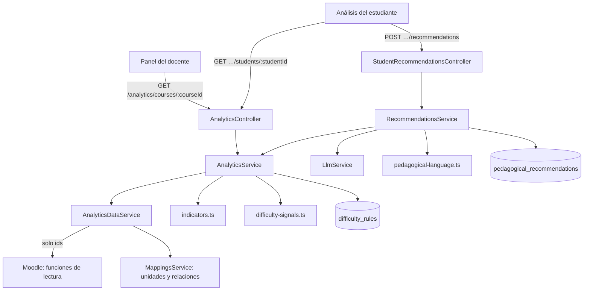

# Analítica y recomendaciones pedagógicas

Implementación de la línea de IA de los sprints 10 y 11: indicadores del curso, señales de dificultad,
evidencias del estudiante y recomendaciones (RF-15 a RF-18). Decisión en
[ADR-018](adr/0018-analitica-sin-snapshots-lecturas-completas.md). La pantalla del panel y del análisis del
estudiante es del plugin ([interfaces del plugin](interfaces-plugin.md)).

> [!NOTE]
> Todo está probado con un Moodle simulado que cumple el contrato de lecturas y con el proveedor de IA
> simulado. Con un Moodle real, estas rutas responden `503 MOODLE_UNAVAILABLE` hasta que el plugin tenga las
> funciones de lectura ([`docs/equipo/pendiente-de-jose.md`](../equipo/pendiente-de-jose.md)).

## Flujo

## Rutas

Todas exigen `viewanalytics`. El `:courseId` debe ser el del token (`CourseAccessGuard`).

| Método | Ruta                                                               | Respuesta | Errores propios                                                                                             |
| ------ | ------------------------------------------------------------------ | --------- | ----------------------------------------------------------------------------------------------------------- |
| GET    | `/analytics/courses/:courseId`                                     | 200       | `503 MOODLE_UNAVAILABLE`                                                                                    |
| GET    | `/analytics/courses/:courseId/students/:studentId`                 | 200       | `404 STUDENT_NOT_FOUND` (no matriculado o id inválido), `503 MOODLE_UNAVAILABLE`                            |
| POST   | `/analytics/courses/:courseId/students/:studentId/recommendations` | 201       | `404`, `422 INSUFFICIENT_DATA`, `429 RATE_LIMITED`, `503 AI_PROVIDER_UNAVAILABLE`, `503 MOODLE_UNAVAILABLE` |
| POST   | `/recommendations/:id/followups`                                   | 201       | `404 RECOMMENDATION_NOT_FOUND` (ajena, de otro curso o inexistente)                                         |

## Indicadores del curso

Cada indicador lleva su `definition`, y un indicador sin dato lleva `value: null` (se muestra como guion,
nunca como cero). Código en `apps/api/src/analytics/indicators.ts`.

| Clave                    | Qué mide                                                                                                                                  | Sin valor cuando                                                      |
| ------------------------ | ----------------------------------------------------------------------------------------------------------------------------------------- | --------------------------------------------------------------------- |
| `delivery_rate`          | Entregas recibidas ÷ esperadas × 100. Esperadas: matriculados × tareas visibles con fecha de entrega vencida. Cuenta enviada o calificada | No se leyeron las entregas, no hay estudiantes o ninguna tarea venció |
| `pending_grading`        | Entregas enviadas sin calificación                                                                                                        | No se leyó el dato (un cero real es 0)                                |
| `average_grade_percent`  | Promedio simple de las notas puestas, cada una como porcentaje de la nota máxima; una nota ausente no cuenta como cero                    | No hay notas                                                          |
| `participation_rate`     | Estudiantes que entraron en los últimos 14 días ÷ matriculados × 100; quien nunca entró cuenta como no participante                       | No se leyeron los accesos o no hay estudiantes                        |
| `completion_rate`        | Actividades completadas ÷ actividades con seguimiento de finalización × 100                                                               | No se leyó la finalización                                            |
| `unit_average:<unitRef>` | Promedio de las notas de las actividades relacionadas con la unidad (`activity_unit_mappings`)                                            | La unidad no tiene actividades relacionadas o notas                   |

Indicadores del estudiante: `delivery_rate`, `average_grade_percent`, `completion_rate` y
`days_since_last_access`, con las mismas definiciones sobre sus propios datos.

La verificación manual está en `analytics.fixtures.ts`: un curso de 4 estudiantes cuyos resultados
(50 % de entregas, 70 % de promedio, 50 % de participación, 75 % de finalización) se comprueban a mano en
`indicators.spec.ts`.

## Señales de dificultad

Una señal lleva solo `studentId`, `rule` y `explanation`: el plugin resuelve el nombre, y la explicación dice
qué hecho observable activó la regla. Una señal no es un diagnóstico (sus textos pasan por el validador de
lenguaje en las pruebas). Si falta el dato que una regla necesita, esa regla no genera señales: la ausencia de
datos no es una señal. Código en `difficulty-signals.ts` y `difficulty-rules.ts`.

| Regla                         | Se activa cuando…                                                                            | Parámetros (por defecto)                                            |
| ----------------------------- | -------------------------------------------------------------------------------------------- | ------------------------------------------------------------------- |
| `MISSING_REQUIRED`            | Hay al menos N tareas vencidas sin entrega                                                   | `minMissing` (2), `requiredCmids` opcional, `windowDays` opcional   |
| `GRADE_BELOW_THRESHOLD`       | Hay al menos N notas por debajo de un porcentaje de la nota máxima (estrictamente menor)     | `thresholdPercent` (60), `minActivities` (2), `windowDays` opcional |
| `SUSTAINED_DECLINE`           | Las últimas N notas bajan una tras otra (orden por fecha de calificación)                    | `consecutive` (3, entre 3 y 10), `windowDays` opcional              |
| `REPEATED_OUTCOME_DIFFICULTY` | Hay al menos N notas bajas en actividades relacionadas con un mismo resultado de aprendizaje | `thresholdPercent` (60), `minActivities` (2), `windowDays` opcional |

Resolución de reglas: para cada tipo se usa la del curso (`difficulty_rules.moodle_course_id`) si existe, si
no la institucional (`moodle_course_id` nulo), si no la de por defecto. Una regla puede desactivarse
(`enabled = false`). Un parámetro guardado que no cumple el esquema se descarta y se usan los de por defecto.

## Carga de datos y datos faltantes

`AnalyticsDataService` lee de Moodle en nombre del docente del token. Las lecturas **esenciales** (actividades y
estudiantes) deben funcionar: si no, `503 MOODLE_UNAVAILABLE`. Las demás (pendientes, notas, finalización,
accesos y entregas) quedan en `null` si fallan **o vienen recortadas** (`truncated`): unos porcentajes
calculados sobre una lista parcial serían falsos, y es mejor un guion que un número equivocado. Las entregas se
leen de las tareas visibles y vencidas (hasta 50); si falla la lectura de una sola, se descartan todas.
Con la lista de estudiantes o de actividades recortada, ningún indicador del curso tiene valor.

## Evidencias del estudiante

`GET …/students/:studentId` separa tres cosas (RF-17):

- **`observed`**: hechos de Moodle tal cual, como filas `{label, value}` (tareas entregadas, notas, entregas sin
  calificar, último acceso o «Nunca ha entrado»).
- **`computed`**: los indicadores del estudiante, con su definición.
- **`unknown`**: lo que falta para concluir, dicho explícitamente (por ejemplo, «El estudiante no tiene notas
  registradas» o «Las actividades no están relacionadas con unidades del sílabo»).

Un estudiante que no está matriculado en el curso responde 404, igual que uno que no existe.

## Recomendaciones (RF-18)

`RecommendationsService` aplica cuatro barreras:

1. **Datos suficientes.** Sin porcentaje de entregas ni promedio de notas responde `422 INSUFFICIENT_DATA`, con
   lo que falta en `details`, y no llama al modelo.
2. **Privacidad.** El modelo recibe las evidencias dentro de `<evidencia_estudiante>` (como datos, sin poder
   cerrar la etiqueta) y **sin el id ni el nombre** del estudiante. Las instrucciones no llevan datos.
3. **Lenguaje.** La salida pasa por `validateRecommendationLanguage` (sin diagnósticos, etiquetas ni juicios).
   Si no cumple, se reintenta una vez diciendo en qué campos, sin repetir el término. Si el segundo intento
   tampoco cumple, `503 AI_PROVIDER_UNAVAILABLE` y no se guarda nada.
4. **Lo desconocido siempre se declara.** `missingInformation` incluye la lista de lo desconocido de las
   evidencias, aunque el modelo la omita.

Se guarda en `pedagogical_recommendations` (evidencias y contenido, estado `GENERATED`). El límite diario es
`AI_DAILY_RECOMMENDATIONS_PER_TEACHER` (50): al agotarlo, `429 RATE_LIMITED` con `Retry-After`. La auditoría
(`recommendation.generate`, `analytics.course_view`, `analytics.student_view`) guarda solo metadatos escalares.

## Lo que falta

- Probar contra un Moodle real (funciones de lectura del plugin).
- La calidad de las recomendaciones con un modelo real: hoy solo se probó el flujo y las barreras, no si son
  pertinentes (evaluación del Sprint 12, IA-05).
- Reglas administrables por API (`/admin/difficulty-rules`): falta definir el permiso de administrador.
- `get_student_learning_evidence` como herramienta del chat.
- Evolución en el tiempo (ver ADR-018): hoy no se guardan snapshots.
