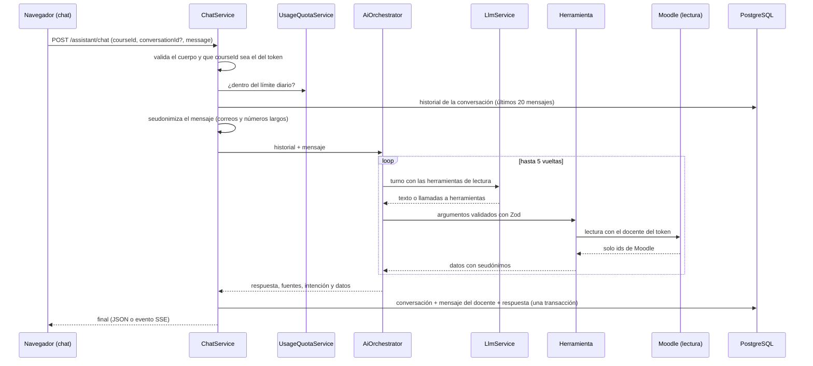

# Asistente conversacional

Implementación de la parte de IA de los sprints 8 y 9: `POST /assistant/chat`, el orquestador de
herramientas, la seudonimización y los límites de uso (RF-10 a RF-14, RNF-07). Decisiones en
[ADR-009](adr/0009-abstraccion-proveedor-llm.md), [ADR-010](adr/0010-seudonimizacion.md) y
[ADR-017](adr/0017-lecturas-moodle-solo-ids.md). La pantalla del chat es del plugin
([interfaces del plugin](interfaces-plugin.md)).

> [!NOTE]
> Todo está probado con el proveedor de IA simulado y con un Moodle simulado que cumple el contrato. Las
> herramientas de Moodle no corren contra un Moodle real hasta que el plugin tenga las funciones de lectura
> ([`docs/equipo/pendiente-de-jose.md`](../equipo/pendiente-de-jose.md)).

## Flujo de un mensaje

## Formatos de respuesta

Con `Accept: text/event-stream` la respuesta es SSE, con el orden fijado en el contrato: cero o más eventos
`tool` y `token`, y un único `final` o `error`. Con otro `Accept` es un JSON con la respuesta completa
(`ChatResponse`). Un fallo **antes del primer evento** sale como JSON con su código HTTP; después del primer
evento ya no se puede cambiar el estado y se informa con un evento `error`, sin el mensaje de la excepción.

| Código                    | HTTP | Cuándo                                                                                                           |
| ------------------------- | ---- | ---------------------------------------------------------------------------------------------------------------- |
| `VALIDATION_ERROR`        | 400  | Mensaje vacío, de más de 2000 caracteres, `courseId` o `conversationId` inválidos                                |
| `FORBIDDEN_COURSE`        | 403  | El `courseId` del cuerpo no es el del token                                                                      |
| `CONVERSATION_NOT_FOUND`  | 404  | La conversación no existe, es de otro docente o de otro curso (SEC-10)                                           |
| `RATE_LIMITED`            | 429  | Se agotó el límite diario de mensajes o tokens; `Retry-After` indica cuánto esperar                              |
| `AI_PROVIDER_UNAVAILABLE` | 503  | No hay proveedor, no respondió a tiempo, devolvió una salida inválida o la conversación supera el tope de tokens |

Nada se guarda si la IA falla: ni la conversación ni los mensajes. Así el docente reintenta sin dejar
mensajes sueltos y el sistema no inventa una respuesta.

`data` de la respuesta lleva el resultado de cada herramienta usada, con su nombre como clave (una segunda
llamada a la misma herramienta usa `nombre#2`), y `students`: la lista de `{alias, studentId}` de los
seudónimos que aparecen en `answer`, para que el plugin los sustituya por el nombre.

## Orquestador

`AiOrchestratorService` (`apps/api/src/assistant/ai-orchestrator.service.ts`):

| Regla                            | Valor / comportamiento                                                                                                   |
| -------------------------------- | ------------------------------------------------------------------------------------------------------------------------ |
| Vueltas máximas por mensaje      | 5 (`MAX_TOOL_ITERATIONS`); al agotarlas responde un texto fijo y marca `incompleteData`                                  |
| Herramientas atendidas por turno | 4 (`MAX_CALLS_PER_TURN`); el resto se ignora                                                                             |
| Herramientas ofrecidas al modelo | Solo las de lectura (`kind: "read"`); una de escritura que el modelo pida igualmente no se ejecuta                       |
| Argumentos                       | Se validan con el esquema Zod de la herramienta; un error vuelve al modelo como dato y marca `incompleteData`            |
| Resultados de herramientas       | Se entregan dentro de `<resultado_herramienta>`, que el resultado no puede cerrar; las instrucciones dicen que son datos |
| Fallo de una herramienta         | El modelo recibe un mensaje genérico (sin el texto de la excepción) y la respuesta se marca incompleta                   |
| Seudónimo inventado              | Un `Estudiante#NNNNNNNN` que ninguna herramienta entregó se reemplaza por `[estudiante no identificado]`                 |

El curso nunca se pide al modelo: sale del token. Un argumento `courseId` o `userid` que el modelo agregue se
ignora.

## Herramientas

Todas son de lectura y están en `apps/api/src/assistant/tools/moodle-tools.ts`. Reciben los datos de
`MoodleRead` (el contrato de [`packages/contracts/src/moodle/read.ts`](../../packages/contracts/src/moodle/read.ts)).

| Herramienta                  | Argumentos                         | Devuelve                                                                                                        | Función de Moodle                                     |
| ---------------------------- | ---------------------------------- | --------------------------------------------------------------------------------------------------------------- | ----------------------------------------------------- |
| `get_course_activities`      | ninguno                            | Actividades con tipo, sección, fecha de entrega y visibilidad                                                   | `local_ai_assistant_list_activities`                  |
| `get_assignment_submissions` | `cmid`                             | Conteos por estado y seudónimos de quienes faltan o entregaron tarde                                            | `local_ai_assistant_get_submissions`                  |
| `get_pending_grading`        | `cmid` opcional                    | Entregas sin calificar por actividad, con seudónimos                                                            | `local_ai_assistant_get_pending_grading`              |
| `get_grade_summary`          | `cmid` y `belowPercent` opcionales | Notas calificadas, sin nota, promedio, mínimo y máximo; con `belowPercent`, quiénes están por debajo            | `local_ai_assistant_get_grades`                       |
| `get_unit_performance`       | ninguno                            | Promedio de notas por unidad del sílabo revisado, con los mismos cálculos del panel ([analítica](analitica.md)) | las de la analítica: actividades, estudiantes y notas |

Una nota ausente no cuenta como cero: no entra al promedio y se informa aparte (`withoutGrade`). Si Moodle
recorta una lista por volumen (`truncated`), la respuesta se marca `incompleteData`.

## Seudonimización

`Pseudonymizer` (`apps/api/src/privacy/pseudonymizer.ts`) cumple el [ADR-010](adr/0010-seudonimizacion.md):

- El seudónimo `Estudiante#NNNNNNNN` se deriva con HMAC-SHA-256 de la clave `PSEUDONYM_SECRET`, el curso y el
  id de Moodle. Es el mismo en cada turno de la conversación, sin guardar tabla de correspondencia, y quien no
  tiene la clave no puede pasar del seudónimo al id. Si dos estudiantes coincidieran, se prueba otra derivación.
- Los nombres no llegan al backend (los resuelve el plugin con `get_course_students`): por eso el backend
  entrega los ids en `data.students` y no «restaura nombres».
- El texto libre del docente pierde correos y números largos (cédula, teléfono) antes de llegar al modelo y de
  guardarse. Es una barrera adicional, no una garantía: el tratamiento del texto libre depende de la política
  D-08.
- La conversación guardada ya está seudonimizada.

`PSEUDONYM_SECRET` es obligatoria en producción cuando `AI_PROVIDER` está definido. Sin ella (solo fuera de
producción) se usa una clave aleatoria del proceso, y los seudónimos cambian al reiniciar.

## Límites de uso y conservación

| Variable                         | Por defecto | Efecto                                                                                        |
| -------------------------------- | ----------- | --------------------------------------------------------------------------------------------- |
| `AI_DAILY_MESSAGES_PER_TEACHER`  | 200         | Mensajes por docente en 24 horas                                                              |
| `AI_DAILY_TOKENS_PER_TEACHER`    | 500000      | Tokens (entrada y salida) por docente en 24 horas                                             |
| `AI_CONVERSATION_RETENTION_DAYS` | 90          | Días que se conserva una conversación; cada mensaje renueva el plazo (provisional hasta D-08) |

El límite se calcula sobre lo guardado en `ai_messages`, así que sobrevive a un reinicio y no depende de
Redis. Al agotarlo responde `429 RATE_LIMITED` y `Retry-After` indica cuándo sale el mensaje más antiguo de la
ventana (mínimo 60 s). El límite es por mensajes y tokens; el costo en dinero queda pendiente del proveedor
(D-07). La tarea diaria `purge-expired-conversations` (03:10, hora del servidor) borra las conversaciones
vencidas y sus mensajes.

La auditoría registra `assistant.chat` solo con metadatos escalares (modelo, herramientas usadas, tokens); nunca
el mensaje ni la respuesta.

## Piezas

| Pieza                           | Ubicación                                                      |
| ------------------------------- | -------------------------------------------------------------- |
| `AssistantController`           | `apps/api/src/assistant/assistant.controller.ts`               |
| `ChatService`                   | `apps/api/src/assistant/chat.service.ts`                       |
| `AiOrchestratorService`         | `apps/api/src/assistant/ai-orchestrator.service.ts`            |
| `UsageQuotaService`             | `apps/api/src/assistant/usage-quota.service.ts`                |
| Herramientas y registro         | `apps/api/src/assistant/tools/`                                |
| `MoodleReadService`             | `apps/api/src/integrations/moodle/moodle-read.service.ts`      |
| `Pseudonymizer`                 | `apps/api/src/privacy/`                                        |
| `LlmService` y proveedores      | `apps/api/src/llm/`                                            |
| Mantenimiento de conversaciones | `apps/api/src/maintenance/conversation-maintenance.service.ts` |

## Lo que falta

- Las funciones de lectura del plugin y la prueba contra un Moodle real.
- `get_teacher_courses` (el token fija un solo curso) y `get_student_learning_evidence`.
- RAG y `search_course_documents` (dependen del modelo de embeddings, D-07).
- La aclaración única ante preguntas ambiguas y el «criterio aplicado» en la respuesta.
- Un adaptador de proveedor real: hoy solo existen el de demostración (`AI_PROVIDER=mock`, responde con datos de ejemplo y lo avisa en cada respuesta) y el que responde `AI_PROVIDER_UNAVAILABLE`.
