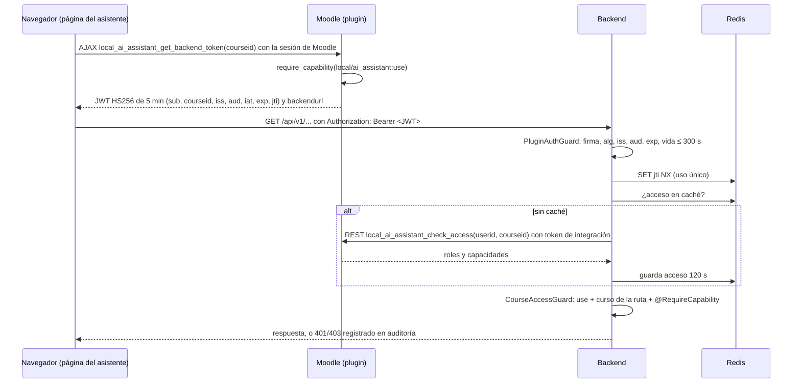

# Autenticación y autorización

Implementación del Sprint 3 de [ADR-006](adr/0006-jwt-plugin-backend.md) (JWT entre el plugin y el
backend) y [ADR-007](adr/0007-validacion-capacidades-moodle.md) (permisos consultados a Moodle).
Requisitos: RF-01, RF-02 y RF-19.

## Flujo

## Piezas

| Pieza                               | Ubicación                                                          | Responsabilidad                                                                                                                              |
| ----------------------------------- | ------------------------------------------------------------------ | -------------------------------------------------------------------------------------------------------------------------------------------- |
| Emisor de tokens                    | `moodle/local/ai_assistant/classes/local/token_issuer.php`         | Firma el JWT con el secreto de los ajustes del plugin                                                                                        |
| `get_backend_token`                 | `moodle/local/ai_assistant/classes/external/get_backend_token.php` | Función AJAX con la sesión del usuario; exige `use` en el curso                                                                              |
| `check_access`                      | `moodle/local/ai_assistant/classes/external/check_access.php`      | Función REST solo para el usuario de integración (`checkaccess`)                                                                             |
| `verifyPluginToken`                 | `apps/api/src/auth/plugin-token.ts`                                | Verificación HS256 con `node:crypto` y comparación en tiempo constante                                                                       |
| `PluginAuthGuard`                   | `apps/api/src/auth/plugin-auth.guard.ts`                           | Guard global; `@Public()` lo omite                                                                                                           |
| `RedisJtiStore`                     | `apps/api/src/auth/jti-store.ts`                                   | `SET jti:<id> NX EX <ttl>`: cada token sirve una vez                                                                                         |
| `AccessService`                     | `apps/api/src/auth/access.service.ts`                              | Llama a `check_access` y guarda el resultado 120 s en Redis                                                                                  |
| `CourseAccessGuard`                 | `apps/api/src/auth/course-access.guard.ts`                         | Exige `use`, curso de la ruta igual al del token y capacidades extra                                                                         |
| `AuditService`                      | `apps/api/src/audit/audit.service.ts`                              | Registra `auth.denied` y `access.denied` en `audit_events`                                                                                   |
| `publish_section`, `publish_module` | `moodle/local/ai_assistant/classes/external/`                      | Crean contenido para un docente; exigen `createcontent` al usuario de integración y los permisos del docente ([publicación](publicacion.md)) |

## Decisiones de detalle

- **Algoritmo fijo.** El backend solo acepta HS256 y no lee el algoritmo del encabezado para decidir; un token con `alg: none` o HS512 se rechaza.
- **Tokens de un solo uso.** El navegador pide un token nuevo por cada llamada al backend. Evita reutilizar un token interceptado, a cambio de una llamada AJAX extra a Moodle.
- **Falla cerrado.** Sin secreto configurado, sin Redis o sin respuesta de Moodle, el backend responde 503 en lugar de permitir el acceso.
- **Caché de permisos de 120 s.** Un cambio de rol en Moodle tarda como máximo 2 minutos en aplicarse (RF-02 pide ≤ 5).
- **Curso de la ruta.** Si una ruta tiene `:courseId`, debe ser el curso del token; se rechaza antes de consultar Moodle.
- **Auditoría sin datos sensibles.** Se guardan acción, resultado, IDs de Moodle, código de error, método y ruta sin query string. Nunca el token.
- **Escritura en nombre del docente.** El usuario de integración solo puede crear contenido si el docente indicado tiene `publish`, `course:manageactivities` (o `course:update`) y `mod/<tipo>:addinstance` en el curso; Moodle decide, no el backend. Detalle en [publicación](publicacion.md).
- **CORS explícito.** Solo los orígenes de `CORS_ORIGINS` pueden llamar al backend desde el navegador; no se usan cookies.

## Códigos de error

| HTTP | `code`                 | Causa                                                        |
| ---- | ---------------------- | ------------------------------------------------------------ |
| 401  | `TOKEN_MISSING`        | Sin encabezado `Authorization: Bearer`                       |
| 401  | `TOKEN_INVALID`        | Firma, algoritmo, emisor, audiencia, vida o claims inválidos |
| 401  | `TOKEN_EXPIRED`        | `exp` vencido más allá de 30 s de tolerancia                 |
| 401  | `TOKEN_REPLAYED`       | El `jti` ya se usó                                           |
| 403  | `FORBIDDEN_COURSE`     | Sin `local/ai_assistant:use` o curso de la ruta distinto     |
| 403  | `FORBIDDEN_CAPABILITY` | Falta una capacidad pedida con `@RequireCapability`          |
| 503  | `AUTH_NOT_CONFIGURED`  | Falta `PLUGIN_JWT_SECRET` o `MOODLE_BASE_URL`                |
| 503  | `AUTH_UNAVAILABLE`     | Redis no respondió al registrar el `jti`                     |
| 503  | `MOODLE_UNAVAILABLE`   | Moodle no respondió a `check_access`                         |

## Evidencia

| Caso del plan de pruebas                       | Cómo se verificó                                                                                         |
| ---------------------------------------------- | -------------------------------------------------------------------------------------------------------- |
| SEC-01 Docente consulta un curso ajeno         | `docente3` contra `IS-501-DEMO`: 403 en el backend; Moodle redirige la página del asistente              |
| SEC-02 Estudiante usa herramientas del docente | `estudiante01`: 403 en el backend; `required_capability_exception` en Moodle y en AJAX                   |
| SEC-03 Token inválido, expirado o reutilizado  | Pruebas unitarias y e2e; token real de PHP reutilizado contra Redis real: 401 `TOKEN_REPLAYED`           |
| SEC-09 Fuga de secretos en logs                | Prueba e2e de auditoría sin firma del token; logs con `authorization` redactado                          |
| Interoperabilidad PHP → Node                   | Token emitido por `token_issuer` aceptado por `verifyPluginToken` con Moodle y Redis reales              |
| Flujo completo en navegador                    | Página del asistente en Chrome como `docente1`: conexión y capacidades mostradas, sin errores en consola |
