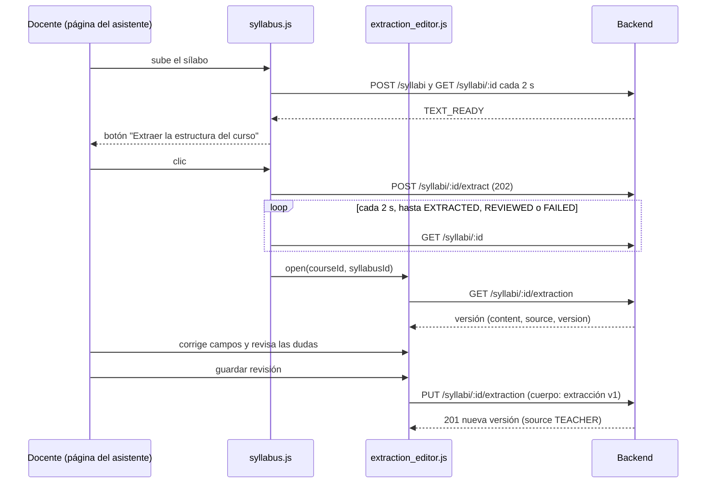

# Editor de la extracción

Implementación de la parte del plugin del Sprint 5 (RF-06): el docente revisa y corrige en Moodle la
estructura que el asistente extrae del sílabo. La extracción con IA y su API las construye el
Sprint 5 de la línea de IA; este documento fija lo que el editor espera de ellas, para que las dos
partes se integren sin sorpresas.

## Flujo

Si el docente vuelve a la página, `index.php?courseid=<id>&syllabusid=<uuid>` retoma el sílabo en el
estado en que esté: ofrece extraer si está en `TEXT_READY` y abre el editor si está en `EXTRACTED` o
`REVIEWED`.

## Módulos

| Archivo (en `moodle/local/ai_assistant/amd/src/`) | Responsabilidad                                                            |
| ------------------------------------------------- | -------------------------------------------------------------------------- |
| `extraction_model.js`                             | Lógica pura: rutas, ediciones, notas de revisión, validación y coherencia  |
| `extraction_editor.js`                            | Dibuja el formulario, enlaza eventos y guarda; no tiene reglas de negocio  |
| `syllabus.js`                                     | Carga, seguimiento del estado, botón de extracción y apertura del editor   |
| `assistant.js`                                    | `callBackend` con token de un solo uso; ahora acepta cuerpos JSON (`json`) |

## Qué hace el editor

- Edita curso, resultados de aprendizaje, periodos de calificación, unidades (temas, fechas,
  resultados vinculados), actividades (tipo, fecha, ponderación, revisión), metodologías, recursos,
  instrumentos y bibliografía. Se pueden agregar y quitar elementos.
- **Indicador de confianza.** Cada campo listado en `uncertainFields` muestra el motivo (`missing`,
  `ambiguous`, `low_confidence`, `inconsistent`) y su nota. Editar el campo o pulsar "Marcar como
  revisado" lo quita de la lista. Las notas que no corresponden a un campo visible (por ejemplo, una
  lista completa) aparecen arriba para que no se pierdan.
- **Fuentes.** Si `sourceReferences` cita la página de un dato, se muestra junto al campo.
- **Valores vacíos.** Un campo opcional vacío se guarda como `null`, nunca como cadena vacía: el
  editor no inventa fechas ni ponderaciones.
- **Errores de campo** (bloquean el guardado): textos obligatorios vacíos, ponderaciones fuera de
  0–100, fechas inválidas e identificadores de resultado con caracteres no permitidos. Son los
  mismos valores que rechaza `syllabusExtractionSchema`.
- **Advertencias de coherencia** (no bloquean): las siete reglas de `findConsistencyIssues`
  (`packages/contracts`). El editor las recalcula al escribir; una prueba compara su resultado con el
  de `packages/contracts` para que no se separen.
- Renombrar o quitar un resultado de aprendizaje actualiza las referencias de unidades y
  actividades; al quitar un elemento, las notas y fuentes de los elementos siguientes se
  reindexan.
- Avisa al salir de la página con cambios sin guardar.

## Contrato que el editor espera del backend

Está en [`docs/api/openapi.yaml`](../api/openapi.yaml); estos son los puntos que el editor usa.

| Ruta                          | Lo que el editor espera                                                                            |
| ----------------------------- | -------------------------------------------------------------------------------------------------- |
| `POST /syllabi/:id/extract`   | 202 y el sílabo; después `GET /syllabi/:id` pasa a `EXTRACTED` o `FAILED`                          |
| `GET /syllabi/:id/extraction` | Última versión: `{ version, source, content, consistencyIssues, createdAt }`                       |
| `PUT /syllabi/:id/extraction` | Cuerpo: la extracción v1. 201 con la nueva versión (`source: "TEACHER"`) y el sílabo en `REVIEWED` |

Puntos que la línea de IA debe confirmar o decidir (el editor se adapta con un cambio pequeño):

1. Mientras corre la extracción, el estado puede seguir en `TEXT_READY` o pasar a `PROCESSING`; el
   editor espera hasta ver `EXTRACTED`, `REVIEWED` o `FAILED`, así que sirve cualquiera de las dos.
2. Los códigos de `errorCode` de una extracción fallida. Hoy `syllabus.js` muestra el mensaje
   genérico "No se pudo extraer el texto"; conviene añadir cadenas para los códigos nuevos en
   `FAILURE_STRINGS`.
3. El editor guarda con `PUT` usando el esquema v1 completo, incluidos `uncertainFields` y
   `sourceReferences` ya depurados por el docente. El backend debe validar con
   `syllabusExtractionSchema` y responder `400 VALIDATION_ERROR` si no cumple.
4. Un sílabo ya `REVIEWED` puede volver a guardarse (nueva versión sin cambiar de estado).

## Cómo trabajar sin la API

El editor se probó con la extracción de ejemplo de `packages/contracts` (`buildSyllabusExtraction`) y
un doble de `callBackend`. Esas pruebas están en `infra/amd/tests/` y se ejecutan con
`pnpm --filter @smart-lms/plugin-js test` (también con `pnpm test`):

- `extraction_model.test.mjs`: lógica pura y comparación con las reglas de `packages/contracts`.
- `extraction_editor.test.mjs`: el editor en un DOM simulado (jsdom): carga, indicador de confianza,
  validación, estructura y guardado. El doble de `core/str` lee las cadenas reales del archivo de
  idioma en inglés, así que una cadena faltante hace fallar la prueba.

## Pendiente

- Comprobar el editor en Moodle con la API real cuando la línea de IA entregue las rutas.
- La verificación visual en un navegador contra Moodle queda para la integración; en este sprint solo
  se probó en un DOM simulado.
- Listado de sílabos del curso: hoy no existe `GET /syllabi`; el docente retoma un sílabo con el
  parámetro `syllabusid` de la URL.
