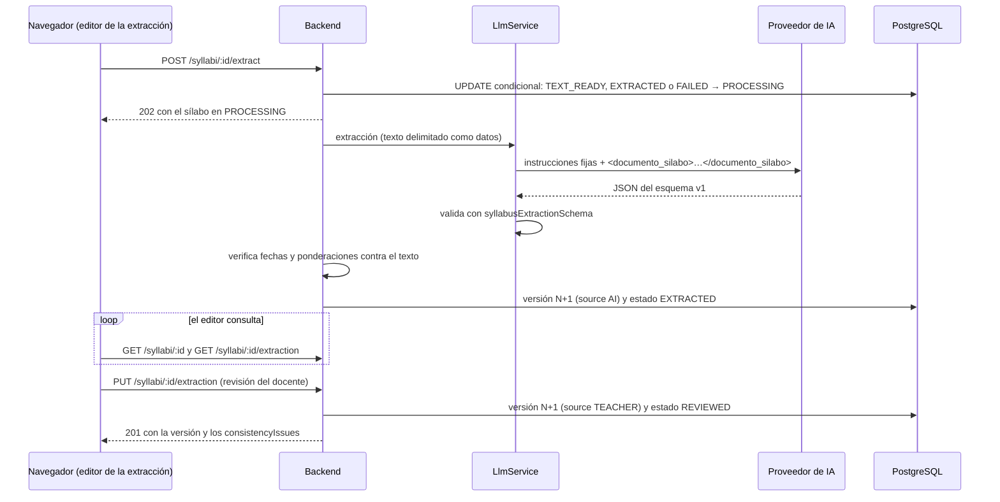

# Extracción estructurada con IA

Implementación del Sprint 5: del texto del sílabo (`extracted_text`, ver
[procesamiento de sílabos](procesamiento-silabos.md)) al esquema v1 revisado por el docente (RF-05 y
RF-06). Decisiones en [ADR-009](adr/0009-abstraccion-proveedor-llm.md) y
[ADR-016](adr/0016-extraccion-ia-versiones-inmutables.md).

## Flujo

## Estados del sílabo

| Desde                                           | Hacia        | Cuándo                                                            |
| ----------------------------------------------- | ------------ | ----------------------------------------------------------------- |
| `TEXT_READY`                                    | `PROCESSING` | `POST /syllabi/:id/extract`                                       |
| `EXTRACTED`, `FAILED`                           | `PROCESSING` | Reintento con `POST /syllabi/:id/extract` (exige texto extraído)  |
| `PROCESSING`                                    | `PROCESSING` | Solo si lleva más de 10 minutos: se da por perdida y se reintenta |
| `PROCESSING`                                    | `EXTRACTED`  | La IA devolvió una salida válida                                  |
| `PROCESSING`                                    | `FAILED`     | Falló la IA; `errorCode` dice por qué                             |
| `TEXT_READY`, `EXTRACTED`, `FAILED`, `REVIEWED` | `REVIEWED`   | `PUT /syllabi/:id/extraction`                                     |

`REVIEWED` es el estado que exige `POST /proposals`. Desde `REVIEWED` no se puede volver a extraer
(`409 INVALID_TRANSITION`), para no perder la revisión del docente. Si el docente guarda su revisión
mientras la IA todavía trabaja, el resultado de la IA se descarta: no se pisa.

### Códigos de fallo (`errorCode`)

| Código                    | Causa                                                 |
| ------------------------- | ----------------------------------------------------- |
| `AI_PROVIDER_UNAVAILABLE` | No hay proveedor configurado o respondió con un error |
| `AI_TIMEOUT`              | No respondió en `AI_TIMEOUT_MS`                       |
| `AI_INVALID_OUTPUT`       | La salida no cumple el esquema v1                     |
| `AI_LIMIT_EXCEEDED`       | El texto estimado supera `AI_MAX_INPUT_TOKENS`        |
| `EXTRACTION_FAILED`       | Cualquier otro error interno                          |

## Rutas

| Método | Ruta                      | Respuesta | Notas                                                                                                                         |
| ------ | ------------------------- | --------- | ----------------------------------------------------------------------------------------------------------------------------- |
| POST   | `/syllabi/:id/extract`    | 202       | Sílabo en `PROCESSING`. `409 INVALID_TRANSITION` si no está listo o ya se procesa                                             |
| GET    | `/syllabi/:id/extraction` | 200       | Última versión, o la de `?version=`. `404 EXTRACTION_NOT_FOUND` si todavía no hay                                             |
| PUT    | `/syllabi/:id/extraction` | 201       | Versión nueva `TEACHER`. `400` con `details` si no cumple el esquema; `409 VERSION_CONFLICT` si otra revisión ganó la versión |

Un sílabo de otro curso responde `404 SYLLABUS_NOT_FOUND`, igual que uno que no existe. Las tres rutas
exigen la capacidad `use`.

## Versiones

Cada resultado, de la IA o del docente, es una fila nueva de `syllabus_extractions` con `version` creciente
(`UNIQUE(document_id, version)`) y nunca se modifica. `source` es `AI` o `TEACHER`; `llm_model` guarda el
modelo de las versiones de IA y `created_by` el docente de las de `TEACHER`. Dos revisiones simultáneas
calculan la misma versión: la segunda choca con la restricción y responde `409 VERSION_CONFLICT`.

## Defensa contra datos inventados y prompt injection

| Capa                         | Dónde                                                | Qué hace                                                                                                      |
| ---------------------------- | ---------------------------------------------------- | ------------------------------------------------------------------------------------------------------------- |
| Instrucciones fijas          | `apps/api/src/syllabi/extraction/syllabus-prompt.ts` | Nunca incluyen texto del documento; dicen que lo de dentro de `<documento_silabo>` son datos                  |
| Delimitador                  | `neutralizeDelimiters`                               | Un documento que trae `</documento_silabo>` para «salir» del bloque pierde el ángulo                          |
| Esquema                      | `LlmService` con `syllabusExtractionSchema`          | Una salida que no cumple el esquema v1 es `AI_INVALID_OUTPUT`                                                 |
| Verificación contra el texto | `apps/api/src/syllabi/extraction/grounding.ts`       | Una fecha o ponderación que no está escrita en el documento se anula (`null`) y se marca en `uncertainFields` |
| Citas                        | `groundExtraction`                                   | Una cita con página inexistente o con un fragmento que no está en el texto pierde ese dato                    |

La verificación acepta varias formas de escribir una fecha (`2026-12-04`, `04/12/2026`, `4 de diciembre`) y
de una ponderación (`12,5`, `12.5`). Es deliberadamente estricta: ante un formato que no reconoce, anula el
dato y pide revisión en lugar de aceptarlo. **Límite conocido:** si el propio documento contiene el valor
(por ejemplo, un sílabo hostil que escribe «100»), la verificación no puede distinguir contenido de
instrucción; el resto de las capas y la revisión del docente cubren ese caso.

El mensaje de las excepciones no se registra en el log ni en la auditoría: puede citar fragmentos del
documento. La auditoría guarda solo metadatos escalares (`syllabus.extraction`, `syllabus.extraction.review`).

## Piezas

| Pieza                       | Ubicación                                                        |
| --------------------------- | ---------------------------------------------------------------- |
| `SyllabusExtractorService`  | `apps/api/src/syllabi/extraction/syllabus-extractor.service.ts`  |
| `SyllabusExtractionService` | `apps/api/src/syllabi/extraction/syllabus-extraction.service.ts` |
| Métricas de calidad         | `packages/contracts/src/syllabus/evaluation.ts`                  |
| Medidor de F1               | `infra/scripts/evaluate-extraction.mjs` (`pnpm eval:extraction`) |

## Medición de calidad (IA-01 e IA-02)

`pnpm eval:extraction [directorio] [--check]` compara, por cada sílabo, `<nombre>.expected.json` (la
extracción correcta, revisada por un docente) con `<nombre>.actual.json` (lo que devolvió el sistema). Ambos
deben cumplir el esquema v1. Por defecto lee `tests/fixtures/extraction-reference/`.

Criterio de coincidencia, fijado antes de medir: un elemento es verdadero positivo si su texto normalizado
(sin tildes, mayúsculas ni signos) es igual al de un elemento de la referencia aún no emparejado. Unidades y
actividades se comparan por título; los resultados de aprendizaje por descripción, porque el identificador
(`RA1`) es una convención del extractor. Los conteos de todos los sílabos se suman (no se promedian los F1
por documento). Con `--check` el comando termina con código 1 si las unidades están por debajo de 0,85 o los
resultados de aprendizaje por debajo de 0,80, las metas del [plan de pruebas](../testing/plan-pruebas.md).

> [!NOTE]
> El medidor está listo, pero todavía no hay conjunto de referencia: faltan los sílabos reales (D-03). No hay
> ninguna métrica de F1 registrada.

## Pruebas

Todo está probado con el proveedor simulado y una base de datos simulada: `syllabus-extractor.service.spec.ts`,
`syllabus-extraction.service.spec.ts`, `evaluation.test.ts` y los casos de ataque de
[`chat-attacks.spec.ts`](../../apps/api/src/assistant/chat-attacks.spec.ts). Las rutas no se han ejercitado
contra PostgreSQL real ni contra un proveedor de IA real.
