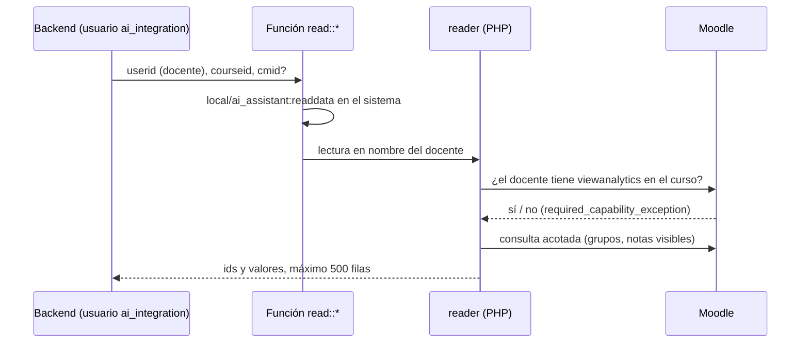

# Lecturas de Moodle para el backend

Siete funciones de servicio web del plugin `local_ai_assistant` que el backend llama para leer los datos
académicos de un curso: actividades, estudiantes, entregas, pendientes de calificar, notas, finalización y último
acceso. Las usan las herramientas del chat, los indicadores y las señales de dificultad. La decisión de devolver
solo ids está en [ADR-017](adr/0017-lecturas-moodle-solo-ids.md) y el contrato de las respuestas, en
[`packages/contracts/src/moodle/read.ts`](../../packages/contracts/src/moodle/read.ts).

## Quién las llama y con qué permisos

- **El usuario de integración** solo puede llamarlas con la capacidad `local/ai_assistant:readdata`, de contexto
  de sistema y sin arquetipos: ningún docente ni estudiante la recibe. `setup_integration.php` se la da al rol
  `smartlmsintegration`.
- **El docente** en cuyo nombre se lee debe existir, estar activo y tener `local/ai_assistant:viewanalytics` en el
  curso. Si no, la función responde con un error de permisos y no devuelve nada. La portada del sitio no es un curso.
- Las funciones están en el servicio `local_ai_assistant_integration` y no son accesibles desde el navegador
  (`ajax => false`).

## Funciones

Todas reciben `userid` y `courseid`. Cada respuesta es un objeto con `truncated` y la lista.

| Función                                  | Parámetros extra | Respuesta                                                                                 |
| ---------------------------------------- | ---------------- | ----------------------------------------------------------------------------------------- |
| `local_ai_assistant_list_activities`     |                  | `activities[]`: `cmid`, `modname`, `name`, `sectionnum`, `visible`, `duedate`, `maxgrade` |
| `local_ai_assistant_list_students`       |                  | `students[]`: `studentid`                                                                 |
| `local_ai_assistant_get_submissions`     | `cmid` (tarea)   | `cmid` y `submissions[]`: `studentid`, `status`, `submittedat`, `late`                    |
| `local_ai_assistant_get_pending_grading` | `cmid?` (o `0`)  | `pending[]`: `cmid`, `studentid`, `submittedat`                                           |
| `local_ai_assistant_get_grades`          | `cmid?` (o `0`)  | `grades[]`: `cmid`, `studentid`, `grade`, `grademax`, `gradedat`                          |
| `local_ai_assistant_get_completion`      |                  | `completion[]`: `cmid`, `studentid`, `completed`, `completedat`                           |
| `local_ai_assistant_get_last_access`     |                  | `lastaccess[]`: `studentid`, `lastaccess`                                                 |

El código está en `classes/external/read.php` (parámetros, estructuras de retorno y comprobación de la capacidad)
y `classes/local/reader.php` (las consultas y las reglas).

## Reglas

| Regla                   | Cómo se cumple                                                                                                                                                                                         |
| ----------------------- | ------------------------------------------------------------------------------------------------------------------------------------------------------------------------------------------------------ |
| Solo ids                | Ninguna respuesta lleva nombres, correos ni cédulas; `PARAM_*` en las estructuras de retorno y el esquema estricto del contrato lo impiden. Una prueba comprueba que no aparecen.                      |
| Estudiantes             | Los matriculados activos que pueden entregar tareas (`mod/assign:submit`). Docentes y matrículas suspendidas quedan fuera.                                                                             |
| Grupos separados        | Con grupos separados, un docente sin `moodle/site:accessallgroups` solo ve a los miembros de sus grupos, en todas las funciones.                                                                       |
| Actividades visibles    | Solo las que el docente ve (`uservisible`) y que no se están borrando. Un `cmid` ajeno al curso o de otro tipo responde `invalid_parameter_exception`.                                                 |
| Fechas                  | ISO-8601 UTC (`2026-11-10T15:30:00Z`); sin fecha, `null`.                                                                                                                                              |
| Notas                   | Número con punto; una nota ausente **no aparece** (nunca un `0`). Una nota oculta, ya sea la actividad o la calificación del estudiante, no se devuelve, salvo que su fecha de visibilidad ya pasó.    |
| Estado de una entrega   | `new` (sin entrega y plazo vigente o sin plazo), `missing` (sin entrega y plazo vencido), `draft`, `submitted` (enviada, sin calificar) y `graded`. `late` es verdadero si se envió después del plazo. |
| Pendientes de calificar | Última entrega con estado `submitted` y sin calificación. Un borrador no cuenta.                                                                                                                       |
| Finalización            | Solo actividades con seguimiento activo y cursos con finalización habilitada. `completed` es verdadero con los estados completa y completa con aprobado; sin registro, no completó.                    |
| Último acceso           | Al curso (`user_lastaccess`); `null` si nunca entró.                                                                                                                                                   |
| Volumen                 | Máximo 500 filas por llamada (`MOODLE_READ_MAX_ROWS`); si se corta, `truncated: true`.                                                                                                                 |
| Librerías de Moodle     | Se cargan con `require_once` dentro de `reader::authorize()`: una petición de servicio web no las carga sola (PHPUnit y CLI sí).                                                                       |

## Pruebas

`tests/external/read_test.php` (18 pruebas de PHPUnit) cubre: que las respuestas no llevan datos personales, cada
función con su caso normal, los cinco estados de entrega, la entrega que aún no vence, `cmid` ajeno o de otro tipo,
pendientes con y sin `cmid`, nota oculta, estudiante sin nota, finalización con y sin seguimiento, último acceso,
grupos separados, un docente sin `viewanalytics` (estudiante y usuario sin matrícula) en las siete funciones, un docente
que llama sin ser el usuario de integración, docentes inexistentes o suspendidos, la portada y el corte a 500 filas.

También se verificó por REST con el token real del usuario de integración, y de punta a punta con
`pnpm smoke:asistente` (ver [integración con la línea de IA](../equipo/integracion-con-ia.md)).
