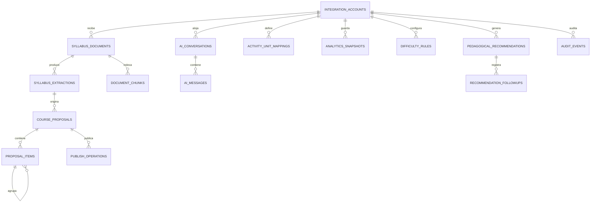
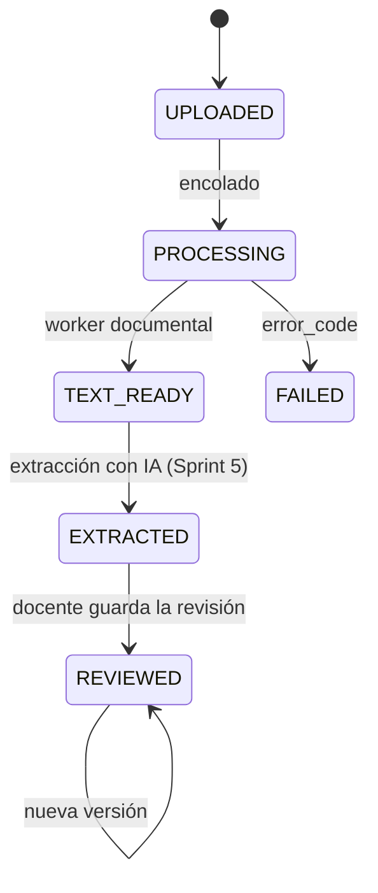
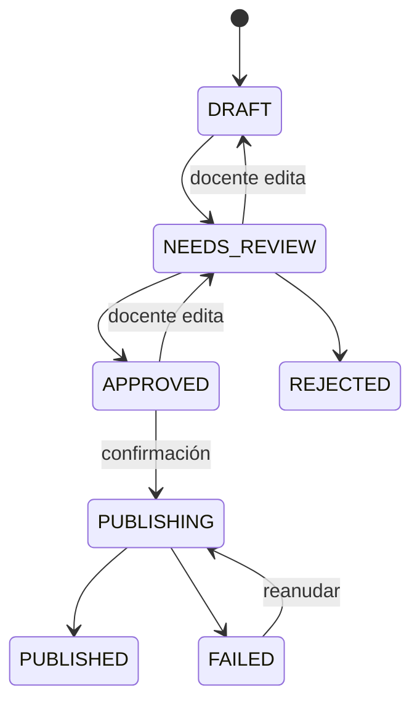

# Modelo de datos de la base auxiliar

Versión 0.3 · Sprint 4. Amplía la sección 8 del
[documento de requisitos](../requisitos/implementacion_lms_inteligente_ia.md) con las entidades que
faltaban y unifica los estados.

**Implementación:** [`apps/api/prisma/schema.prisma`](../../apps/api/prisma/schema.prisma) y la
migraciones `20261109163904_init`, `20261109200000_integration_account_unique_url` y `20261110090000_document_text`. Diferencias con este documento:

- Todas las tablas tienen `id` UUID y `created_at`; las que se editan tienen además `updated_at`.
- `embedding` es `vector` sin dimensión y sin índice HNSW hasta elegir el modelo de embeddings (D-07).
- Las extensiones `vector` y `pgcrypto` se crean al inicio de la migración inicial, no en el esquema de Prisma (su soporte es una función en vista previa).
- `audit_events.integration_account_id` es opcional: un intento no autenticado no tiene cuenta asociada.

## Principios

- Moodle guarda los datos académicos. Aquí solo hay datos de la capa inteligente y **referencias** a IDs de Moodle (`moodle_*_id`).
- No se guardan nombres de estudiantes ni calificaciones copiadas de Moodle, salvo en snapshots de indicadores agregados.
- Los secretos no se guardan en la base: `integration_accounts` guarda una referencia al gestor de secretos.
- Todas las tablas con datos personales tienen fecha de retención o se limpian por una tarea programada (RNF-08).

## Diagrama entidad–relación

## Entidades

Todas tienen `id` UUID y `created_at`. Se omiten en las tablas para abreviar.

### `integration_accounts`

Una instancia de Moodle conectada. En el MVP hay una sola, pero el modelo permite más.

| Campo              | Tipo | Notas                                     |
| ------------------ | ---- | ----------------------------------------- |
| `name`             | text | Nombre de la institución o instancia      |
| `moodle_base_url`  | text | URL base de Moodle; única (Sprint 4)      |
| `token_secret_ref` | text | Referencia al secreto, nunca el token     |
| `jwt_key_ref`      | text | Referencia a la clave de firma del plugin |
| `status`           | enum | `ACTIVE`, `DISABLED`                      |

### `syllabus_documents`

| Campo                    | Tipo           | Notas                                         |
| ------------------------ | -------------- | --------------------------------------------- |
| `integration_account_id` | uuid FK        |                                               |
| `moodle_course_id`       | int            |                                               |
| `uploaded_by`            | int            | ID de usuario Moodle                          |
| `filename`               | text           |                                               |
| `mime_type`              | text           | MIME real detectado                           |
| `size_bytes`             | int            | ≤ 10 MB (RNF-04)                              |
| `checksum_sha256`        | text           | Detecta recargas del mismo archivo            |
| `storage_key`            | text           | Ubicación del archivo; nula tras la retención |
| `status`                 | enum           | `DocumentStatus`                              |
| `error_code`             | text null      | Motivo de rechazo o fallo                     |
| `retain_until`           | timestamp      | Fecha de eliminación del archivo              |
| `extracted_text`         | jsonb null     | `documentTextSchema` (Sprint 4)               |
| `page_count`             | int null       | Páginas; estimadas en DOCX                    |
| `text_extracted_at`      | timestamp null | Fin de la extracción de texto                 |

Índices: `(moodle_course_id, created_at)`, `(moodle_course_id, checksum_sha256)`.

### `syllabus_extractions`

| Campo                | Tipo      | Notas                                                |
| -------------------- | --------- | ---------------------------------------------------- |
| `document_id`        | uuid FK   |                                                      |
| `version`            | int       | Único por documento                                  |
| `schema_version`     | text      | `1.0` (`packages/contracts`)                         |
| `content`            | jsonb     | Cumple `syllabusExtractionSchema`                    |
| `consistency_issues` | jsonb     | Resultado de `findConsistencyIssues`                 |
| `source`             | enum      | `AI` (generada) o `TEACHER` (editada por el docente) |
| `created_by`         | int null  | Usuario Moodle si `source = TEACHER`                 |
| `llm_model`          | text null | Modelo usado si `source = AI`                        |

Restricción: `UNIQUE (document_id, version)`.

### `course_proposals`

| Campo              | Tipo           | Notas                                           |
| ------------------ | -------------- | ----------------------------------------------- |
| `extraction_id`    | uuid FK        | Versión exacta que originó la propuesta (RF-06) |
| `moodle_course_id` | int            |                                                 |
| `created_by`       | int            |                                                 |
| `status`           | enum           | `ProposalStatus`                                |
| `approved_by`      | int null       |                                                 |
| `approved_at`      | timestamp null |                                                 |
| `published_at`     | timestamp null |                                                 |

### `proposal_items`

| Campo                  | Tipo         | Notas                                                              |
| ---------------------- | ------------ | ------------------------------------------------------------------ |
| `proposal_id`          | uuid FK      |                                                                    |
| `parent_id`            | uuid FK null | Actividad dentro de una sección                                    |
| `item_type`            | enum         | `SECTION`, `ASSIGN`, `FORUM`, `QUIZ`, `LABEL`, `PAGE` (según D-05) |
| `title`                | text         |                                                                    |
| `description`          | text null    |                                                                    |
| `position`             | int          |                                                                    |
| `unit_ref`             | text         | Ruta de la unidad en la extracción                                 |
| `learning_outcome_ids` | text[]       |                                                                    |
| `due_date`             | date null    | Solo si existe en la extracción o la confirmó el docente           |
| `weight`               | numeric null |                                                                    |
| `moodle_item_id`       | int null     | `cmid` o `sectionid` creado                                        |
| `publish_status`       | enum         | `PENDING`, `CREATED`, `FAILED`                                     |
| `publish_error`        | text null    |                                                                    |

Índice: `(proposal_id, position)`.

### `publish_operations`

Hace idempotente la publicación (RF-09).

| Campo             | Tipo           | Notas                            |
| ----------------- | -------------- | -------------------------------- |
| `proposal_id`     | uuid FK        |                                  |
| `idempotency_key` | text           | `UNIQUE`; la envía el cliente    |
| `requested_by`    | int            |                                  |
| `status`          | enum           | `RUNNING`, `SUCCEEDED`, `FAILED` |
| `created_count`   | int            |                                  |
| `failed_count`    | int            |                                  |
| `finished_at`     | timestamp null |                                  |

### `document_chunks`

| Campo              | Tipo         | Notas                                                                                                             |
| ------------------ | ------------ | ----------------------------------------------------------------------------------------------------------------- |
| `document_id`      | uuid FK      |                                                                                                                   |
| `moodle_course_id` | int          | Duplicado a propósito para filtrar antes de buscar (RF-14)                                                        |
| `page`             | int null     |                                                                                                                   |
| `chunk_index`      | int          |                                                                                                                   |
| `content`          | text         |                                                                                                                   |
| `embedding`        | vector(1024) | `pgvector`; 1024 es la dimensión de los embeddings de demostración (ADR-019); con el modelo de D-07 puede cambiar |
| `embedding_model`  | text         | Permite reindexar al cambiar de modelo                                                                            |

Índices: `(moodle_course_id)`, único `(document_id, chunk_index)` e índice vectorial HNSW por coseno sobre `embedding`
(creado con SQL: Prisma no lo conoce, ver ADR-019).

### `ai_conversations` y `ai_messages`

| Tabla              | Campo                                  | Notas                                              |
| ------------------ | -------------------------------------- | -------------------------------------------------- |
| `ai_conversations` | `moodle_user_id`, `moodle_course_id`   | Una conversación pertenece a un usuario y un curso |
| `ai_conversations` | `retain_until`                         | Retención configurable                             |
| `ai_messages`      | `role`                                 | `USER`, `ASSISTANT`, `TOOL`                        |
| `ai_messages`      | `content`                              | Texto seudonimizado (ADR-010)                      |
| `ai_messages`      | `intent`, `tool_name`                  | Para métricas                                      |
| `ai_messages`      | `llm_model`, `tokens_in`, `tokens_out` | Control de costos (RNF-07)                         |

### `activity_unit_mappings`

Vincula actividades de Moodle con unidades y resultados de aprendizaje, incluidas las que no creó el
sistema (necesario para el rendimiento por unidad, RF-15).

| Campo                  | Tipo   | Notas                |
| ---------------------- | ------ | -------------------- |
| `moodle_course_id`     | int    |                      |
| `moodle_cm_id`         | int    | `UNIQUE` por curso   |
| `unit_ref`             | text   |                      |
| `learning_outcome_ids` | text[] |                      |
| `source`               | enum   | `PROPOSAL`, `MANUAL` |

### `analytics_snapshots`

Historial para calcular la evolución (RF-15).

| Campo              | Tipo      | Notas                                                                                                 |
| ------------------ | --------- | ----------------------------------------------------------------------------------------------------- |
| `moodle_course_id` | int       |                                                                                                       |
| `moodle_user_id`   | int null  | Nulo para indicadores del curso completo                                                              |
| `taken_by`         | int null  | Docente que abrió el panel (ADR-021)                                                                  |
| `taken_on`         | date null | Día UTC del snapshot                                                                                  |
| `taken_at`         | timestamp |                                                                                                       |
| `indicators`       | jsonb     | `{formula, signals, values}`: versión de la fórmula, cantidad de señales y el valor de cada indicador |

Índices: `(moodle_course_id, moodle_user_id, taken_at)` y único `(integration_account_id, moodle_course_id, taken_by, taken_on)`
(uno por día, curso y docente).

### `difficulty_rules`

| Campo              | Tipo     | Notas                                                                                           |
| ------------------ | -------- | ----------------------------------------------------------------------------------------------- |
| `moodle_course_id` | int null | Nulo = regla institucional por defecto                                                          |
| `rule`             | enum     | `MISSING_REQUIRED`, `GRADE_BELOW_THRESHOLD`, `SUSTAINED_DECLINE`, `REPEATED_OUTCOME_DIFFICULTY` |
| `params`           | jsonb    | Umbral, ventana, cantidad mínima                                                                |
| `enabled`          | bool     |                                                                                                 |

### `pedagogical_recommendations` y `recommendation_followups`

| Tabla                         | Campo                                   | Notas                                 |
| ----------------------------- | --------------------------------------- | ------------------------------------- |
| `pedagogical_recommendations` | `moodle_course_id`, `moodle_student_id` |                                       |
| `pedagogical_recommendations` | `requested_by`                          | Docente                               |
| `pedagogical_recommendations` | `evidence`                              | jsonb con los datos observados usados |
| `pedagogical_recommendations` | `content`                               | jsonb con las secciones de RF-18      |
| `pedagogical_recommendations` | `status`                                | `GENERATED`, `DISMISSED`, `APPLIED`   |
| `recommendation_followups`    | `action_taken`, `observed_result`       | Registro docente (RF-20)              |

### `audit_events`

| Campo                          | Tipo      | Notas                                           |
| ------------------------------ | --------- | ----------------------------------------------- |
| `integration_account_id`       | uuid FK   |                                                 |
| `actor_moodle_id`              | int null  | Nulo si la petición no se autenticó             |
| `moodle_course_id`             | int null  |                                                 |
| `action`                       | text      | Por ejemplo `proposal.publish`, `auth.denied`   |
| `resource_type`, `resource_id` | text null |                                                 |
| `outcome`                      | enum      | `SUCCESS`, `DENIED`, `ERROR`                    |
| `metadata`                     | jsonb     | Sin nombres, notas ni texto de mensajes (RF-19) |

Índices: `(actor_moodle_id, created_at)`, `(moodle_course_id, created_at)`.

## Estados

El documento de requisitos mezclaba los estados del documento y de la propuesta (`EXTRACTED` aparecía
en ambos). Quedan separados así:

### `DocumentStatus`

Un archivo rechazado en la carga (tipo, macros o antivirus) no crea fila: queda solo en `audit_events`. `REJECTED` sigue en el enum, sin uso por ahora.

### `ProposalStatus`

Toda transición que no aparece en el diagrama se rechaza con `409` (RF-08).

## Pendiente

- Dimensión del vector (`N`) y modelo de embeddings: dependen de D-07.
- Valores por defecto de retención: dependen de D-08.
- Tipos de `proposal_items.item_type`: dependen de D-05.
