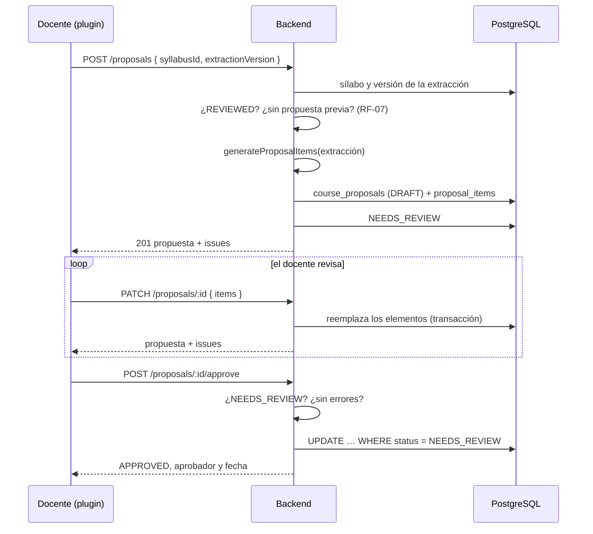
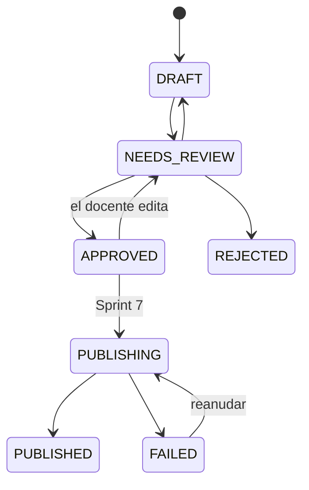

# Propuestas de curso

Implementación del Sprint 6 (RF-07 y RF-08): del resultado de la revisión del docente a una estructura
de curso que se puede editar y aprobar. La publicación en Moodle es el Sprint 7. La decisión de edición y
concurrencia está en [ADR-014](adr/0014-edicion-propuestas-reemplazo-concurrencia.md).

## Flujo



## Piezas del backend (`apps/api/src/proposals/`)

| Archivo                     | Responsabilidad                                                                |
| --------------------------- | ------------------------------------------------------------------------------ |
| `proposal-generator.ts`     | Extracción → elementos propuestos. Función pura                                |
| `activity-type-map.ts`      | Tipo de actividad del esquema v1 → elemento de Moodle (D-05 provisional)       |
| `proposal-policy.ts`        | Política institucional: total de ponderaciones por periodo y tipos permitidos  |
| `proposal-validation.ts`    | `issues` de la revisión: errores (impiden aprobar) y advertencias              |
| `proposal-state-machine.ts` | Transiciones permitidas (RF-08); lo demás responde `409 INVALID_TRANSITION`    |
| `proposal-structure.ts`     | Valida y normaliza los elementos que envía el docente                          |
| `proposal.dto.ts`           | Esquemas Zod de entrada y forma de las respuestas                              |
| `proposals.service.ts`      | Casos de uso: crear, leer, editar, aprobar; auditoría                          |
| `proposals.controller.ts`   | `POST /proposals`, `GET`/`PATCH /proposals/:id`, `POST /proposals/:id/approve` |

## Reglas del generador

- Cada unidad de la extracción es una **sección**; sus temas van en la descripción.
- Cada actividad es un elemento hijo de su sección. Si no tiene resultados de aprendizaje propios, hereda
  los de su unidad; si ninguno los tiene, queda sin vínculo y la revisión lo marca.
- **No se inventa nada.** La fecha y la ponderación son las de la extracción, o `null`.
- `unitRef` guarda la ruta de la unidad (`gradingPeriods[0].units[1]`): es lo que permite sumar
  ponderaciones por periodo.
- El mismo sílabo no genera dos propuestas sin confirmación: `409 PROPOSAL_EXISTS` con el id de la
  existente, salvo `confirmDuplicate: true`. Una propuesta `REJECTED` no cuenta.

### Tipos de Moodle (D-05, provisional)

| Tipo en la extracción               | Elemento de Moodle  |
| ----------------------------------- | ------------------- |
| `assignment`, `practice`, `project` | `ASSIGN` (tarea)    |
| `quiz`, `exam`                      | `QUIZ` (vacío)      |
| `forum`                             | `FORUM`             |
| `resource`                          | `PAGE`              |
| `other`                             | `LABEL` (a revisar) |

## Revisión (`issues`)

| Código                        | Severidad   | Cuándo                                                                 |
| ----------------------------- | ----------- | ---------------------------------------------------------------------- |
| `EMPTY_PROPOSAL`              | error       | No hay secciones                                                       |
| `EMPTY_TITLE`                 | error       | Un elemento no tiene título                                            |
| `ITEM_TYPE_NOT_ENABLED`       | error       | El tipo no está en `enabledItemTypes` de la política (D-05)            |
| `PERIOD_WEIGHTS_EXCEED_TOTAL` | error       | Las ponderaciones de un periodo superan el total de la política (D-04) |
| `PERIOD_WEIGHTS_NOT_TOTAL`    | advertencia | Todas definidas, pero la suma no es el total                           |
| `ACTIVITY_WITHOUT_OUTCOME`    | advertencia | Una actividad sin resultado de aprendizaje (RF-07)                     |
| `SECTION_WITHOUT_ACTIVITIES`  | advertencia | Una sección sin actividades                                            |

Si falta alguna ponderación del periodo no se avisa de la suma: el docente aún debe completarla.
Los valores por defecto (total 100, tolerancia 0.01, todos los tipos permitidos) son provisionales hasta
cerrar **D-04** y **D-05**; se cambian en `DEFAULT_PROPOSAL_POLICY` sin tocar el resto.

## Estados



La prueba de la máquina de estados recorre las 49 combinaciones de origen y destino. `REJECTED` existe
en el modelo, pero el contrato aún no tiene una ruta para rechazar.

## Permisos

| Ruta                                         | Capacidades       |
| -------------------------------------------- | ----------------- |
| `GET /proposals/:id`                         | `use`             |
| `POST /proposals`, `PATCH`, `POST …/approve` | `use` y `publish` |

Una propuesta de otro curso responde `404`, igual que una inexistente. Se audita `proposal.create`,
`proposal.update` y `proposal.approve` con id, cantidad de elementos y versión de la extracción, sin
títulos ni descripciones.

## Vista previa en el plugin

`proposal_model.js` (lógica pura) y `proposal_preview.js` (página):

- Árbol de secciones y actividades con título, descripción, tipo de elemento, fecha, ponderación y
  resultados de aprendizaje; subir, bajar, agregar y quitar.
- Muestra las observaciones del backend (`issues`) por elemento y generales. Describen la última versión
  guardada: con cambios sin guardar se avisa, y **aprobar solo se habilita con todo guardado y sin errores**.
- Los valores vacíos se envían como `null`; `moodleItemId` y `publishStatus` no se envían.
- Estados de solo lectura (`PUBLISHING`, `PUBLISHED`, `REJECTED`, `FAILED`) y aprobada (editable, con aviso).
- Se llega desde el editor de la extracción (botón "Generar la propuesta", solo sobre una versión
  guardada por el docente) o con `index.php?courseid=<id>&proposalid=<uuid>`.
- Si el sílabo ya tiene propuesta, ofrece abrirla o crear otra.

## Pruebas

| Capa                    | Archivo                                                                                                   | Qué cubre                                                    |
| ----------------------- | --------------------------------------------------------------------------------------------------------- | ------------------------------------------------------------ |
| Unitarias del dominio   | `proposal-generator`, `proposal-validation`, `proposal-state-machine`, `proposal-structure` (`*.spec.ts`) | Generador, política, 49 transiciones, estructura             |
| e2e con base en memoria | `apps/api/test/proposals.e2e-spec.ts`                                                                     | Los cuatro endpoints, permisos, curso ajeno, FUN-05, carrera |
| Contra PostgreSQL real  | `apps/api/test/proposals.db.e2e-spec.ts` (opcional)                                                       | Tipos `Decimal` y fecha, cascada, 3 aprobaciones simultáneas |
| JavaScript del plugin   | `infra/amd/tests/proposal_*.test.mjs`                                                                     | Modelo y vista previa en un DOM simulado                     |

La prueba contra PostgreSQL no corre por defecto porque CI no tiene base:

```bash
RUN_DB_TESTS=1 DATABASE_URL=postgresql://app:<clave>@localhost:5543/ai_assistant \
  pnpm --filter @smart-lms/api exec jest proposals.db
```

## Pendiente

- Ruta para rechazar una propuesta (`NEEDS_REVIEW → REJECTED`).
- D-04 y D-05 con la institución: reemplazar la política provisional y la tabla de tipos.
- Verificación visual de la vista previa en Moodle con la API real.
- Publicación (Sprint 7): `POST /proposals/:id/publish` y sus rutas de seguimiento ya están en el contrato.
