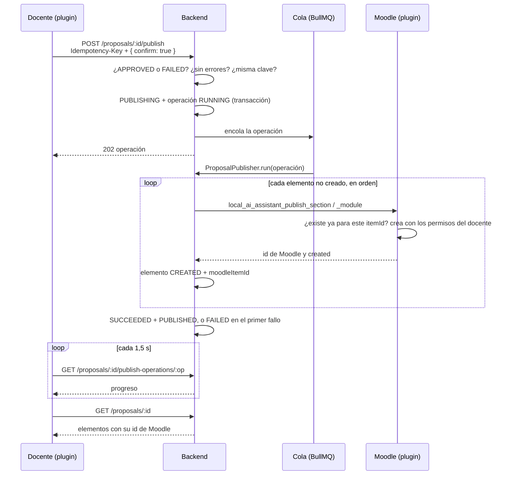

# Publicación en Moodle

Implementación del Sprint 7 (RF-09): crear en el curso las secciones y actividades de una propuesta
aprobada, sin duplicados y con reanudación tras fallos. Las decisiones están en
[ADR-008](adr/0008-creacion-actividades-funcion-externa.md) y
[ADR-015](adr/0015-publicacion-idempotente-identidad-docente.md).

## Flujo



## Backend (`apps/api/src/proposals/`)

| Archivo                                 | Responsabilidad                                                                           |
| --------------------------------------- | ----------------------------------------------------------------------------------------- |
| `proposal-publish.service.ts`           | Inicia o reanuda la publicación; idempotencia por clave; consulta de la operación         |
| `proposal-publisher.ts`                 | Publica elemento por elemento y cierra la operación; códigos de fallo sin datos internos  |
| `publish-dispatcher.ts`                 | Encola la operación (BullMQ, cola `proposal-publish`); sin Redis la ejecuta en el proceso |
| `publish.dto.ts`                        | Cuerpo, cabecera y forma de `PublishOperation`                                            |
| `integrations/moodle/moodle.service.ts` | `publishSection` y `publishModule` (no se reintentan automáticamente)                     |

Reglas:

- Solo se publica una propuesta `APPROVED`, o `FAILED` para reanudarla. La revisión se repite antes de crear
  nada, por si la política cambió desde la aprobación.
- `confirm: true` explícito y `Idempotency-Key` de 16 a 128 caracteres; sin ellos, `400`.
- La misma clave devuelve la misma operación; otra clave sobre una propuesta ya publicada o en publicación
  responde `409 INVALID_TRANSITION`; una clave ya usada en otra propuesta, `409 IDEMPOTENCY_KEY_REUSED`.
- Dos peticiones simultáneas con la misma clave crean una sola operación (índice único de la base).
- Se detiene en el primer fallo. El elemento queda `FAILED` con su causa (`MOODLE_PERMISSION`,
  `MOODLE_UNAVAILABLE`, `MOODLE_BAD_RESPONSE`, `MOODLE_ERROR:<código>` o `PUBLISH_ERROR`); los siguientes
  quedan `PENDING` y la propuesta pasa a `FAILED`.
- Al reanudar, los elementos `FAILED` vuelven a `PENDING` y se salta lo `CREATED`.
- Si no se puede encolar, la operación y la propuesta quedan `FAILED` y la respuesta es `503`.
- La propuesta devuelve `lastPublishOperation`, para retomar el seguimiento al recargar la página.

## Plugin (`moodle/local/ai_assistant/`)

| Archivo                                       | Responsabilidad                                                                      |
| --------------------------------------------- | ------------------------------------------------------------------------------------ |
| `classes/local/publisher.php`                 | Crea secciones y actividades; reconoce lo ya creado; valida permisos del docente     |
| `classes/external/publish_section.php`        | Función `local_ai_assistant_publish_section` (valida parámetros y capacidad técnica) |
| `classes/external/publish_module.php`         | Función `local_ai_assistant_publish_module`                                          |
| `db/install.xml`, `db/upgrade.php`            | Tabla `local_ai_assistant_items` (curso, id del elemento, tipo, id de Moodle)        |
| `db/events.php`, `classes/local/observer.php` | Al borrar un curso se olvida lo publicado en él                                      |
| `db/access.php`                               | Capacidad `local/ai_assistant:createcontent` (solo el usuario de integración)        |

### Funciones externas

| Función                              | Parámetros                                                                         | Devuelve                             |
| ------------------------------------ | ---------------------------------------------------------------------------------- | ------------------------------------ |
| `local_ai_assistant_publish_section` | `userid`, `courseid`, `itemid` (UUID), `name`, `summary`                           | `sectionid`, `sectionnum`, `created` |
| `local_ai_assistant_publish_module`  | `userid`, `courseid`, `itemid`, `sectionid`, `modname`, `name`, `intro`, `duedate` | `cmid`, `created`                    |

Tipos de actividad (D-05 provisional): `assign`, `forum`, `quiz`, `label`, `page`. Valores:

- Las actividades se crean **ocultas** y con el `idnumber` `ai:<uuid>`.
- `duedate` (`AAAA-MM-DD` o vacío) es el final del día en la zona horaria del docente: fecha de entrega en
  tarea y foro, cierre en cuestionario. Sin fecha no se asigna ninguna.
- Un cuestionario se crea vacío; una etiqueta muestra el título y la descripción; una página usa la
  descripción como contenido.
- Nombres de hasta 255 caracteres; descripciones como texto escapado, nunca como HTML.

### Permisos

1. El usuario de integración debe tener `local/ai_assistant:createcontent` en el sistema.
   `infra/moodle/cli/setup_integration.php` la concede al rol de integración (es idempotente).
2. El docente (`userid`) debe estar activo y tener `local/ai_assistant:publish` en el curso, más
   `moodle/course:update` (secciones) o `moodle/course:manageactivities` y `mod/<tipo>:addinstance`
   (actividades). Si no, `required_capability_exception` (`nopermissions`), que el backend registra como
   `MOODLE_PERMISSION`.
3. La sección debe pertenecer al curso; la página principal del sitio no se acepta.
4. Las actividades se crean con `create_module()` actuando como el docente, y la sesión del usuario de
   integración se restaura incluso si falla.

## Panel de publicación (plugin, `publish_panel.js`)

- Aparece con la propuesta aprobada: texto explicativo, casilla de **confirmación explícita** y botón; no
  publica con cambios sin guardar.
- Una clave de idempotencia por intento: si falla el inicio y el docente repite, usa la misma.
- Sigue la operación y muestra el progreso; si se recarga la página, retoma `lastPublishOperation`.
- Al terminar: resumen de lo creado con un enlace a cada elemento (secciones:
  `course/view.php?id=…&sectionid=…`; actividades: `mod/view.php?id=…`) y el aviso de que están ocultas.
- Si se detiene: qué se creó, qué falló y por qué, y un botón para reanudar.

## Pruebas

| Capa                                | Qué cubre                                                                                                                                                             |
| ----------------------------------- | --------------------------------------------------------------------------------------------------------------------------------------------------------------------- |
| PHPUnit del plugin (Moodle real)    | Cada tipo de actividad, repetición sin duplicados, mapeo perdido, borrado en Moodle, zona horaria, fechas inválidas, permisos, identidad restaurada, borrado de curso |
| e2e del backend con Moodle simulado | Publicación, `FUN-06`, `SEC-04`, claves, validación, caída a mitad, respuesta perdida, reanudación, permisos y aislamiento de curso                                   |
| Contra PostgreSQL real (opcional)   | Tres peticiones simultáneas con la misma clave, reanudación                                                                                                           |
| JavaScript del plugin               | Panel: confirmación, progreso, resumen con enlaces, fallo y reanudación, retomar tras recargar                                                                        |

También se verificó de punta a punta con el backend, PostgreSQL, Redis y un Moodle 5.1.8 reales: la
propuesta se publicó (4 elementos creados), repetir con la misma clave devolvió la misma operación y otra
clave respondió `409`. Esa verificación detectó un error que las pruebas no veían: en una petición de
servicio web Moodle no carga `course/lib.php` (en CLI y PHPUnit sí); el publicador lo carga ahora.

```bash
bash infra/scripts/moodle.sh compose exec -T webserver php /var/www/html/admin/cli/upgrade.php --non-interactive
MSYS_NO_PATHCONV=1 bash infra/scripts/moodle.sh compose exec -T webserver vendor/bin/phpunit --testsuite local_ai_assistant_testsuite
```

## Pendiente

- D-05: confirmar con la institución los tipos de actividad y sus valores por defecto.
- Las pruebas PHPUnit no corren en CI (solo `phpcs`); se ejecutan en el entorno local.
- Publicar una propuesta editada tras publicarla (actualizar en lugar de crear) no está soportado: una
  propuesta publicada es de solo lectura.
- La prueba de carga y la verificación visual del panel con la API de IA real quedan para el Sprint 12.
