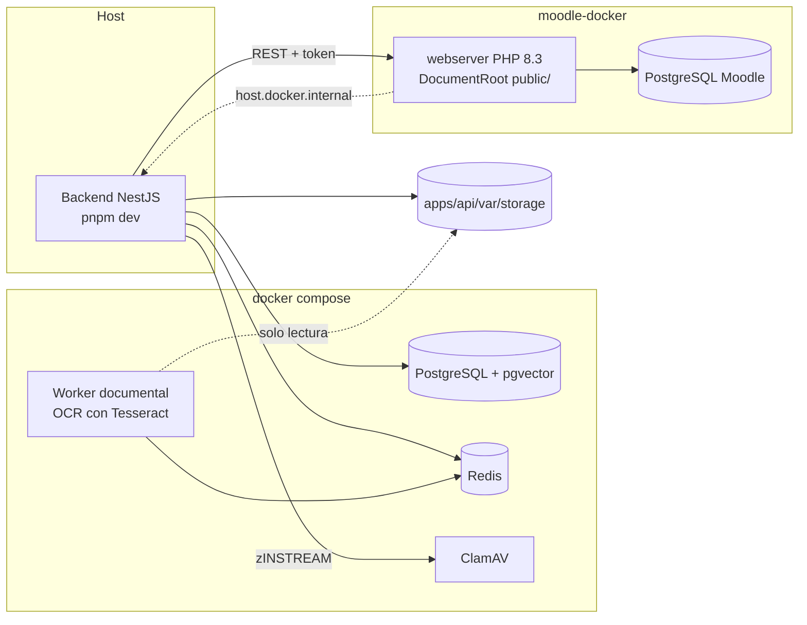

# Entorno de desarrollo local

Cómo levantar Moodle 5.1, la base auxiliar, Redis y el backend en un equipo de desarrollo. Todo usa
datos sintéticos; nunca se cargan datos reales de estudiantes.

## Piezas

| Pieza             | Cómo se levanta                                | Dirección                            |
| ----------------- | ---------------------------------------------- | ------------------------------------ |
| Moodle 5.1.8      | `infra/scripts/moodle.sh` (moodle-docker)      | <http://localhost:8000>              |
| Base de Moodle    | moodle-docker (PostgreSQL)                     | Solo dentro de Docker                |
| Base auxiliar     | `docker compose` (PostgreSQL + pgvector)       | `localhost:${APP_DB_PORT:-5433}`     |
| Redis             | `docker compose`                               | `localhost:${REDIS_PORT:-6379}`      |
| ClamAV            | `docker compose --profile antivirus`           | `localhost:${CLAMAV_PORT:-3310}`     |
| Worker documental | `docker compose --profile worker`              | Sin puertos; solo Redis y el almacén |
| Backend           | `pnpm --filter @smart-lms/api dev`             | `http://localhost:${PORT}/api/v1`    |
| Plugin            | Montado en vivo en `public/local/ai_assistant` | Administración de Moodle             |



## Requisitos

- Docker Desktop (o Docker Engine con Compose v2).
- Node.js 24 o superior y pnpm 12.
- Git Bash en Windows para ejecutar los scripts de `infra/scripts/`.
- Unos 2 GB libres para el código de Moodle y las imágenes.

## Primera vez

Los pasos deben seguir este orden.

1. Clonar el repositorio (`git clone https://github.com/kiramman-mp3/sistema-gestion-aprendizaje-IA.git`), crear el `.env` y completar las contraseñas (`APP_DB_PASSWORD`, `MOODLE_ADMIN_PASSWORD`, `PLUGIN_JWT_SECRET` de al menos 32 caracteres).

   ```bash
   cp .env.example .env
   ```

2. Instalar dependencias y preparar el cliente de Prisma.

   ```bash
   pnpm install
   pnpm --filter @smart-lms/api prisma:generate
   ```

3. Levantar la base auxiliar y Redis, y aplicar las migraciones.

   ```bash
   docker compose up -d
   pnpm --filter @smart-lms/api prisma:deploy
   ```

4. Descargar y levantar Moodle.

   ```bash
   bash infra/scripts/moodle.sh setup
   bash infra/scripts/moodle.sh up
   ```

5. Instalar Moodle, el plugin y el usuario de integración. El script copia al plugin el secreto JWT (`PLUGIN_JWT_SECRET`) y la URL del backend (`http://localhost:${PORT}/api/v1`). Al final se imprime el token: cópialo en `MOODLE_TOKEN` del `.env`.

   ```bash
   bash infra/scripts/moodle.sh install
   ```

6. Cargar los datos sintéticos.

   ```bash
   bash infra/scripts/moodle.sh seed
   ```

7. Arrancar el backend y comprobar que ve sus dependencias.

   ```bash
   pnpm --filter @smart-lms/api dev
   curl http://localhost:3000/api/v1/health
   ```

8. Entrar a <http://localhost:8000> como `docente1`, abrir el curso `IS-501-DEMO` y, en **More**, elegir **AI assistant** (**Más** y **Asistente IA** con Moodle en español). La página debe mostrar que está conectada con el backend y los permisos del docente.

> [!NOTE]
> El código de Moodle no se monta desde el host: `moodle.sh setup` lo clona dentro del volumen de
> Docker `smart-lms-moodle_moodle_code`. En Windows, montarlo desde NTFS hacía que la instalación
> tardara horas; con el volumen, la instalación toma unos 3 minutos. Solo el plugin y los scripts CLI
> se montan desde el repositorio. Las siguientes veces basta con `moodle.sh up`.
>
> `moodle.sh down` elimina la base de datos de Moodle; el código en el volumen se conserva. Para
> recrear la instalación: `down`, `up`, `install` y `seed`, y copia el nuevo token en `.env`.

## Uso diario

| Tarea                                              | Comando                                                                                                                                                                                                     |
| -------------------------------------------------- | ----------------------------------------------------------------------------------------------------------------------------------------------------------------------------------------------------------- |
| Levantar todo                                      | `docker compose up -d && bash infra/scripts/moodle.sh up`                                                                                                                                                   |
| Detener Moodle                                     | `bash infra/scripts/moodle.sh down`                                                                                                                                                                         |
| Detener base auxiliar y Redis                      | `docker compose down`                                                                                                                                                                                       |
| Backend en modo desarrollo                         | `pnpm --filter @smart-lms/api dev`                                                                                                                                                                          |
| Crear una migración                                | `pnpm --filter @smart-lms/api prisma:migrate -- --name <nombre>`                                                                                                                                            |
| Reaplicar secreto JWT y URL del backend            | `bash infra/scripts/moodle.sh configure`                                                                                                                                                                    |
| Recompilar el JavaScript del plugin                | `pnpm build:amd` (CI exige que `amd/build` esté al día: `pnpm check:amd`)                                                                                                                                   |
| Rotar el token de Moodle                           | `bash infra/scripts/moodle.sh compose exec webserver php /opt/smart-lms/cli/setup_integration.php --rotate`                                                                                                 |
| Revisar el código PHP                              | `bash infra/scripts/phpcs.sh`                                                                                                                                                                               |
| Preparar PHPUnit (una vez por instalación)         | `MSYS_NO_PATHCONV=1 bash infra/scripts/moodle.sh compose exec -T webserver php public/admin/tool/phpunit/cli/init.php`                                                                                      |
| Aplicar un cambio del plugin en la base            | `MSYS_NO_PATHCONV=1 bash infra/scripts/moodle.sh compose exec -T webserver php /var/www/html/admin/cli/upgrade.php --non-interactive` (tras subir `$plugin->version`; crea tablas, capacidades y funciones) |
| Pruebas PHPUnit del plugin                         | `MSYS_NO_PATHCONV=1 bash infra/scripts/moodle.sh compose exec -T webserver vendor/bin/phpunit --testsuite local_ai_assistant_testsuite`                                                                     |
| Backend en contenedor                              | `docker compose --profile api up -d --build` (ver problemas conocidos)                                                                                                                                      |
| Antivirus para las cargas                          | `docker compose --profile antivirus up -d` (el primer arranque tarda unos minutos)                                                                                                                          |
| Worker documental con el backend en el host        | `WORKER_STORAGE_SOURCE=./apps/api/var/storage docker compose --profile worker up -d --build document-worker`                                                                                                |
| Pruebas contra PostgreSQL real (opcional)          | `RUN_DB_TESTS=1 DATABASE_URL=postgresql://app:<clave>@localhost:<puerto>/ai_assistant pnpm --filter @smart-lms/api exec jest proposals.db`                                                                  |
| API de IA simulada (chat, extracción, analítica)   | `pnpm --filter @smart-lms/contracts build && pnpm mock:ai` (puerto 3100); ver [integración con la línea de IA](../equipo/integracion-con-ia.md)                                                             |
| Prueba de carga del backend                        | `RATE_LIMIT_PER_MINUTE=0` en el backend y `pnpm loadtest -- --scenario session --concurrency 20 --duration 15`                                                                                              |
| Verificación de punta a punta (propuesta → Moodle) | `pnpm smoke:publicacion` (con el backend y Moodle levantados; borra lo que crea)                                                                                                                            |
| Pruebas del JavaScript del plugin                  | `pnpm --filter @smart-lms/plugin-js test`                                                                                                                                                                   |
| Pruebas del worker                                 | `pnpm --filter @smart-lms/document-worker test`                                                                                                                                                             |

## Datos sintéticos

`infra/moodle/cli/seed.php` crea datos deterministas:

| Elemento    | Detalle                                                                                                                                                     |
| ----------- | ----------------------------------------------------------------------------------------------------------------------------------------------------------- |
| Cursos      | `IS-501-DEMO` (12 estudiantes) y `BD-301-DEMO` (8 estudiantes)                                                                                              |
| Docentes    | `docente1` (edición, IS-501), `docente2` (sin edición, IS-501), `docente3` (edición, BD-301)                                                                |
| Estudiantes | `estudiante01` a `estudiante12`                                                                                                                             |
| Tareas      | 3 en IS-501 y 2 en BD-301, vencidas y por vencer, con entregas sin enviar, en borrador, a tiempo y tardías; calificadas total, parcialmente o sin calificar |
| Contraseña  | `Demo#2026` por defecto (`seed --password=...` para cambiarla)                                                                                              |

`docente3` no tiene acceso a `IS-501-DEMO`: sirve para la prueba SEC-01 (curso ajeno).

### Curso de prueba del asistente

`infra/moodle/cli/seed_curso_prueba.php` crea, aparte, un curso para probar el chat, la analítica y las funciones de
lectura de punta a punta:

```bash
MSYS_NO_PATHCONV=1 bash infra/scripts/moodle.sh compose exec -T webserver php /opt/smart-lms/cli/seed_curso_prueba.php
```

| Elemento      | Detalle                                                                                                                                                                                                  |
| ------------- | -------------------------------------------------------------------------------------------------------------------------------------------------------------------------------------------------------- |
| Curso         | `AN-401-PRUEBA`, con finalización habilitada y 5 secciones                                                                                                                                               |
| Personas      | `prueba_docente` (edición), `prueba_ajeno` (sin matrícula: prueba el rechazo de permisos) y `prueba_est01` a `prueba_est12` con nombres ficticios reconocibles (Carla, Andrés…)                          |
| Actividades   | 3 tareas, un foro, un cuestionario, una página y una etiqueta                                                                                                                                            |
| Entregas      | Tarea 1: 9 a tiempo, 2 tardías y 1 sin entrega, todas calificadas. Tarea 2: 1 pendiente de calificar, 3 sin entrega y 8 calificadas. Tarea 3 (vence en 4 días): 3 enviadas, 3 borradores y 6 sin entrega |
| Notas         | Perfiles alto, medio, con entregas tardías y en descenso; el cuestionario tiene 10 notas y la del estudiante 04 está oculta                                                                              |
| Finalización  | 46 actividades completadas (seguimiento manual)                                                                                                                                                          |
| Último acceso | 11 estudiantes con acceso (3 con más de 14 días) y el 11 nunca entró                                                                                                                                     |
| Contraseña    | `Demo#2026` por defecto (`--password=...`)                                                                                                                                                               |

Los plazos son relativos a hoy. Con `--recrear` se borra el curso y se vuelve a crear; los usuarios `prueba_*` se
conservan. Sin esa opción, si el curso ya existe, el script se detiene.

Con el backend en marcha (`AI_PROVIDER=mock pnpm --filter @smart-lms/api dev`), `pnpm smoke:asistente` comprueba el
chat y la analítica contra este curso.

## Usuario de integración

`infra/moodle/cli/setup_integration.php` aplica mínimo privilegio:

- Usuario `ai_integration` con autenticación `webservice` (no puede entrar por la web).
- Rol `smartlmsintegration` en contexto de sistema con solo `webservice/rest:use`, `local/ai_assistant:checkaccess` (preguntar a Moodle qué puede hacer un docente en un curso), `local/ai_assistant:createcontent` (publicar) y `local/ai_assistant:readdata` (las [lecturas de Moodle](../architecture/lecturas-moodle.md)).
- Tras subir `$plugin->version` hay que ejecutar `upgrade.php` y luego `setup_integration.php`, para que el rol reciba las capacidades nuevas.
- Autorizado únicamente en el servicio restringido `local_ai_assistant_integration`, cuyas funciones define `db/services.php` del plugin.

Cada sprint que agregue funciones al servicio debe añadir también las capacidades que esas funciones
requieran, y documentarlo. `setup_integration.php` es idempotente: al volver a ejecutarlo aplica las
capacidades nuevas sin regenerar el token.

## Conexión del navegador con el backend

La página del asistente se ejecuta en el navegador y llama al backend directamente, por eso:

- La URL del backend del plugin debe ser accesible desde el navegador (`localhost`, no `host.docker.internal`).
- `CORS_ORIGINS` del backend debe incluir el `wwwroot` de Moodle (`http://localhost:8000`).
- `PLUGIN_JWT_SECRET` del backend y el secreto del plugin deben coincidir; `moodle.sh configure` los sincroniza.

El flujo completo está en [autenticación y autorización](../architecture/autenticacion-autorizacion.md).

## Puertos y conflictos

Si otro proyecto usa un puerto, cámbialo en `.env`:

| Variable                 | Por defecto      |
| ------------------------ | ---------------- |
| `PORT` (backend en host) | `3000`           |
| `API_PORT` (contenedor)  | `3000`           |
| `APP_DB_PORT`            | `5433`           |
| `REDIS_PORT`             | `6379`           |
| `CLAMAV_PORT`            | `3310`           |
| `MOODLE_DOCKER_WEB_PORT` | `127.0.0.1:8000` |

## Procesamiento de sílabos

- Sin `CLAMAV_URL`, el backend acepta archivos sin analizarlos y lo avisa en el log; en producción no arranca sin ella.
- El worker en Docker trae Poppler y Tesseract con español. Ejecutado en el host de Windows no tiene OCR y los PDF escaneados terminan en `EMPTY_DOCUMENT`.
- `STORAGE_DIR` relativo se resuelve desde `apps/api` tanto en el backend como en el worker.
- Flujo, estados y códigos de error en [`docs/architecture/procesamiento-silabos.md`](../architecture/procesamiento-silabos.md).

## Problemas conocidos

| Síntoma                                                                                | Causa y solución                                                                                                                                                                     |
| -------------------------------------------------------------------------------------- | ------------------------------------------------------------------------------------------------------------------------------------------------------------------------------------ |
| `rootdirpublic` al abrir Moodle                                                        | El servidor web apunta a la raíz y no a `public/`. Revisa que `local.yml` se copió con `moodle.sh setup`.                                                                            |
| `Could not open input file: C:/Program Files/Git/...`                                  | Git Bash convirtió la ruta. Los scripts ya usan `MSYS_NO_PATHCONV=1`; si ejecutas `docker exec` a mano, añádelo.                                                                     |
| `port is already allocated`                                                            | Otro contenedor usa el puerto. Cambia la variable correspondiente en `.env`.                                                                                                         |
| `Cannot find module './internal/class.js'` en pruebas                                  | Falta generar el cliente: `pnpm --filter @smart-lms/api prisma:generate`.                                                                                                            |
| `"moodle": "down"` con el perfil `api`                                                 | Moodle redirige a su `wwwroot` (`http://localhost:8000`), inaccesible desde el contenedor. Para desarrollar, ejecuta el backend en el host.                                          |
| La página del asistente muestra "No se pudo conectar con el backend (Failed to fetch)" | El backend no está corriendo, la URL del plugin no coincide con su puerto o falta el origen en `CORS_ORIGINS`. Revisa con `moodle.sh configure`.                                     |
| La página muestra `(TOKEN_INVALID)`                                                    | El secreto del plugin y `PLUGIN_JWT_SECRET` no coinciden, o `MOODLE_BASE_URL` no es el `wwwroot` de Moodle.                                                                          |
| `assign_capability` falla con `coding_exception` al ejecutar `setup_integration.php`   | El plugin declara una capacidad nueva que Moodle aún no conoce. Ejecuta `admin/cli/upgrade.php` y vuelve a ejecutar `setup_integration.php` (no regenera el token).                  |
| `Call to undefined function` al llamar una función del plugin por REST                 | En un servicio web Moodle no carga todas sus bibliotecas (CLI y PHPUnit sí). Haz `require_once` de lo que uses y prueba la función con `curl` al servicio REST, no solo con PHPUnit. |
| Una prueba del backend falla por tiempo de espera con Moodle y el backend en marcha    | El equipo está cargado. Detén `pnpm dev` y repite; las suites `cors` y `auth` pasan solas en ~15 s.                                                                                  |
| `ERR_PNPM_IGNORED_BUILDS` en CI o Docker                                               | Un paquete nuevo trae scripts de instalación. Decide si se permiten en `allowBuilds` de `pnpm-workspace.yaml`.                                                                       |
