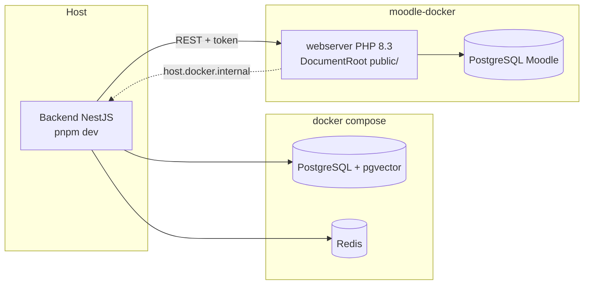

# Entorno de desarrollo local

Cómo levantar Moodle 5.1, la base auxiliar, Redis y el backend en un equipo de desarrollo. Todo usa
datos sintéticos; nunca se cargan datos reales de estudiantes.

## Piezas

| Pieza          | Cómo se levanta                                | Dirección                         |
| -------------- | ---------------------------------------------- | --------------------------------- |
| Moodle 5.1.8   | `infra/scripts/moodle.sh` (moodle-docker)      | <http://localhost:8000>           |
| Base de Moodle | moodle-docker (PostgreSQL)                     | Solo dentro de Docker             |
| Base auxiliar  | `docker compose` (PostgreSQL + pgvector)       | `localhost:${APP_DB_PORT:-5433}`  |
| Redis          | `docker compose`                               | `localhost:${REDIS_PORT:-6379}`   |
| Backend        | `pnpm --filter @smart-lms/api dev`             | `http://localhost:${PORT}/api/v1` |
| Plugin         | Montado en vivo en `public/local/ai_assistant` | Administración de Moodle          |



## Requisitos

- Docker Desktop (o Docker Engine con Compose v2).
- Node.js 24 o superior y pnpm 12.
- Git Bash en Windows para ejecutar los scripts de `infra/scripts/`.
- Unos 2 GB libres para el código de Moodle y las imágenes.

## Primera vez

Los pasos deben seguir este orden.

1. Crear el `.env` y completar las contraseñas (`APP_DB_PASSWORD`, `MOODLE_ADMIN_PASSWORD`, `PLUGIN_JWT_SECRET` de al menos 32 caracteres).

   ```bash
   cp .env.example .env
   ```

2. Instalar dependencias y preparar el cliente de Prisma.

   ```bash
   pnpm install
   pnpm --filter @smart-lms/api prisma:generate
   ```

3. Levantar la base auxiliar y Redis, y aplicar las migraciones.

   ```bash
   docker compose up -d
   pnpm --filter @smart-lms/api prisma:deploy
   ```

4. Descargar y levantar Moodle.

   ```bash
   bash infra/scripts/moodle.sh setup
   bash infra/scripts/moodle.sh up
   ```

5. Instalar Moodle, el plugin y el usuario de integración. Al final se imprime el token: cópialo en `MOODLE_TOKEN` del `.env`.

   ```bash
   bash infra/scripts/moodle.sh install
   ```

6. Cargar los datos sintéticos.

   ```bash
   bash infra/scripts/moodle.sh seed
   ```

7. Arrancar el backend y comprobar que ve sus dependencias.

   ```bash
   pnpm --filter @smart-lms/api dev
   curl http://localhost:3000/api/v1/health
   ```

> [!NOTE]
> El código de Moodle no se monta desde el host: `moodle.sh setup` lo clona dentro del volumen de
> Docker `smart-lms-moodle_moodle_code`. En Windows, montarlo desde NTFS hacía que la instalación
> tardara horas; con el volumen, la instalación toma unos 3 minutos. Solo el plugin y los scripts CLI
> se montan desde el repositorio. Las siguientes veces basta con `moodle.sh up`.
>
> `moodle.sh down` elimina la base de datos de Moodle; el código en el volumen se conserva. Para
> recrear la instalación: `down`, `up`, `install` y `seed`, y copia el nuevo token en `.env`.

## Uso diario

| Tarea                                      | Comando                                                                                                                                 |
| ------------------------------------------ | --------------------------------------------------------------------------------------------------------------------------------------- |
| Levantar todo                              | `docker compose up -d && bash infra/scripts/moodle.sh up`                                                                               |
| Detener Moodle                             | `bash infra/scripts/moodle.sh down`                                                                                                     |
| Detener base auxiliar y Redis              | `docker compose down`                                                                                                                   |
| Backend en modo desarrollo                 | `pnpm --filter @smart-lms/api dev`                                                                                                      |
| Crear una migración                        | `pnpm --filter @smart-lms/api prisma:migrate -- --name <nombre>`                                                                        |
| Rotar el token de Moodle                   | `bash infra/scripts/moodle.sh compose exec webserver php /opt/smart-lms/cli/setup_integration.php --rotate`                             |
| Revisar el código PHP                      | `bash infra/scripts/phpcs.sh`                                                                                                           |
| Preparar PHPUnit (una vez por instalación) | `MSYS_NO_PATHCONV=1 bash infra/scripts/moodle.sh compose exec -T webserver php public/admin/tool/phpunit/cli/init.php`                  |
| Pruebas PHPUnit del plugin                 | `MSYS_NO_PATHCONV=1 bash infra/scripts/moodle.sh compose exec -T webserver vendor/bin/phpunit --testsuite local_ai_assistant_testsuite` |
| Backend en contenedor                      | `docker compose --profile api up -d --build` (ver problemas conocidos)                                                                  |

## Datos sintéticos

`infra/moodle/cli/seed.php` crea datos deterministas:

| Elemento    | Detalle                                                                                                                                                     |
| ----------- | ----------------------------------------------------------------------------------------------------------------------------------------------------------- |
| Cursos      | `IS-501-DEMO` (12 estudiantes) y `BD-301-DEMO` (8 estudiantes)                                                                                              |
| Docentes    | `docente1` (edición, IS-501), `docente2` (sin edición, IS-501), `docente3` (edición, BD-301)                                                                |
| Estudiantes | `estudiante01` a `estudiante12`                                                                                                                             |
| Tareas      | 3 en IS-501 y 2 en BD-301, vencidas y por vencer, con entregas sin enviar, en borrador, a tiempo y tardías; calificadas total, parcialmente o sin calificar |
| Contraseña  | `Demo#2026` por defecto (`seed --password=...` para cambiarla)                                                                                              |

`docente3` no tiene acceso a `IS-501-DEMO`: sirve para la prueba SEC-01 (curso ajeno).

## Usuario de integración

`infra/moodle/cli/setup_integration.php` aplica mínimo privilegio:

- Usuario `ai_integration` con autenticación `webservice` (no puede entrar por la web).
- Rol `smartlmsintegration` en contexto de sistema con solo `webservice/rest:use`.
- Autorizado únicamente en el servicio restringido `local_ai_assistant_integration`, cuyas funciones define `db/services.php` del plugin.

Cada sprint que agregue funciones al servicio debe añadir también las capacidades que esas funciones
requieran, y documentarlo.

## Puertos y conflictos

Si otro proyecto usa un puerto, cámbialo en `.env`:

| Variable                 | Por defecto      |
| ------------------------ | ---------------- |
| `PORT` (backend en host) | `3000`           |
| `API_PORT` (contenedor)  | `3000`           |
| `APP_DB_PORT`            | `5433`           |
| `REDIS_PORT`             | `6379`           |
| `MOODLE_DOCKER_WEB_PORT` | `127.0.0.1:8000` |

## Problemas conocidos

| Síntoma                                               | Causa y solución                                                                                                                            |
| ----------------------------------------------------- | ------------------------------------------------------------------------------------------------------------------------------------------- |
| `rootdirpublic` al abrir Moodle                       | El servidor web apunta a la raíz y no a `public/`. Revisa que `local.yml` se copió con `moodle.sh setup`.                                   |
| `Could not open input file: C:/Program Files/Git/...` | Git Bash convirtió la ruta. Los scripts ya usan `MSYS_NO_PATHCONV=1`; si ejecutas `docker exec` a mano, añádelo.                            |
| `port is already allocated`                           | Otro contenedor usa el puerto. Cambia la variable correspondiente en `.env`.                                                                |
| `Cannot find module './internal/class.js'` en pruebas | Falta generar el cliente: `pnpm --filter @smart-lms/api prisma:generate`.                                                                   |
| `"moodle": "down"` con el perfil `api`                | Moodle redirige a su `wwwroot` (`http://localhost:8000`), inaccesible desde el contenedor. Para desarrollar, ejecuta el backend en el host. |
| `ERR_PNPM_IGNORED_BUILDS` en CI o Docker              | Un paquete nuevo trae scripts de instalación. Decide si se permiten en `allowBuilds` de `pnpm-workspace.yaml`.                              |
