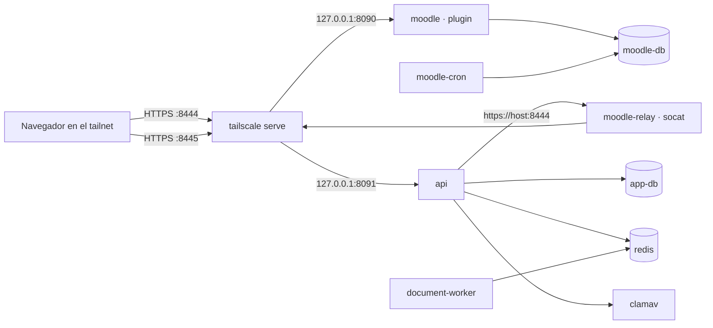

# Despliegue de demostración en un homelab

Cómo se levantó el proyecto completo (Moodle con el plugin, backend, worker, bases, Redis y ClamAV) en un servidor
casero y se publicó con HTTPS dentro de una red de Tailscale. Es una instalación **de demostración con datos
sintéticos**, no de producción: para producción con el Moodle de la institución, ver el
[manual de instalación y operación](instalacion-y-operacion.md).

## Qué se instala



`docker-compose.homelab.yml` se combina con `docker-compose.prod.yml`:

- Quita el proxy Caddy: el TLS lo pone `tailscale serve`, con el certificado de `*.ts.net`.
- Añade un Moodle 5.1.8 propio (`moodle`, `moodle-db`, `moodle-cron`), con el plugin montado en solo lectura y la
  configuración de [`infra/homelab/moodle-config.php`](../../infra/homelab/moodle-config.php).
- Moodle y el backend escuchan solo en `127.0.0.1`.
- `moodle-relay` resuelve un detalle de Tailscale: `tailscale serve` solo atiende el tráfico que entra por la interfaz
  `tailscale0`, así que un contenedor no puede llamar a la dirección pública de Moodle. El backend la necesita porque
  es la misma que firma el JWT del plugin (`MOODLE_BASE_URL`). El relé escucha en la IP del bridge de Docker y
  reenvía la conexión TLS sin descifrarla.

`tailscale serve` (sin Funnel) publica solo dentro del tailnet: el sitio no queda abierto a internet.

## Requisitos

| Recurso  | Valor usado                                                       |
| -------- | ----------------------------------------------------------------- |
| Servidor | Debian 13, x86_64, 4 núcleos, 8 GB de RAM                         |
| Software | Docker 29 con Compose, Tailscale con HTTPS activado en el tailnet |
| Memoria  | Unos 3,5 GB en uso con todo levantado (ClamAV es lo más pesado)   |

## Pasos

### 1. Código y secretos

```bash
git clone https://github.com/kiramman-mp3/sistema-gestion-aprendizaje-ia.git ~/apps/smart-lms
S=~/.config/smart-lms/secrets && mkdir -p "$S" && chmod 700 "$S" && cd "$S"
for f in db_password redis_password moodle_db_password; do openssl rand -hex 24 > $f; done
openssl rand -hex 32 > jwt_secret
printf 'Aa1!%s\n' "$(openssl rand -hex 12)" > moodle_admin_password
chmod 600 * && chmod 644 db_password redis_password moodle_db_password
```

Las tres contraseñas de servicio quedan en 644 porque las leen usuarios del contenedor que no son el dueño del archivo
(postgres, redis, www-data); la carpeta en 700 impide que otros usuarios del servidor lleguen a ellas.

`api.env` lleva `DATABASE_URL`, `REDIS_URL` (con las contraseñas anteriores y los hosts `app-db` y `redis`),
`PLUGIN_JWT_SECRET` (el contenido de `jwt_secret`), `PSEUDONYM_SECRET` (`openssl rand -hex 32`) y, para usar IA real,
`AI_PROVIDER`, `AI_MODEL` y `AI_API_KEY`. `worker.env` solo lleva `REDIS_URL`. `MOODLE_TOKEN` se añade en el paso 4.
No dejes una variable vacía (`MOODLE_TOKEN=`): el backend la rechaza.

### 2. Configuración

```bash
cd ~/apps/smart-lms
cp .env.homelab.example .env.homelab   # completar con el nombre del servidor en el tailnet y `tailscale ip -4`
C="docker compose -p smart-lms --env-file .env.homelab -f docker-compose.prod.yml -f docker-compose.homelab.yml"
```

### 3. Servicios, migraciones y publicación

```bash
$C up -d app-db redis clamav moodle-db moodle-code   # moodle-code copia Moodle en su volumen la primera vez
$C build api document-worker migrate
$C run --rm migrate
$C up -d moodle moodle-cron moodle-relay document-worker
tailscale serve --bg --https=8444 http://127.0.0.1:8090
tailscale serve --bg --https=8445 http://127.0.0.1:8091
```

### 4. Moodle, plugin y usuario de integración

```bash
M="docker exec -i --user www-data smart-lms-moodle-1"
$M php /var/www/html/admin/cli/install_database.php --agree-license --fullname="LMS Inteligente (demostración)" \
  --shortname=lms-demo --adminuser=admin --adminpass="$(cat $S/moodle_admin_password)" --adminemail=admin@example.com
```

La instalación tarda varios minutos: si la sesión SSH se corta, sigue corriendo en el contenedor (hay 490 tablas
`mdl_` cuando termina). Después:

1. Configura el plugin (`set_config` de `jwtsecret` con el contenido de `jwt_secret` y de `backendurl` con
   `https://<servidor>:8445/api/v1`).
2. Ejecuta `php /opt/smart-lms/cli/setup_integration.php` y guarda el token que imprime como `MOODLE_TOKEN` en `api.env`.
3. `$C up -d api`. El estado debe ser `ok` en las cuatro dependencias:
   `curl https://<servidor>:8445/api/v1/health`.
4. Datos sintéticos: `seed.php`, `seed_curso_prueba.php`, `seed_docentes_prueba.php`, `seed_cursos_prueba.php` y
   `cargar_imagenes_cursos.php` en `/opt/smart-lms/cli/`, con `$M php`.

## Uso

Desde un equipo del tailnet, abre `https://<servidor>:8444` e inicia sesión con `prueba_docente` (contraseña de
los datos sintéticos, ver la [guía del entorno local](../desarrollo/entorno-local.md)); el asistente está en
**Más → AI assistant** de un curso, por ejemplo `AN-401-PRUEBA`. El administrador es `admin`, con la contraseña de
`moodle_admin_password`.

## Verificación (2026-11-13)

| Comprobación                                          | Resultado                                                       |
| ----------------------------------------------------- | --------------------------------------------------------------- |
| `GET /health` por HTTPS                               | `ok` en base, Redis, Moodle y antivirus                         |
| Sesión y analítica con un JWT firmado como el plugin  | `200`; 5 indicadores en `AN-401-PRUEBA`                         |
| Chat con Gemini: «¿Quiénes no entregaron la Tarea 3?» | `200`, 6 estudiantes, igual que en el entorno local             |
| Carga de `01-bases-de-datos.pdf` y extracción con IA  | `TEXT_READY` (3 páginas, confianza alta) y 4 unidades extraídas |
| Cron de Moodle                                        | Tareas programadas ejecutándose cada minuto                     |

## Problemas encontrados

| Síntoma                                                                             | Causa y solución                                                                                                                          |
| ----------------------------------------------------------------------------------- | ----------------------------------------------------------------------------------------------------------------------------------------- |
| Redis se reinicia: `Can't open or create append-only dir`                           | Corría como root sin capacidades. Corregido en `docker-compose.prod.yml`: usa el entrypoint de la imagen con `CHOWN`, `SETUID` y `SETGID` |
| `moodle-cron` se reinicia: `20-local.ini: Permission denied`                        | El entrypoint de la imagen necesita root; `cron.php` corre como `www-data` con `su`                                                       |
| Moodle por HTTPS: «Reverse proxy enabled so the server cannot be accessed directly» | `tailscale serve` conserva la cabecera Host; basta `sslproxy`, sin `reverseproxy`                                                         |
| `/health` con `moodle: down` y `Connection refused` desde el backend                | `tailscale serve` no atiende tráfico del bridge de Docker; lo resuelve `moodle-relay`                                                     |

## Mantenimiento

| Tarea                  | Comando                                                                                                                                             |
| ---------------------- | --------------------------------------------------------------------------------------------------------------------------------------------------- |
| Estado                 | `$C ps` y `curl https://<servidor>:8445/api/v1/health`                                                                                              |
| Actualizar             | `git pull`, `$C build api document-worker migrate`, `$C run --rm migrate`, `$C up -d`; si cambió el plugin, `upgrade.php` y `setup_integration.php` |
| Cambiar la clave de IA | Editar `AI_API_KEY` en `api.env` y `$C up -d api`                                                                                                   |
| Detener                | `$C down` (los volúmenes se conservan) y `tailscale serve --https=8444 off`, `--https=8445 off`                                                     |
