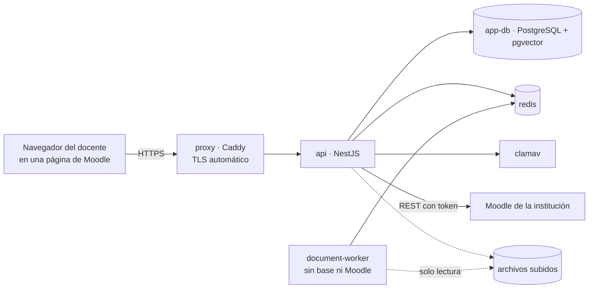

# Manual de instalación y operación

Cómo instalar y mantener el backend de Smart LMS en producción (Sprint 13). El Moodle es el de la institución;
aquí se instala el backend, el worker documental, la base auxiliar, Redis, el antivirus y el proxy con TLS, y se
configura el plugin. Para desarrollo local, ver la [guía del entorno local](../desarrollo/entorno-local.md).

## Qué se instala



Solo el proxy publica puertos (80 y 443). La base, Redis y el worker viven en una red interna sin salida a
internet; el backend y ClamAV tienen salida (Moodle y firmas de antivirus).

## Requisitos

| Recurso         | Mínimo recomendado                                                                                                                                    |
| --------------- | ----------------------------------------------------------------------------------------------------------------------------------------------------- |
| Servidor        | Linux x86_64 con Docker Engine 27 o superior y Compose v2; 4 vCPU, 8 GB de RAM, 60 GB de disco                                                        |
| Red             | Un nombre DNS para el backend (por ejemplo `asistente.ejemplo.edu.ec`) apuntando al servidor, puertos 80 y 443 abiertos, salida a Moodle y a internet |
| Moodle          | 5.1 con servicios web habilitados y acceso HTTPS desde el servidor                                                                                    |
| Para las copias | `openssl`, `cron` y espacio en `/var/backups/smart-lms`                                                                                               |

Los límites de memoria de `docker-compose.prod.yml` suman unos 5,2 GB (backend 768 MB, base 1 GB, worker 1 GB,
ClamAV 2 GB, Redis 256 MB, proxy 128 MB).

## Instalación

### 1. Descargar el código

```bash
sudo git clone https://github.com/kiramman-mp3/sistema-gestion-aprendizaje-IA.git /opt/smart-lms
cd /opt/smart-lms
sudo git checkout <etiqueta>      # una versión estable de main (v1.0.0, ...), nunca develop
```

### 2. Crear los secretos (fuera del repositorio)

```bash
sudo install -d -m 700 /etc/smart-lms/secrets
cd /etc/smart-lms/secrets
openssl rand -hex 24 | sudo tee db_password redis_password >/dev/null   # o una contraseña distinta para cada uno
```

Crea `api.env` y `worker.env` a partir de `infra/docker/prod/api.env.example` y `worker.env.example`. Los valores
importantes:

| Variable (`api.env`)        | Valor                                                                                                                                                                                    |
| --------------------------- | ---------------------------------------------------------------------------------------------------------------------------------------------------------------------------------------- |
| `DATABASE_URL`              | `postgresql://app:<contenido de db_password>@app-db:5432/ai_assistant`                                                                                                                   |
| `REDIS_URL`                 | `redis://:<contenido de redis_password>@redis:6379` (igual en `worker.env`)                                                                                                              |
| `PLUGIN_JWT_SECRET`         | 32 caracteres aleatorios como mínimo: `openssl rand -hex 32`. El mismo valor va en el plugin                                                                                             |
| `MOODLE_TOKEN`              | El token del usuario de integración (paso 5)                                                                                                                                             |
| `AI_PROVIDER`, `AI_API_KEY` | Cuando la institución defina el proveedor (D-07)                                                                                                                                         |
| `PSEUDONYM_SECRET`          | 32 caracteres aleatorios como mínimo: `openssl rand -hex 32`. Obligatoria si `AI_PROVIDER` está definido; no se cambia después sin perder la continuidad de los seudónimos del historial |

```bash
sudo chmod 600 /etc/smart-lms/secrets/*
```

> [!WARNING]
> Estos archivos nunca se suben al repositorio ni se copian a correos o chats. Quien los lee puede leer
> la base de datos y publicar en Moodle en nombre del backend.

### 3. Configurar el despliegue

```bash
cp .env.production.example .env.production
nano .env.production    # SECRETS_DIR, API_DOMAIN, ACME_EMAIL y MOODLE_BASE_URL
```

`MOODLE_BASE_URL` es el `wwwroot` de Moodle (por ejemplo `https://moodle.ejemplo.edu.ec`); también es el único
origen que puede llamar al backend desde el navegador.

### 4. Levantar los servicios y aplicar las migraciones

```bash
COMPOSE="docker compose --env-file .env.production -f docker-compose.prod.yml"
$COMPOSE up -d --build app-db redis clamav        # el primer arranque de ClamAV tarda unos minutos
$COMPOSE run --rm migrate                          # migraciones de Prisma
$COMPOSE up -d --build                             # backend, worker y proxy
$COMPOSE ps                                        # todos "healthy"
```

Comprueba desde el servidor (el estado no se publica en internet):

```bash
$COMPOSE exec -T api wget -qO- http://127.0.0.1:3000/api/v1/health
# {"status":"ok","dependencies":{"database":"ok","redis":"ok","moodle":"ok","antivirus":"ok"}}
```

### 5. Instalar el plugin en Moodle y crear el usuario de integración

1. Copia `moodle/local/ai_assistant` a `public/local/ai_assistant` (Moodle 5.1) o `local/ai_assistant`, y actualiza
   Moodle desde **Administración del sitio → Notificaciones** (o `php admin/cli/upgrade.php`). La actualización crea
   la tabla `local_ai_assistant_items`, las capacidades y las funciones externas.
2. En **Administración del sitio → Plugins → Plugins locales → Asistente docente con IA** (`AI teaching assistant` en inglés) configura:
   - **URL del backend**: `https://<API_DOMAIN>/api/v1` (la usa el navegador).
   - **Secreto JWT**: el mismo `PLUGIN_JWT_SECRET`.
3. Crea el usuario técnico y su token. `infra/moodle/cli/setup_integration.php` es la referencia (está escrito para
   la instancia de desarrollo: ajusta la ruta de `config.php` de la primera línea a la de tu Moodle): habilita los
   servicios web y el protocolo REST, crea el rol de mínimo privilegio (`webservice/rest:use`,
   `local/ai_assistant:checkaccess` y `local/ai_assistant:createcontent`), el usuario `ai_integration` con
   autenticación `webservice`, lo autoriza solo en el servicio `local_ai_assistant_integration` y genera el token,
   que se imprime una sola vez. Cópialo en `MOODLE_TOKEN` de `api.env` y reinicia el backend:
   `$COMPOSE up -d api`.
4. Comprueba con una cuenta de docente: en un curso, **Más → Asistente IA** debe mostrar "Conectado con el backend" y
   sus permisos.

### 6. Programar copias de seguridad, la prueba de restauración y el monitoreo

```bash
sudo install -d -m 700 /var/backups/smart-lms
openssl rand -hex 32 | sudo tee /etc/smart-lms/backup.pass >/dev/null && sudo chmod 600 /etc/smart-lms/backup.pass
```

> [!IMPORTANT]
> **Guarda una copia de `/etc/smart-lms/backup.pass` fuera del servidor** (gestor de contraseñas de la institución).
> Sin ella las copias cifradas no se pueden restaurar.

Con `sudo crontab -e`:

```cron
# Copia cifrada cada noche, y prueba de restauración cada domingo
15 2 * * *  cd /opt/smart-lms && BACKUP_PASSPHRASE_FILE=/etc/smart-lms/backup.pass infra/scripts/backup.sh >> /var/log/smart-lms-backup.log 2>&1
45 3 * * 0  cd /opt/smart-lms && BACKUP_PASSPHRASE_FILE=/etc/smart-lms/backup.pass ROW_TOLERANCE=200 infra/scripts/restore-test.sh >> /var/log/smart-lms-restore-test.log 2>&1
# Salud cada 5 minutos; avisa por correo solo si algo falla
*/5 * * * * cd /opt/smart-lms && infra/monitoring/check-health.sh > /tmp/smart-lms-health.txt || mail -s "Smart LMS: $(head -1 /tmp/smart-lms-health.txt)" admin@ejemplo.edu.ec < /tmp/smart-lms-health.txt
```

`ROW_TOLERANCE` admite las filas que se escriben entre la copia nocturna y la prueba del domingo (por ejemplo, de
auditoría). Una copia sin probar no cuenta: revisa el registro de la prueba cada semana.

## Operación diaria

| Tarea                    | Comando                                                                                                                                                |
| ------------------------ | ------------------------------------------------------------------------------------------------------------------------------------------------------ |
| Ver el estado            | `$COMPOSE ps` y `infra/monitoring/check-health.sh`                                                                                                     |
| Ver los registros        | `$COMPOSE logs -f --tail=200 api` (rotan solos: 5 archivos de 10 MB por servicio)                                                                      |
| Reiniciar el backend     | `$COMPOSE restart api`                                                                                                                                 |
| Copia manual             | `BACKUP_PASSPHRASE_FILE=/etc/smart-lms/backup.pass infra/scripts/backup.sh`                                                                            |
| Probar la última copia   | `BACKUP_PASSPHRASE_FILE=/etc/smart-lms/backup.pass infra/scripts/restore-test.sh`                                                                      |
| Rotar el token de Moodle | `setup_integration.php --rotate` en el servidor de Moodle (ajusta la ruta de `config.php` del script); actualiza `MOODLE_TOKEN` y `$COMPOSE up -d api` |
| Rotar el secreto JWT     | Nuevo valor en `api.env` y en el ajuste del plugin **a la vez**; reinicia el backend. Los tokens en vuelo (5 min) fallarán una vez                     |

## Actualizar a una versión nueva

1. Haz una copia: `infra/scripts/backup.sh`. Anota la versión actual (`git describe --tags`).
2. `git fetch --tags && sudo git checkout <versión nueva>`.
3. Si cambió el plugin, cópialo a Moodle y ejecuta la actualización (`upgrade.php`).
4. `$COMPOSE run --rm migrate && $COMPOSE up -d --build`.
5. Comprueba la salud y haz una consulta de prueba desde un curso.

**Volver atrás**: `git checkout <versión anterior>` y `$COMPOSE up -d --build`. Las migraciones de Prisma son
solo hacia adelante: si la versión nueva migró la base y hay que volver, restaura la copia del paso 1
(ver el [procedimiento de incidentes](procedimiento-incidentes.md)).

## Restaurar desde una copia

```bash
export BACKUP_PASSPHRASE_FILE=/etc/smart-lms/backup.pass
cd /opt/smart-lms
$COMPOSE stop api document-worker                                        # el backend no debe escribir
infra/scripts/restore.sh db    /var/backups/smart-lms/db-<fecha>.dump.enc ai_assistant
infra/scripts/restore.sh files /var/backups/smart-lms/files-<fecha>.tar.gz.enc
$COMPOSE up -d api document-worker
```

`restore.sh db` sin tercer argumento restaura en una base nueva (`restore_<fecha>`) para revisarla sin tocar la real.

## Lista de comprobación de seguridad

- [ ] Los puertos abiertos hacia internet son solo el 80 y el 443 (`ss -tlnp`).
- [ ] `/etc/smart-lms/secrets/*` con permisos 600 y dueño root; ningún secreto en el repositorio ni en `.env.production`.
- [ ] `https://<API_DOMAIN>/api/v1/health` responde 404 desde fuera; `check-health.sh` responde OK desde el servidor.
- [ ] La copia de la contraseña de cifrado está guardada fuera del servidor.
- [ ] La última prueba de restauración terminó en OK.
- [ ] `CORS_ORIGINS` (derivado de `MOODLE_BASE_URL`) es solo el sitio de Moodle.
- [ ] El token de Moodle pertenece al usuario `ai_integration` y solo ve las funciones del servicio.
- [ ] El servidor recibe actualizaciones de seguridad del sistema operativo.

## Datos y retención

| Dato                             | Dónde                       | Conservación                                                                 |
| -------------------------------- | --------------------------- | ---------------------------------------------------------------------------- |
| Archivos de sílabos              | volumen `file_storage`      | `SYLLABUS_RETENTION_DAYS` (30 por defecto); lo borra el mantenimiento diario |
| Texto, extracciones y propuestas | PostgreSQL                  | Pendiente de la política institucional (D-08)                                |
| Auditoría                        | PostgreSQL (`audit_events`) | Pendiente de D-08                                                            |
| Copias de seguridad              | `/var/backups/smart-lms`    | `RETENTION_DAYS` (14 por defecto)                                            |

Los plazos definitivos de conversaciones, embeddings y auditoría dependen de la política de datos de la
institución (D-08) y se ajustan aquí cuando se cierre.
