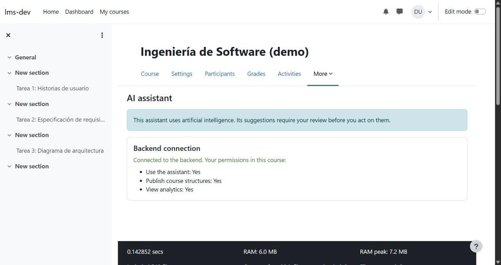

# Resultados de la Fase 2 — Infraestructura e integración

Sprints 2 y 3 · Cerrada el 2026-11-09 · Hito **H1** alcanzado: plugin ↔ backend ↔ Moodle autenticado.

## Entregables

| Entregable                                  | Estado | Evidencia                                                                                      |
| ------------------------------------------- | ------ | ---------------------------------------------------------------------------------------------- |
| Moodle 5.1.8 funcional con datos sintéticos | Hecho  | [Guía del entorno local](../desarrollo/entorno-local.md); `seed.php` verificado contra la base |
| Plugin `local_ai_assistant` inicial         | Hecho  | Instalado en Moodle; página del asistente funcionando en Chrome                                |
| Backend conectado                           | Hecho  | `GET /api/v1/health` con base de datos, Redis y Moodle en `ok`                                 |
| Comunicación autenticada (RF-01)            | Hecho  | JWT HS256 de un solo uso; [flujo y decisiones](../architecture/autenticacion-autorizacion.md)  |
| Autorización por curso y capacidad (RF-02)  | Hecho  | `check_access` en Moodle y `CourseAccessGuard` en el backend                                   |
| Auditoría básica (RF-19)                    | Hecho  | Rechazos de autenticación y acceso en `audit_events`                                           |

## Métricas

| Métrica                             | Resultado                   | Meta            |
| ----------------------------------- | --------------------------- | --------------- |
| Pruebas del backend (Jest)          | 84 de 84                    | Todas en verde  |
| Pruebas de contratos (Vitest)       | 17 de 17                    | Todas en verde  |
| Pruebas del plugin (PHPUnit)        | 15 de 15                    | Todas en verde  |
| Cobertura de líneas del backend     | 96,72 % (ramas 89,3 %)      | ≥ 70 % (RNF-05) |
| Consultas no autorizadas bloqueadas | 100 % de los casos probados | 100 % (RNF-06)  |
| Estándar de código Moodle (`phpcs`) | 0 errores, 0 advertencias   | 0               |
| Instalación de Moodle desde cero    | ~3 minutos                  | —               |

La cobertura se midió con `pnpm --filter @smart-lms/api test:cov` al cierre del Sprint 3.

## Casos de seguridad cubiertos

| Caso   | Descripción                             | Resultado                           |
| ------ | --------------------------------------- | ----------------------------------- |
| SEC-01 | Docente consulta un curso ajeno         | Bloqueado (403 y auditado)          |
| SEC-02 | Estudiante usa herramientas del docente | Bloqueado en Moodle y en el backend |
| SEC-03 | Token inválido, expirado o reutilizado  | Bloqueado (401 y auditado)          |
| SEC-09 | Fuga de secretos en logs                | Sin tokens en logs ni en auditoría  |

SEC-04 a SEC-08 y SEC-10 dependen de funciones de sprints posteriores (publicación, carga de
archivos, documentos, conversaciones).

## Riesgos detectados

| Riesgo                                                                                   | Estado y mitigación                                                               |
| ---------------------------------------------------------------------------------------- | --------------------------------------------------------------------------------- |
| Instalación de Moodle inviable en Windows por el montaje de archivos                     | Resuelto: el código vive en un volumen de Docker                                  |
| Backend en contenedor no alcanza Moodle por la redirección a `wwwroot`                   | Abierto: documentado; en desarrollo el backend corre en el host                   |
| Dependencias solo ESM (`@nestjs/config` 12, `jose` 6) incompatibles con Jest en CommonJS | Mitigado: versiones CommonJS o implementación propia; revisar al migrar a Nest 12 |
| Un token por llamada duplica las peticiones a Moodle                                     | Aceptado: costo bajo; revisar si afecta la latencia del chat (RNF-01)             |
| Cambio de rol en Moodle tarda hasta 2 minutos en aplicarse                               | Aceptado: dentro de RF-02 (≤ 5 minutos)                                           |
