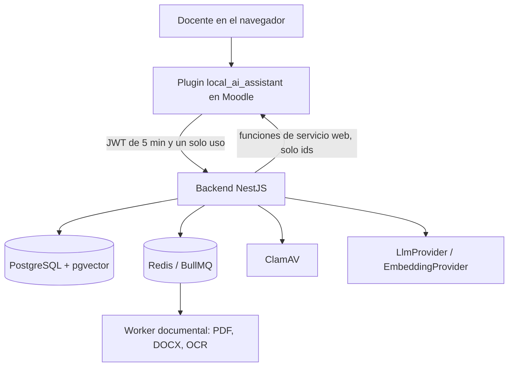

# 1. Arquitectura

## 1.1 Objetivo

Un asistente docente con IA integrado en Moodle 5.1 que ayuda a planificar un curso a partir del sílabo, a consultar datos del
curso en lenguaje natural y a detectar situaciones que merecen atención, **sin sacar datos personales de Moodle y dejando
siempre la decisión al docente**. El alcance y los requisitos están en la [especificación](../requisitos/especificacion-requisitos.md).

## 1.2 Componentes

| Componente        | Responsabilidad                                                                                                                                                        | Fuente                                                                                   |
| ----------------- | ---------------------------------------------------------------------------------------------------------------------------------------------------------------------- | ---------------------------------------------------------------------------------------- |
| Plugin de Moodle  | Interfaz (carga, revisión, propuesta, publicación, chat, panel, administración); emite el token; crea secciones y actividades; lee datos con funciones de solo lectura | `moodle/local/ai_assistant`                                                              |
| Backend           | Valida permisos en cada petición, orquesta la IA, guarda propuestas, conversaciones, auditoría y fragmentos                                                            | `apps/api`                                                                               |
| Worker documental | Extrae texto y página de PDF y DOCX y hace OCR; no tiene acceso a la base de datos                                                                                     | `apps/document-worker` ([ADR-013](../architecture/adr/0013-worker-sin-base-de-datos.md)) |
| Contratos         | Esquema del sílabo v1, lecturas de Moodle y colas, compartidos y validados con Zod                                                                                     | `packages/contracts`                                                                     |

## 1.3 Decisiones principales

| Decisión                                                    | ADR                                                                                   |
| ----------------------------------------------------------- | ------------------------------------------------------------------------------------- |
| Autenticación plugin–backend con JWT corto y de un solo uso | [ADR-006](../architecture/adr/0006-jwt-plugin-backend.md)                             |
| Moodle es la única fuente de permisos                       | [ADR-007](../architecture/adr/0007-validacion-capacidades-moodle.md)                  |
| Crear actividades con una función externa del plugin        | [ADR-008](../architecture/adr/0008-creacion-actividades-funcion-externa.md)           |
| Proveedor de IA detrás de una interfaz                      | [ADR-009](../architecture/adr/0009-abstraccion-proveedor-llm.md)                      |
| Seudonimización de estudiantes                              | [ADR-010](../architecture/adr/0010-seudonimizacion.md)                                |
| Publicación idempotente y reanudable                        | [ADR-015](../architecture/adr/0015-publicacion-idempotente-identidad-docente.md)      |
| Lecturas de Moodle con un contrato de solo ids              | [ADR-017](../architecture/adr/0017-lecturas-moodle-solo-ids.md)                       |
| RAG con pgvector y embeddings intercambiables               | [ADR-019](../architecture/adr/0019-rag-embeddings-pgvector.md)                        |
| Capacidad `administer` y rutas de administración            | [ADR-020](../architecture/adr/0020-capacidad-administer-y-rutas-de-administracion.md) |
| Snapshots de indicadores bajo demanda                       | [ADR-021](../architecture/adr/0021-snapshots-de-indicadores-bajo-demanda.md)          |

La lista completa está en el [registro de ADR](../architecture/adr/README.md) (22 decisiones).

## 1.4 Flujos

- **Del sílabo a Moodle (CU-01 a CU-03).** Carga validada por su contenido real y analizada con ClamAV → texto con página
  (worker, OCR si hace falta) → extracción estructurada con IA, sin inventar fechas ni ponderaciones → revisión y corrección
  por el docente → propuesta de secciones y actividades → aprobación → publicación idempotente con las actividades **ocultas**.
  Detalle en [procesamiento](../architecture/procesamiento-silabos.md), [extracción](../architecture/extraccion-ia.md),
  [propuestas](../architecture/propuestas.md) y [publicación](../architecture/publicacion.md).
- **Chat (CU-04).** Mensaje → cuota de uso → seudonimización → bucle de herramientas de solo lectura (entregas, pendientes,
  notas, unidades, evidencias, documentos) → respuesta con fuentes, criterio aplicado y aviso de datos incompletos.
  Detalle en [asistente conversacional](../architecture/asistente-chat.md).
- **Analítica y recomendaciones (CU-05).** Indicadores y señales calculados al pedirlos con funciones puras; evidencias
  separadas en observado, calculado y desconocido; recomendaciones con un validador que impide diagnósticos.
  Detalle en [analítica](../architecture/analitica.md).

## 1.5 Datos

PostgreSQL con 15 tablas (propuestas, versiones de la extracción, conversaciones, auditoría, snapshots, reglas, fragmentos con
vectores…) y la tabla del plugin que relaciona cada elemento publicado con su sección o actividad. No se guardan nombres de
estudiantes ni calificaciones copiadas de Moodle, salvo los valores agregados de los snapshots. Detalle y diagrama en el
[modelo de datos](../architecture/modelo-datos.md).
